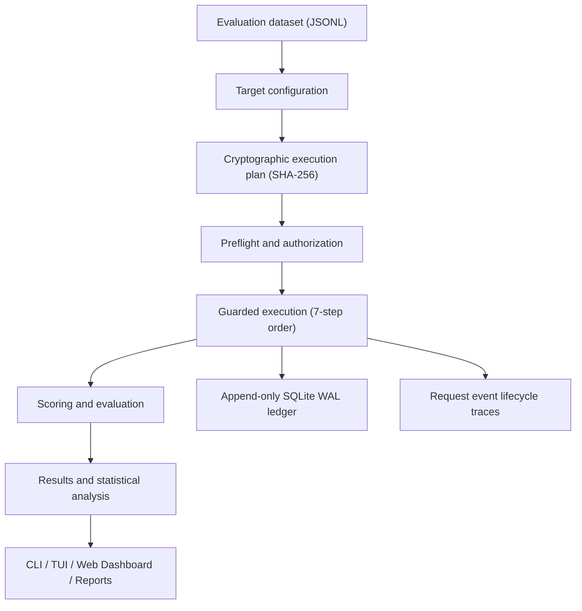

<p align="center">
  <picture>
    <source media="(prefers-color-scheme: dark)" srcset="assets/runport-logo-white.png">
    <source media="(prefers-color-scheme: light)" srcset="assets/runport-logo-black.png">
    
  </picture>
</p>

<p align="center">
  <strong>Benchmark AI systems. Know what they cost. Trust what they score.</strong>
</p>

<p align="center">
  An open-source, local-first benchmarking and evaluation platform for LLMs, prompts, RAG pipelines, and AI workflows.
</p>

<p align="center">
  <a href="https://github.com/Sudharsanselvaraj/Runport/actions/workflows/ci.yml"></a>
  <a href="LICENSE"></a>
  <a href="https://www.python.org/"></a>
  <a href="https://github.com/Sudharsanselvaraj/Runport"></a>
</p>

<p align="center">
  <a href="#why-runport">Why Runport</a> ·
  <a href="#capabilities">Capabilities</a> ·
  <a href="#integrations">Integrations</a> ·
  <a href="#quickstart">Quickstart</a> ·
  <a href="docs/">Documentation</a> ·
  <a href="CONTRIBUTING.md">Contributing</a>
</p>

---

## What is Runport?

Evaluating an AI application is more than checking whether its final response looks correct.

You need to know whether it solves the task, whether its outputs are reliable, how long it takes, what it costs, and whether a change to the model or workflow introduces a regression.

Runport brings benchmarking, evaluation, execution governance, and result inspection into one local-first workflow.

Use it to evaluate:
- **LLMs and model providers** (OpenRouter, OpenAI-compatible APIs, Ollama)
- **Prompt and model variations** (temperature, system instructions, token caps)
- **RAG and retrieval pipelines** (faithfulness, precision, retrieval coverage)
- **AI workflows and orchestration endpoints** (Dify, Flowise, Langflow, n8n, LangGraph)
- **Custom HTTP applications** (REST webhooks, internal scoring services)
- **Python callables and subprocess targets** (in-process functions, local rules)

Runport provides a common target interface, evaluation components, statistical metrics, and local interfaces for inspecting benchmark results.

---

## Why Runport?

| The Challenge | Runport's Approach |
|:---|:---|
| **Benchmark runs can generate unexpected API spend** | Preflight checks, configured spend ceilings, approval, and an append-only local SQLite WAL ledger. |
| **Evaluation scores can hide missing ground truth** | Supervised metrics require reference labels; missing values remain explicit (`None` / `UNAVAILABLE`). |
| **Model agreement can be mistaken for correctness** | Agreement statistics (Cohen's $\kappa$) are reported separately from ground-truth accuracy. |
| **Different systems require different integrations** | A common target abstraction (`Target` / `TargetResult`) for supported models and workflows. |
| **Benchmark results are difficult to inspect** | Interactive CLI, fullscreen terminal dashboard (Rich), local web dashboard (FastAPI + React), and trace exports. |
| **Evaluation data may be sensitive** | Local-first storage, regex PII redaction, secret scrubbing, and zero external telemetry by design. |

---

## Capabilities

### 01 — Benchmark Different AI Targets
Evaluate supported model endpoints, local inference engines, workflow applications, HTTP services, and Python callables through a common target interface.

### 02 — Evaluate Output Quality
Run supervised and programmatic evaluations with explicit datasets and scoring rules. Scorer areas include:
- **Classification & statistical reports**: Accuracy, precision, recall, macro-F1, confusion matrices
- **Structured extraction**: Field-level validation and schema conformity
- **Exact & pattern matching**: Token-level equality, regex assertions, substring matches
- **Generation-oriented scoring**: Length, format adherence, reference-based similarity
- **Performance & cost scoring**: Latency percentiles, cost per 1k cases
- **RAG evaluation components**: Contextual faithfulness, answer relevancy, groundedness
- **Configurable LLM-judge scoring**: Custom rubric evaluation with explanation capture

### 03 — Measure Performance and Cost
Inspect operational metrics such as latency, token usage, and available cost information. Runport preserves cost provenance with a fixed vocabulary:

| Provenance | Meaning |
|:---|:---|
| **`ACTUAL`** | Provider-reported cost directly from billing headers. |
| **`ESTIMATED`** | Cost calculated using available pricing rate cards and reported token usage. |
| **`UNRESOLVED`** | A potentially billable request whose cost cannot be reconciled. |
| **`UNAVAILABLE`** | Cost information is unavailable or the target has no applicable price ($0.00 local compute). |
| **`REPLAYED`** | Deterministic offline replay execution; zero provider spend ($0.00). |

> **Null is not 0**: Missing telemetry (tokens, latency, confidence, or cost) remains `None` / `UNAVAILABLE` and is never silently defaulted to zero.

### 04 — Inspect and Compare Results
Use the local interfaces to explore benchmark runs, evaluation results, candidate model comparisons, budget balances, and trace diagnostic reports.

### 05 — Keep Execution Under Control
Live evaluation is designed around explicit authorization, cryptographic plan fingerprinting, budget checks, and spend accounting:
- A live run should be reviewed before execution.
- In interactive sessions, an operator confirms the typed plan fingerprint.
- An unresolved spend entry immediately halts subsequent live runs until reconciled via `runport budget reconcile`.

---

## How it Works



Runport separates target execution from evaluation logic. This allows supported targets to use common result structures, statistical scorers, and reporting tools.

---

## Integrations

Runport supports multiple target types. Integration depth varies by connector:

<!-- BEGIN CONNECTOR MATRIX (generated from src/runport/connectors/registry.py; do not edit by hand) -->
| Connector | Name | Status | Integration | Tested | Streaming | Tool calls | Structured output | Per-step trace | Usage | Cost | Errors / timeouts |
|:---|:---|:---:|:---|:---:|:---:|:---:|:---:|:---:|:---:|:---:|:---:|
| `openai_compat` | OpenAI / OpenAI-compatible | **Stable** | native | yes | — | — | partial | — | yes | partial | yes |
| `openrouter` | OpenRouter | **Stable** | native | yes | — | — | — | — | yes | yes | yes |
| `dify` | Dify | **Stable** | native | yes | yes | — | — | partial | yes | partial | yes |
| `http_workflow` | Generic HTTP endpoint | **Stable** | generic http | yes | — | — | — | — | partial | partial | yes |
| `python_target` | Python callable | **Stable** | in process | yes | — | — | partial | — | — | — | yes |
| `subprocess` | Subprocess (stdin/stdout) | **Stable** | in process | yes | — | — | — | — | — | — | yes |
| `ollama` | Ollama | **Stable** | native | yes | — | — | partial | — | yes | — | yes |
| `mcp` | MCP server (tools) | *Experimental* | native | yes | — | yes | yes | — | — | — | yes |
| `flowise` | Flowise | *Experimental* | generic http | partial | — | — | — | — | — | — | yes |
| `langflow` | Langflow | *Experimental* | generic http | partial | — | — | — | — | — | — | yes |
| `n8n` | n8n | *Experimental* | generic http | partial | — | — | — | — | — | — | yes |
| `langgraph` | LangGraph | *Experimental* | generic http | partial | — | — | — | — | — | — | yes |
| `vllm` | vLLM | Via | via `openai_compat` | — | — | — | — | — | yes | partial | yes |
| `lm_studio` | LM Studio | Via | via `openai_compat` | — | — | — | — | — | yes | partial | yes |
| `localai` | LocalAI | Via | via `openai_compat` | — | — | — | — | — | yes | partial | yes |
| `litellm` | LiteLLM proxy | Via | via `openai_compat` | — | — | — | — | — | yes | partial | yes |
| `groq` | Groq | Via | via `openai_compat` | — | — | — | — | — | yes | partial | yes |
| `together` | Together | Via | via `openai_compat` | — | — | — | — | — | yes | partial | yes |
| `fireworks` | Fireworks | Via | via `openai_compat` | — | — | — | — | — | yes | partial | yes |
| `deepinfra` | DeepInfra | Via | via `openai_compat` | — | — | — | — | — | yes | partial | yes |
| `deepseek` | DeepSeek | Via | via `openai_compat` | — | — | — | — | — | yes | partial | yes |
| `mistral` | Mistral | Via | via `openai_compat` | — | — | — | — | — | yes | partial | yes |
| `anthropic` | Anthropic | Via | via `openrouter` | — | — | — | — | — | yes | yes | yes |
| `gemini` | Gemini | Via | via `openrouter` | — | — | — | — | — | yes | yes | yes |
| `langchain` | LangChain | Planned | none | — | — | — | — | — | — | — | — |
| `crewai` | CrewAI | Planned | none | — | — | — | — | — | — | — | — |
| `llamaindex` | LlamaIndex | Planned | none | — | — | — | — | — | — | — | — |
<!-- END CONNECTOR MATRIX -->

> [!NOTE]
> **Experimental integrations** should be treated as black-box endpoint adapters, not as complete framework-level instrumentation. In particular, internal node-level and per-step tracing is not guaranteed.

See the [Connector Catalogue](docs/connectors/README.md) and [Connector Documentation](docs/connectors.md) for configuration details.

---

## Evaluation and Metrics

Runport includes evaluation components across several benchmark dimensions:

| Area | Available Capabilities |
|:---|:---|
| **Classification** | Accuracy, macro precision, recall, macro-F1, multiclass confusion matrices |
| **Statistical Analysis** | 95% Wilson score confidence intervals, 2,000-resample bootstrap intervals, Cohen's $\kappa$, Holm-Bonferroni correction |
| **Extraction** | Structured output validation, field extraction accuracy, schema adherence |
| **Matching** | Exact string match, regex patterns, substring token coverage |
| **Generation** | Output length, formatting criteria, and configurable LLM-judge scoring |
| **RAG** | Contextual faithfulness, answer relevancy, groundedness scoring |
| **Performance** | Mean and percentile latencies ($p_{50}, p_{90}, p_{95}, p_{99}$), token usage, cost per 1k cases |

### Statistical Integrity
Runport strictly distinguishes:
- **Accuracy** against human-approved ground truth.
- **Agreement** (e.g. Cohen's $\kappa$) between models or annotators.
- **Confidence intervals** (Wilson score, bootstrap) around measured results.
- **Missing telemetry** and unavailable metrics (`None`, never $0$).

> Agreement between models is not ground-truth accuracy. Threshold selection is tuned on DEV only and evaluated frozen on TEST.

See the [Metrics Reference](docs/metrics.md) for mathematical definitions and formulas.

---

## Quickstart

### Requirements
- **Python**: 3.11, 3.12, or 3.13
- [`uv`](https://docs.astral.sh/uv/) (recommended) or `pip`

### 1. Clone the Repository
```bash
git clone https://github.com/Sudharsanselvaraj/Runport.git
cd Runport
```

### 2. Install Dependencies
```bash
uv sync --extra dev --extra report
```

### 3. Initialize a Workspace
```bash
uv run runport init
```
This initializes the local workspace configuration (`runport.yaml`) and database directories.

### 4. Run an Offline Replay ($0.00 Spend)
```bash
uv run runport benchmark --replay --dataset data/evaluation/synthetic_seed_eval.jsonl
```
Replay uses recorded fixtures. It is designed for deterministic, offline testing and is marked with `REPLAYED` provenance.

### 5. Inspect the Budget
```bash
uv run runport budget status
```

No provider API key is needed for the offline quickstart. For live execution, consult the [Quickstart Guide](docs/quickstart.md) and [Safety Documentation](docs/safety.md) before configuring credentials or authorizing a run.

---

## Interfaces

Runport offers multiple ways to operate and inspect the local evaluation environment:

### Command-Line Interface (CLI)
Use the CLI to initialize workspaces, validate datasets, run benchmarks, inspect budgets, compare runs, and export traces:
```bash
uv run runport --help
```

### Terminal Dashboard (TUI)
Launch the interactive terminal dashboard:
```bash
uv run runport ui
```

<p align="center">
  
</p>

### Local Web Dashboard
Launch the local web interface:
```bash
uv run runport web
```
Open **http://127.0.0.1:8000** in your browser. The web application is served locally through FastAPI and the bundled React frontend.

<p align="center">
  
</p>

---

## Safety and Privacy

Runport is designed for local-first evaluation and controlled live execution. Key safeguards include:

- **Local SQLite WAL Storage**: All evaluations, traces, and ledger records remain on your local machine.
- **Fail-Closed Spend Ceilings**: Configurable workspace, pilot, per-run, and per-case spend caps.
- **Cryptographic Plan Approval**: SHA-256 fingerprint binding target routes, dataset hashes, prompt templates, and caps.
- **Unresolved Spend Handling**: Unpriced live calls halt subsequent runs fail-closed until reconciled.
- **Automatic Secret Scrubbing**: API keys (`sk-...`) and Authorization headers are scrubbed from logs and exports.
- **Dataset Immutability**: Source datasets are SHA-256 hashed before and after evaluation to prevent data drift.
- **SSRF Safeguards**: Outbound HTTP connectors reject requests to cloud metadata (`169.254.169.254`) and unauthorized internal subnets.
- **Zero Telemetry**: No tracking pixels, remote analytics, or external telemetry by design.

> [!IMPORTANT]
> These controls are application-level safeguards. They do not replace provider-side spending limits, operating-system isolation, network policy, or production security review.

Read the [Safety Guide](docs/safety.md) for full details.

---

## Documentation

| Guide | Description | Link |
|:---|:---|:---:|
| **Quickstart** | Initialize and run your first evaluation | [quickstart.md](docs/quickstart.md) |
| **System Architecture** | Decoupled 5-layer design and storage engine | [ARCHITECTURE.md](docs/ARCHITECTURE.md) |
| **Core Concepts & Invariants** | Targets, plans, execution order, and the 10 invariants | [concepts.md](docs/concepts.md) |
| **Connectors & Integrations** | Setup guides for models, workflows, and custom targets | [connectors.md](docs/connectors.md) |
| **Metrics & Formulas** | Complete mathematical reference and statistical methods | [metrics.md](docs/metrics.md) |
| **Safety & Spend Governance** | Privacy, spend ceilings, and plan authorization | [safety.md](docs/safety.md) |
| **CLI Reference** | Comprehensive command-line options and flags | [cli.md](docs/cli.md) |
| **Configuration Reference** | Full schema specification for `runport.yaml` | [config-reference.md](docs/config-reference.md) |
| **Web UI & TUI Guide** | Operating the local web dashboard and terminal interface | [web-ui.md](docs/web-ui.md) |
| **FAQ & Troubleshooting** | Frequently asked questions and common resolutions | [faq.md](docs/faq.md) |

---

## Development

Install development and reporting dependencies:
```bash
uv sync --extra dev --extra report
```

Run the core test suite:
```bash
uv run pytest
```

Run plugin tests:
```bash
uv run pytest examples/plugins
```

Run linting and static type analysis:
```bash
uv run ruff check
uv run mypy
```

> Automated tests run completely offline and must not require live API credentials or incur provider spend.

See [CONTRIBUTING.md](CONTRIBUTING.md) before submitting pull requests.

---

## Project Status

Runport is under active development and currently in **alpha**.

Connector capabilities and integration depth vary. Some workflow adapters are experimental, and the project does not yet provide universal framework-level agent tracing or a dedicated public SDK for every language.

Issues, bug reports, connector requests, and contributions are welcome:
- [Report a Bug](https://github.com/Sudharsanselvaraj/Runport/issues)
- [Request an Integration](https://github.com/Sudharsanselvaraj/Runport/issues)
- [Contributing Guidelines](CONTRIBUTING.md)
- [Security Policy](SECURITY.md)

---

## License

Runport is licensed under the **[Apache License 2.0](LICENSE)**. See [NOTICE](NOTICE) for third-party acknowledgments.

<p align="center">
  <strong>Build. Benchmark. Evaluate. Improve.</strong>
</p>

<p align="center">
  If Runport is useful to you, consider giving the project a ⭐ on GitHub.
</p>
