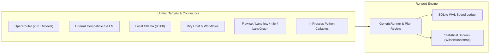

<p align="center">
  <picture>
    <source media="(prefers-color-scheme: dark)" srcset="assets/runport-logo-white.png">
    <source media="(prefers-color-scheme: light)" srcset="assets/runport-logo-black.png">
    
  </picture>
</p>

<p align="center">
  <b>The Universal Open-Source LLM & Workflow Evaluation Framework</b>
</p>

<p align="center">
  <a href="https://github.com/Sudharsanselvaraj/runport/actions/workflows/ci.yml"></a>
  <a href="https://github.com/Sudharsanselvaraj/runport"></a>
  <a href="LICENSE"></a>
  <a href="https://www.python.org/"></a>
  <a href="tests/"></a>
  <a href="https://github.com/Sudharsanselvaraj/runport/stargazers"></a>
</p>

<p align="center">
  <a href="docs/"><b>Documentation</b></a> |
  <a href="#-metrics-and-features"><b>Metrics & Features</b></a> |
  <a href="#-integrations"><b>Integrations</b></a> |
  <a href="#-vibe-coder-quickstart"><b>Vibe-Coder Quickstart</b></a> |
  <a href="#-quickstart"><b>Getting Started</b></a> |
  <a href="#-interactive-tui--web-dashboard"><b>TUI & Web Dashboard</b></a>
</p>

<br>

**Runport** is a simple-to-use, local-first open-source LLM, prompt, and workflow evaluation framework. It is similar to Pytest but specialized for unit-testing and benchmarking LLM applications, prompt templates, and multi-agent workflows under hard, fail-closed spend caps and strict ground truth.

Runport incorporates strict statistical research (Wilson score confidence intervals, non-parametric percentile bootstrap, Cohen's Kappa, and Holm-Bonferroni corrections) to compute supervised metrics exclusively against human-approved ground truth—all with zero external telemetry.

Whether you're evaluating raw completions, prompt variations, RAG pipelines, or compound agentic workflows implemented via **Dify**, **Flowise**, **Langflow**, **n8n**, **LangGraph**, **Ollama**, or custom HTTP endpoints, Runport has you covered.

---

## ⚡ Why Runport?

Traditional LLM evaluation frameworks suffer from silent budget overruns, simulated metrics, and siloed evaluation of single prompts rather than real multi-step pipelines:

| Principle | Traditional LLM Benchmarking | The Runport Guarantee |
|:---|:---|:---|
| **Hard Spend Caps** | Batch evaluations run until credit cards decline or rate limits trigger. | Preflight checks halt execution before spending a cent. Unresolved spend halts subsequent runs fail-closed until reconciled. |
| **Strict Ground Truth** | LLM consensus is treated as truth ("LLM-as-a-judge" agreement = accuracy). | Supervised metrics require human ground-truth approval. Agreement is reported honestly as Cohen's $\kappa$. |
| **Honest Telemetry** | Missing tokens, latency, or unpriced calls are defaulted to $0 or estimated arbitrarily. | **Null is not 0**. Missing telemetry remains `None` / `UNAVAILABLE`. Every dollar has fixed provenance. |
| **Universal Connectors** | Frameworks only benchmark single-prompt completion endpoints. | Unified `Target` abstraction evaluates raw LLMs, Dify workflows, n8n webhooks, LangGraph graphs, and Python callables. |
| **Local-First Visibility** | Telemetry and proprietary prompts are phoned home to cloud SaaS dashboards. | 100% local operation: full-screen Rich TUI, local FastAPI + React web UI, and sanitized trace exports. |

---

## 🔥 Metrics and Features

Runport provides a comprehensive suite of statistical, supervised, operational, and financial evaluation metrics:

### 📐 Supervised Quality Metrics
- [**Multiclass & Binary Accuracy**](docs/metrics.md#21-multiclass--binary-accuracy) — Computes accuracy strictly against human-approved ground-truth labels with explicit sample denominators.
- [**Per-Class Precision, Recall, & F1**](docs/metrics.md#22-per-class-precision-recall-and-f1) — Detailed classification breakdown with explicit zero/NaN handling and support metrics.
- [**Multiclass Confusion Matrix**](docs/metrics.md#2-supervised-quality-metrics) — Full $K \times K$ confusion matrix tracking predictions, label drifts, and `INVALID_OUTPUT` rejections.
- [**Format & JSON Adherence**](docs/metrics.md#2-supervised-quality-metrics) — Strict output structure validation ensuring responses conform to target schemas before scoring.

### 📊 Statistical Rigor & Significance
- [**Wilson Score Confidence Intervals**](docs/metrics.md#23-wilson-score-confidence-interval) — Two-sided 95% asymmetric binomial confidence intervals for accuracy and proportion metrics.
- [**Percentile Bootstrap CIs**](docs/metrics.md#24-bootstrap-confidence-intervals) — 2,000-resample non-parametric bootstrap intervals for continuous statistics (latency, cost, tokens).
- [**Cohen's Kappa ($\kappa$)**](docs/metrics.md#25-inter-rater--inter-model-agreement-cohens-kappa) — Chance-corrected agreement between models or annotators. Consensus is never presented as accuracy.
- [**Holm-Bonferroni Correction**](docs/metrics.md#2-supervised-quality-metrics) — Family-wise error rate control for multi-candidate hypothesis testing.

### 🔍 RAG & Retrieval Metrics
- [**Contextual Faithfulness**](docs/metrics.md#rag-metrics) — Measures whether generated claims are factually grounded in the retrieved context.
- [**Answer Relevancy**](docs/metrics.md#rag-metrics) — Evaluates how directly the response addresses the user input query.
- [**Retrieval Context Recall & Precision**](docs/metrics.md#rag-metrics) — Measures how well retrieved chunks capture expected ground-truth knowledge.

### 💰 Spend Governance & Append-Only Ledger
- [**Append-Only SQLite WAL Ledger**](docs/safety.md#budget-governance) — Micro-dollar accounting stored locally in WAL mode (`runport.db`).
- [**Multi-Tier Spend Ceilings**](docs/safety.md#budget-governance) — Hard fail-closed limits: total workspace budget, pilot cap, per-run ceiling, and per-case ceiling.
- [**Unresolved Spend Circuit Breaker**](docs/safety.md#unresolved-spend) — If a billed request omits price telemetry, it books as `UNRESOLVED` and halts future live runs until reconciled via `runport budget reconcile`.
- [**Fixed Provenance Vocabulary**](docs/safety.md#budget-governance) — Spend is classified strictly as `ACTUAL`, `ESTIMATED`, `UNRESOLVED`, `UNAVAILABLE`, or `REPLAYED`.

### 🔐 Cryptographic Plan Authorization
- [**Plan Fingerprint SHA-256**](docs/concepts.md#cryptographic-plan-fingerprint) — Cryptographically binds candidate models, endpoint routes, dataset hash, prompt template hash, and budget caps.
- [**Interactive Terminal Confirmation**](docs/safety.md#interactive-authorization) — Live runs require typing `RUN LIVE <models> PLAN <fingerprint>` into an interactive TTY.
- [**Single-Use CI Approval**](docs/safety.md#interactive-authorization) — Token-based approval `--approve <fingerprint>` prevents replay attacks in automated pipelines.

### 🛡️ Privacy, Security & Zero Telemetry
- [**Salted SHA-256 Pseudonymization**](docs/safety.md#pii-redaction) — Deterministic identifier masking with local salts.
- [**Automated PII Redaction**](docs/safety.md#pii-redaction) — Tokenizes emails, phone numbers, national IDs, and introduced names.
- [**SSRF Network Defense**](docs/safety.md#ssrf-safeguards) — Outbound HTTP targets reject cloud metadata (`169.254.169.254`) and unauthorized internal subnets.
- [**Automatic Secret Scrubbing**](docs/safety.md#secret-scrubbing) — Scrub API keys (`sk-...`) and Authorization headers from logs, traces, and exports.

---

## 🔌 Integrations

Runport decouples target execution from evaluation scoring. Every target implements the uniform `Target` protocol and returns a standardized `TargetResult`:



### Supported Connectors

| Target / Connector | Protocol | Status | Cost Accounting | Description |
|:---|:---|:---:|:---:|:---|
| **OpenRouter** (`openrouter`) | REST / Meta-API | **Stable** | `ACTUAL` | Direct routing to 200+ models with live catalog rate cards. |
| **OpenAI Compatible** (`openai_compat`) | Chat Completions | **Stable** | `ESTIMATED` | OpenAI, vLLM, Together, Groq, Mistral, and custom endpoints. |
| **Ollama** (`ollama`) | REST (`/api/chat`) | **Stable** | `ACTUAL-LOCAL` ($0.00) | Local offline open-weights models with zero API cost. |
| **Dify** (`dify`) | REST / SSE Streaming | **Stable** | `ESTIMATED` / `UNAVAILABLE` | Dify Chatbot and Workflow pipelines with step-level tracing. |
| **Custom HTTP Workflow** (`http_workflow`) | JSON REST / Webhook | **Stable** | `ESTIMATED` / `UNAVAILABLE` | Any external webhook accepting JSON and returning structured data. |
| **Python Target** (`python_target`) | In-Process Code | **Stable** | `UNAVAILABLE` ($0.00) | In-process Python functions, classes, or CLI binaries. |
| **Flowise** (`flowise`) | REST Flow Runner | *Experimental* | `UNAVAILABLE` | Flowise multi-agent and RAG flow executions. |
| **Langflow** (`langflow`) | REST Flow Runner | *Experimental* | `UNAVAILABLE` | Langflow visual AI pipelines. |
| **n8n** (`n8n`) | Webhook Automation | *Experimental* | `UNAVAILABLE` | n8n workflow webhook automation endpoints. |
| **LangGraph** (`langgraph`) | StateGraph Endpoint | *Experimental* | `UNAVAILABLE` | LangGraph multi-step agent graphs with trace emission. |

For detailed connector schemas and integration guides, see the [Connector Documentation](docs/connectors.md).

---

## 🤖 Vibe-Coder QuickStart

If you use an AI coding assistant (Claude Code, Cursor, AGY, Codex), point it at Runport to test your LLM app, run evals, and verify metrics autonomously with **$0.00 spend**:

```bash
# 1. Run deterministic replay evaluation in CI or agent scratchpad
uv run runport benchmark --replay --dataset data/evaluation/synthetic_seed_eval.jsonl

# 2. Validate dataset schema and split leakage
uv run runport validate-dataset data/evaluation/synthetic_seed_eval.jsonl

# 3. Check ledger spend caps and policy status
uv run runport budget status
```

Because replay executions carry provenance `REPLAYED` and book `$0.00`, your coding agent can run full benchmark loops on every code change without incurring costs or needing API keys.

---

## 🚀 Quickstart

Get up and running with Runport in under 60 seconds.

### 1. Installation

Requires Python 3.11+. Install via [`uv`](https://docs.astral.sh/uv/) (recommended) or standard `pip`:

```bash
# Option A: Install via uv tool (global CLI)
uv tool install runport

# Option B: Clone and run locally
git clone https://github.com/Sudharsanselvaraj/runport.git
cd runport
uv sync --extra dev --extra report
```

### 2. Initialize Workspace

Initialize your local configuration, data directories, and SQLite WAL ledger:

```bash
uv run runport init
```

This creates `runport.yaml` (workspace configuration) and `.runport/runport.db` (local SQLite ledger).

### 3. Run Replay Evaluation ($0.00 Spend)

Test your setup immediately without an API key using the deterministic offline replay engine:

```bash
uv run runport benchmark --replay --dataset data/evaluation/synthetic_seed_eval.jsonl
```

### 4. Live Evaluation (Under Fail-Closed Spend Caps)

To evaluate live models with real API calls:

```bash
# Export provider API key
export OPENROUTER_API_KEY="sk-or-v1-..."

# Verify API key presence offline without network calls
uv run runport api-preflight

# Execute live benchmark (prompts for typed cryptographic plan confirmation)
uv run runport benchmark --live --model google/gemini-3.5-flash-lite
```

---

## 🧪 Evaluate with Pure Python & Pytest

Runport can be used programmatically inside standard Pytest test suites or notebook environments:

```python
import pytest
from runport.targets.base import Target, TargetResult, TargetStatus, CostBasis
from runport.scorers.classification import ClassificationReportScorer
from runport.scorers.stats import wilson

def test_llm_classification():
    # 1. Predictions from your model or workflow
    predictions = ["SUPPORT", "BILLING", "SUPPORT", "OTHER"]
    ground_truth = ["SUPPORT", "BILLING", "SALES", "OTHER"]

    # 2. Score with Runport classification report scorer
    scorer = ClassificationReportScorer(allowed_labels=["SUPPORT", "BILLING", "SALES", "OTHER"])
    report = scorer.compute_report(predictions, ground_truth)

    # 3. Compute 95% Wilson score confidence interval
    ci_low, ci_high = wilson(report.valid_cases, report.total_cases)

    # 4. Assert performance thresholds
    assert report.accuracy >= 0.75, f"Accuracy {report.accuracy} below threshold 0.75"
    assert report.macro_f1 >= 0.70
    assert ci_low > 0.30
```

---

## 📊 Interactive TUI & Web Dashboard

Runport provides dual local-first user interfaces for complete evaluation visibility without sending data to any cloud service.

### Full-Screen Terminal UI (`runport ui`)
A high-density terminal dashboard inspired by `btop` built using Rich:

<p align="center">
  
</p>

- Real-time CPU and memory telemetry gauges
- Live inference request event streamer
- Model catalog browser with context lengths and token rates
- Budget ledger monitor and transaction explorer
- Dataset validation and cross-split leakage inspector

```bash
uv run runport ui
```

### Local Web Dashboard (`runport web`)
A modern local web interface built with FastAPI, React 18, TypeScript, and Framer Motion:

<p align="center">
  
</p>

- Interactive **Bento Showcase** with live spend-guard simulators
- Cryptographic plan approval preview
- Latency percentiles ($p_{50}, p_{90}, p_{95}, p_{99}$) and token breakdown charts
- Multiclass confusion matrix visualizations

```bash
uv run runport web
# Open http://127.0.0.1:8000
```

---

## 📚 Complete Documentation

All technical documentation is organized in the [`docs/`](docs/) directory:

- [**Documentation Home**](docs/README.md) — Documentation portal and architecture index.
- [**Quickstart Guide**](docs/quickstart.md) — 2-minute walkthrough from installation to first live run.
- [**Metrics & Formulas Reference**](docs/metrics.md) — Mathematical definitions for accuracy, Wilson intervals, bootstrap, and Cohen's $\kappa$.
- [**Connectors & Integrations**](docs/connectors.md) — Setup and schemas for Dify, Flowise, n8n, LangGraph, Ollama, and custom HTTP.
- [**Safety, Privacy & Spend Governance**](docs/safety.md) — Fail-closed budget caps, SSRF safeguards, and PII redaction.
- [**Core Concepts & Invariants**](docs/concepts.md) — The 10 immutable architectural invariants.
- [**System Architecture**](docs/ARCHITECTURE.md) — Deep-dive architecture and layer decoupling.
- [**Configuration Reference**](docs/config-reference.md) — Complete `runport.yaml` schema reference.
- [**CLI Reference**](docs/cli.md) — All CLI commands, options, and flags.
- [**FAQ**](docs/faq.md) — Frequently asked questions.

---

## 🤝 Contributing

We welcome community contributions, additional workflow connectors, and bug reports. Please read our [Contributing Guidelines](CONTRIBUTING.md) and [Code of Conduct](CODE_OF_CONDUCT.md).

```bash
# Run complete test suite (388 tests, 100% offline)
uv run pytest

# Run type checks
uv run mypy

# Run linter
uv run ruff check
```

---

## 🔒 Security & Telemetry

- **Zero Telemetry**: Runport contains **zero** tracking pixels, telemetry events, or remote reporting. All datasets, traces, and SQLite ledgers stay strictly on your local machine.
- **Vulnerability Disclosure**: To report security vulnerabilities, please refer to our [Security Policy](SECURITY.md).

---

## 📄 License

Runport is open-source software licensed under the **[Apache License, Version 2.0](LICENSE)**. See [NOTICE](NOTICE) for third-party acknowledgments.

<p align="center">
  ⭐ <b>Star Runport on GitHub</b> — support honest, spend-capped open-source evaluation!
</p>
