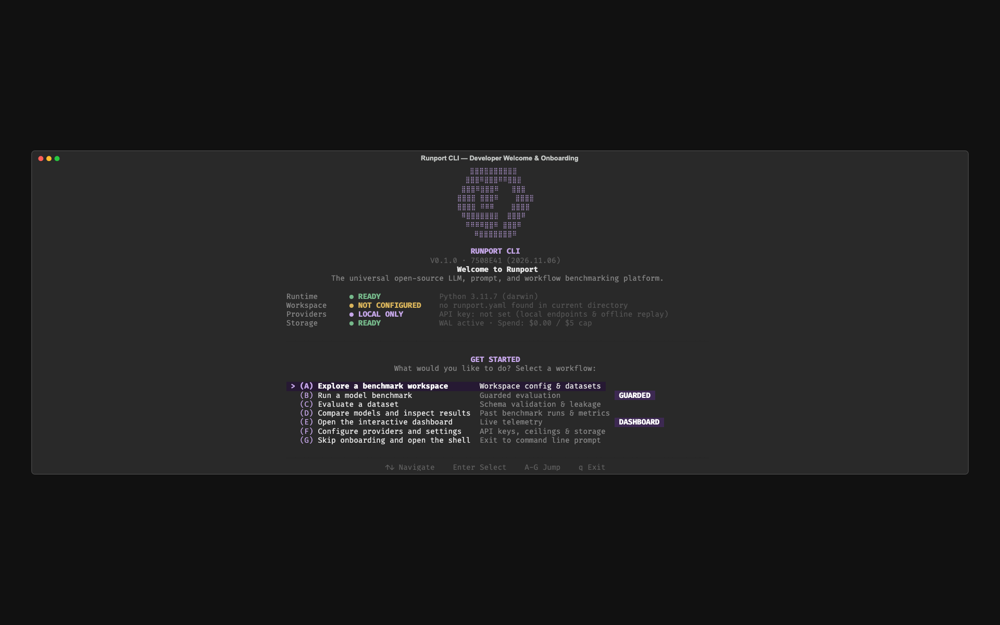
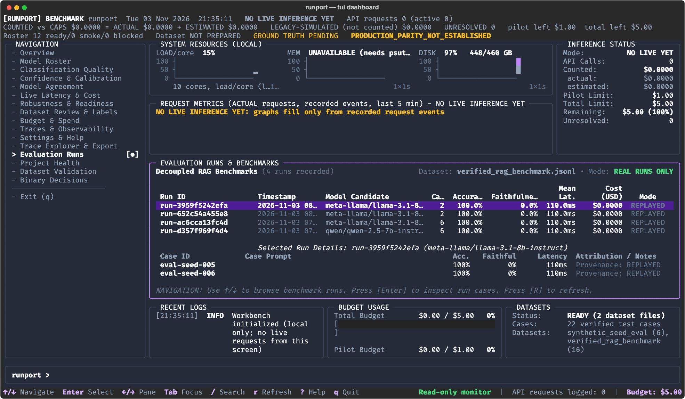

<p align="center">
  <picture>
    <source media="(prefers-color-scheme: dark)" srcset="assets/runport-logo-white.png">
    <source media="(prefers-color-scheme: light)" srcset="assets/runport-logo-black.png">
    
  </picture>
</p>

<p align="center">
  <b>Universal local-first LLM, prompt, and workflow benchmarking platform.</b>
</p>

<p align="center">
  <a href="https://github.com/Sudharsanselvaraj/Runport/actions/workflows/ci.yml"></a>
  <a href="https://github.com/Sudharsanselvaraj/Runport"></a>
  <a href="LICENSE"></a>
  <a href="https://www.python.org/"></a>
  <a href="https://github.com/Sudharsanselvaraj/Runport/stargazers"></a>
</p>

<p align="center">
  <a href="#quickstart"><b>Quickstart</b></a> ·
  <a href="docs/"><b>Docs</b></a> ·
  <a href="docs/connectors/README.md"><b>Connectors</b></a> ·
  <a href="SECURITY.md"><b>Security</b></a>
</p>

<br>

> 🚧 **Public alpha**: Runport is under active development. Core evaluation abstractions, budget ledgers, and CLI commands are stable; workflow connector coverage is expanding. Feedback and issues are welcome.

---

## Before you begin

Runport is a developer-first platform for evaluating and comparing large language models, prompt chains, and agentic workflows:

- **Universal Evaluation**: Evaluates raw LLM APIs, prompt wrappers, and compound agentic workflows (Dify, Flowise, n8n, LangGraph, custom HTTP endpoints) under hard, fail-closed spend caps.
- **Strict Ground Truth**: Supervised metrics (accuracy, F1, calibration) are computed **exclusively** from human-approved annotations. Model-to-model consensus is never presented as accuracy.
- **Honest Accounting**: Missing tokens, latency, confidence, or cost remain `None` / `UNAVAILABLE`—never fabricated as zero. Spend is booked into an append-only SQLite WAL ledger with fixed provenance (`ACTUAL`, `ESTIMATED`, `UNRESOLVED`, `UNAVAILABLE`). Unresolved spend halts subsequent runs fail-closed until reconciled.
- **Local-First & Private**: Zero external telemetry, zero tracking, and zero remote data collection. All prompts, evaluations, and API keys stay strictly on your local machine.

---

## Step 1: Install and start Runport

### Requirements
- **Python**: 3.11 or 3.12
- **Package Manager**: [`uv`](https://docs.astral.sh/uv/) (recommended) or standard `pip`

```bash
# Option A: Install via uv tool (global CLI)
uv tool install runport

# Option B: Clone and run locally
git clone https://github.com/Sudharsanselvaraj/Runport.git
cd Runport
uv sync

# Launch the interactive workbench launcher
uv run runport
```

<p align="center">
  
</p>

The interactive launcher provides unified access to every workbench capability:
- Launch the full-screen terminal UI dashboard (`runport ui`)
- Run dataset validation and cross-split leakage checks (`runport validate-dataset`)
- Inspect candidate model routes, readiness, and blockers (`runport models roster`)
- Verify API credentials offline without making any network requests (`runport api-preflight`)
- Run RAG and classification benchmarks under spend ceilings (`runport benchmark`)
- Inspect budget ledgers, spend caps, and ledger transactions (`runport budget status`)

---

## Table of Contents

- [Before you begin](#before-you-begin)
- [Step 1: Install and start Runport](#step-1-install-and-start-runport)
- [Why Runport?](#why-runport)
- [Quickstart](#quickstart)
- [How Runport works](#how-runport-works)
- [Integrations](#integrations)
- [Contributing](#contributing)
- [Security](#security)
- [Telemetry](#telemetry)
- [License](#license)

---

## Why Runport?

Traditional LLM evaluation frameworks suffer from silent overspend, simulated metrics, and siloed evaluation of raw prompts rather than real multi-step pipelines. Runport provides four foundational guarantees:

| Principle | Traditional LLM Benchmarking | The Runport Guarantee |
|:---|:---|:---|
| **Hard Spend Caps** | Batch evaluations run until payment cards decline or rate limits trigger. | Preflight checks halt execution before spending a cent; unresolved spend halts subsequent runs fail-closed. |
| **Strict Ground Truth** | LLM consensus is treated as ground truth ("LLM-as-a-judge" agreement = accuracy). | Supervised metrics require human ground-truth approval. DEV-only threshold tuning is frozen before TEST. |
| **Universal Connectors** | Frameworks only benchmark single-prompt completion endpoints. | Benchmark raw LLMs alongside compound workflows (Dify, Flowise, n8n, LangGraph, Python scripts, custom REST). |
| **Local-First Visibility** | Telemetry is phoned home to cloud SaaS dashboards. | 100% local operation: full-screen Rich TUI, local FastAPI + React web UI, and sanitized trace exports. |

---

## Quickstart

Verify your installation in under 60 seconds with an offline replay evaluation ($0.00 spend, zero network calls, zero keys required).

### Step A: Validate Evaluation Dataset
Validate dataset schema, confidentiality boundaries, and partition integrity:
```bash
uv run runport validate-dataset data/evaluation/synthetic_seed_eval.jsonl
```

### Step B: Offline Credential & Safety Preflight
Verify your local environment and safety gates without sending a single network packet:
```bash
uv run runport api-preflight
```

### Step C: Run Replay Benchmark
Execute a deterministic offline evaluation against synthetic test cases:
```bash
uv run runport benchmark --dataset data/evaluation/synthetic_seed_eval.jsonl --target meta-llama/llama-3.1-8b-instruct --replay
```

<p align="center">
  
</p>

### Launch the Local Web Dashboard
Runport also includes a modern local web dashboard powered by FastAPI and React:
```bash
uv run runport web
```
Open **http://127.0.0.1:8000** in your browser to inspect evaluation runs, latency percentiles, confusion matrices, and budget ledgers.

---

## How Runport works

Runport enforces a strict, fail-closed execution lifecycle for every evaluation run. No provider request is ever dispatched without passing each gate in order:

```text
┌─────────────────────────┐
│ 1. Authorization Check  │  Interactive typed phrase or verified token approval
└────────────┬────────────┘
             │
┌────────────▼────────────┐
│ 2. Privacy Gate         │  Scans dataset confidentiality; blocks non-public records
└────────────┬────────────┘
             │
┌────────────▼────────────┐
│ 3. Preflight Budget     │  Binds cryptographic plan fingerprint (SHA-256); checks caps
└────────────┬────────────┘
             │
┌────────────▼────────────┐
│ 4. Transport Execution  │  Dispatches request with bounded retries (429/5xx only)
└────────────┬────────────┘
             │
┌────────────▼────────────┐
│ 5. Strict Validation    │  Validates response schema; rejects missing required telemetry
└────────────┬────────────┘
             │
┌────────────▼────────────┐
│ 6. Persistence          │  Writes run results and trace events to SQLite WAL database
└────────────┬────────────┘
             │
┌────────────▼────────────┐
│ 7. Spend Booking        │  Books spend into ledger (ACTUAL, ESTIMATED, or UNRESOLVED)
└─────────────────────────┘
```

### Cryptographic Plan Fingerprint
Before any live run begins, Runport computes a SHA-256 fingerprint binding:
- Candidate model IDs and endpoint routing configurations
- SHA-256 hash of the input dataset
- SHA-256 hash of the prompt template
- Configured budget caps and circuit breaker ceilings

If any input, route, or budget ceiling changes between approval and dispatch, the plan fingerprint changes and the execution is rejected fail-closed.

---

## Integrations

Runport decouples target execution from evaluation scoring, allowing unified benchmarking across direct model APIs, local engines, and orchestration workflows.

| Target / Connector | Type | Status | Description |
|:---|:---|:---:|:---|
| **OpenAI Compatible** (`openai_compat`) | LLM API | **Supported** | OpenAI, vLLM, Ollama, Together, Groq, Mistral, Anyscale, and custom endpoints. |
| **OpenRouter** (`openrouter`) | LLM API | **Supported** | 200+ models via OpenRouter unified gateway with live catalog pricing. |
| **Ollama** (`ollama`) | Local LLM | **Supported** | Local offline models (`/api/chat`, `/api/generate`) with zero API cost. |
| **Custom HTTP Workflow** (`http_workflow`) | Workflow | **Supported** | Any external webhook or REST service accepting JSON payloads. |
| **Python Target** (`python_target`) | Code | **Supported** | In-process Python callables, classes, or CLI binaries returning structured outputs. |
| **Dify** (`dify`) | Workflow | **Supported** | Dify Chat & Workflow application executions via API endpoints. |
| **Flowise** (`flowise`) | Workflow | *Experimental* | Flowise AI workflow executions. |
| **Langflow** (`langflow`) | Workflow | *Experimental* | Langflow multi-agent and RAG flow executions. |
| **n8n** (`n8n`) | Workflow | *Experimental* | n8n webhook automation pipelines. |
| **LangGraph** (`langgraph`) | Workflow | *Experimental* | LangGraph StateGraph agent endpoints with per-step trace recording. |

For detailed connector schemas and configuration examples, see the [Connector Documentation](docs/connectors/README.md).

---

## Contributing

We welcome community contributions, bug fixes, and additional connector adapters. Please review our [Contributing Guidelines](CONTRIBUTING.md) before submitting pull requests.

- **Offline Tests**: All automated tests run completely offline (`uv run pytest`).
- **Invariant Integrity**: Never weaken architectural invariants or fabricate missing telemetry.
- **Clean Commits**: Make focused, atomic commits with imperative commit messages.
- **Zero Leakage**: Verify clean scans locally with `gitleaks detect` before pushing.

---

## Security

Runport is engineered from the ground up to protect your data, credentials, and budget:
- **Zero Telemetry**: Runport never collects, transmits, or phones home user queries, traces, or datasets.
- **Automatic Secret Scrubbing**: Transports, logs, and trace exports automatically scrub API keys (`sk-...`) and Authorization headers.
- **SSRF Safeguards**: Outbound HTTP transports reject connections to cloud metadata (`169.254.169.254`) and unauthorized internal network destinations.

For vulnerability disclosure instructions, see [SECURITY.md](SECURITY.md).

---

## Telemetry

Runport contains **zero** telemetry, tracking, or remote analytics:
- No user events, prompt payloads, or benchmark metrics are ever uploaded.
- All evaluation artifacts, traces, and SQLite ledgers remain strictly on your local filesystem.
- You can verify this invariant directly in the codebase:
  ```bash
  git grep -iE "telemetry\.track|mixpanel|posthog|analytics|segment" src/
  ```

---

## License

Runport is licensed under the **Apache License, Version 2.0**. See [LICENSE](LICENSE) and [NOTICE](NOTICE) for complete terms and third-party software acknowledgments.

---

<p align="center">
  ⭐ If you find Runport useful, star us on GitHub — it helps the project grow.
</p>
