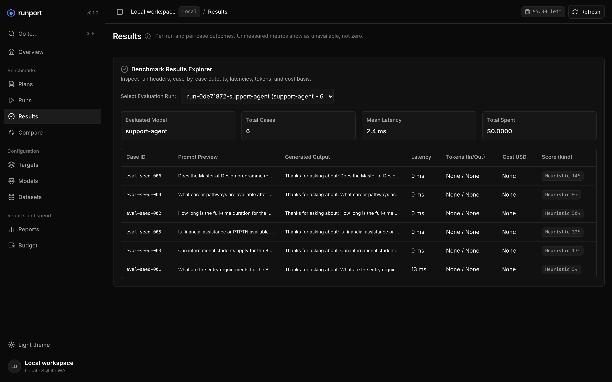
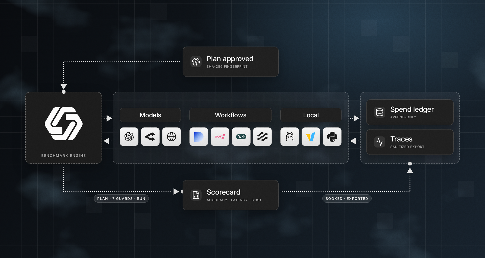
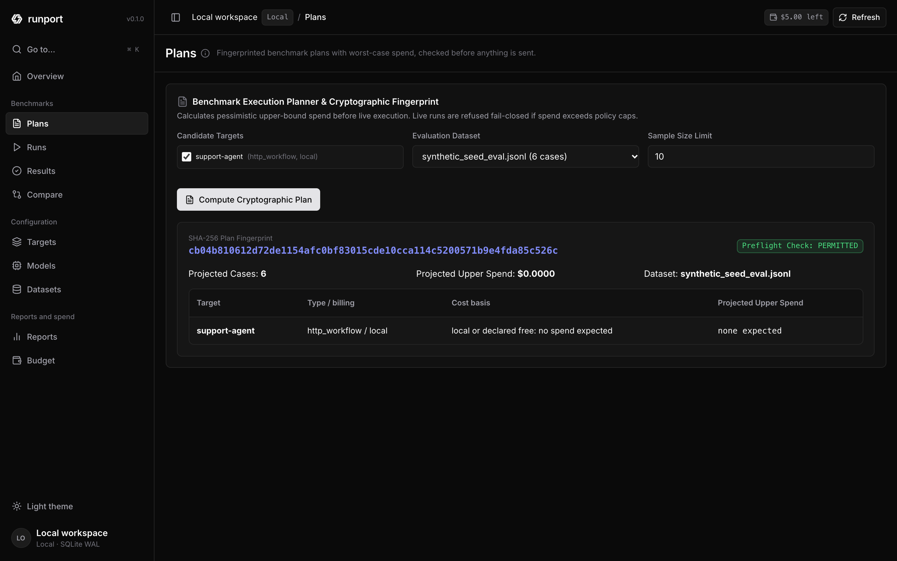
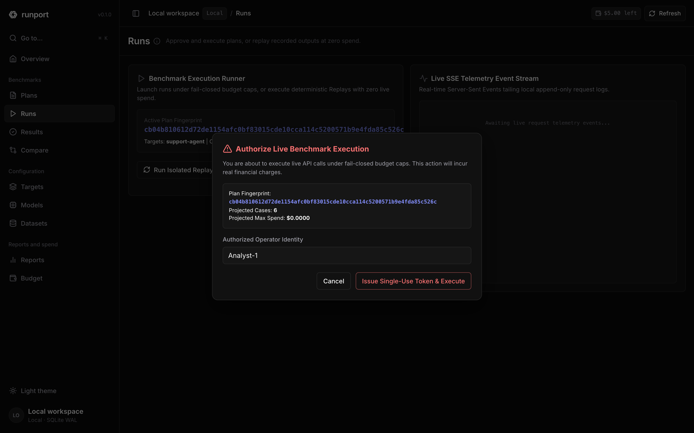
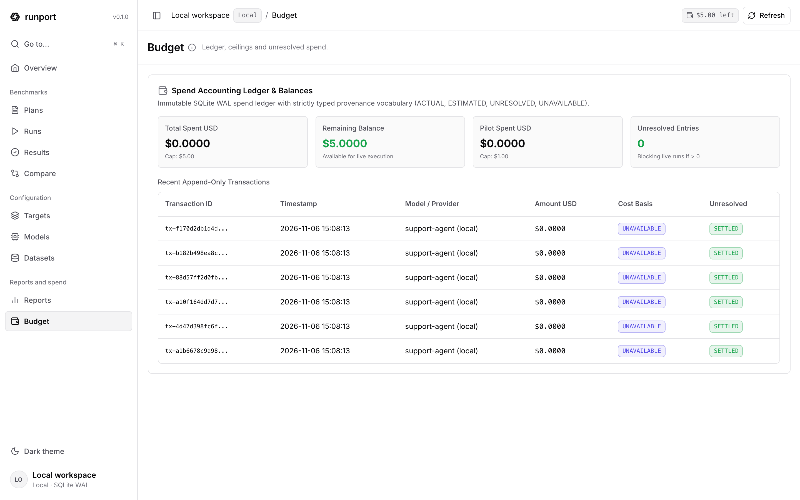

<p align="center">
  <picture>
    <source media="(prefers-color-scheme: dark)" srcset="assets/runport-logo-white.png">
    <source media="(prefers-color-scheme: light)" srcset="assets/runport-logo-black.png">
    
  </picture>
</p>

<h3 align="center">Benchmark any model, prompt or AI workflow.<br />Know exactly what it cost and what it got right.</h3>

<p align="center">
  Runport is an open-source, local-first benchmarking platform. Point it at an LLM API, a RAG pipeline, an agent, an MCP server or a Dify / n8n workflow, run your own dataset under hard spend caps, and get scores, latency, tokens and dollars you can defend. Nothing is invented, and nothing leaves your machine unless you approve it.
</p>

<p align="center">
  <a href="https://github.com/Sudharsanselvaraj/Runport/actions/workflows/ci.yml"></a>
  <a href="LICENSE"></a>
  <a href="https://www.python.org/"></a>
  <a href="https://github.com/Sudharsanselvaraj/Runport/releases"></a>
  <a href="https://github.com/Sudharsanselvaraj/Runport/stargazers"></a>
</p>

<p align="center">
  <a href="#quickstart"><strong>Quickstart</strong></a> ·
  <a href="#why-runport"><strong>Why Runport</strong></a> ·
  <a href="#integrations">Integrations</a> ·
  <a href="#use-it-your-way">Use it your way</a> ·
  <a href="#documentation">Docs</a> ·
  <a href="CONTRIBUTING.md">Contributing</a>
</p>

<br />

<p align="center">
  
</p>
<p align="center">
  <sub>Results explorer in the local web dashboard. A local HTTP agent run on the bundled synthetic dataset: $0 spend, scores labelled <em>Heuristic</em>, missing tokens shown as <code>None</code>.</sub>
</p>

---

## Why Runport

Most benchmark tools give you a leaderboard. Runport gives you numbers you can put in front of a skeptical reviewer.

- **Nothing is invented.** Missing latency, tokens or cost stay `None`. They are never defaulted to zero.
- **Agreement is not correctness.** Accuracy comes only from human-approved ground truth. Heuristic and judge scores are stored and labelled as such.
- **Spend is governed, not hoped for.** Hard caps are checked before every live request. A request whose cost cannot be resolved is booked `UNRESOLVED` and blocks the next live run until you reconcile it.
- **Nothing runs by surprise.** A plan is fingerprinted with SHA-256. Live execution needs an approval bound to that fingerprint, and a changed plan invalidates it.
- **Local by default.** Results, the spend ledger and approvals live in SQLite on your machine. Exported traces are scrubbed of secrets.
- **One engine, every interface.** The CLI, terminal UI, web dashboard, Python SDK and MCP server all go through the same guarded runner.

---

## Quickstart

**Requirements:** Python 3.11+ and [uv](https://docs.astral.sh/uv/). Node.js is only needed to rebuild the dashboard; a prebuilt bundle ships with the package.

```bash
git clone https://github.com/Sudharsanselvaraj/Runport.git
cd Runport
uv sync --extra dev --extra report

uv run runport init                 # create a local workspace: config, budget policy, database
```

Run your first benchmark offline. It replays recorded outputs, needs **no API key** and books **$0.00**:

```bash
uv run runport benchmark --replay --dataset examples/replay-demo/fixtures.jsonl --split ALL
uv run runport budget status
uv run runport web                  # dashboard at http://127.0.0.1:8000
```

Prefer the terminal? `uv run runport ui` opens the terminal dashboard and `uv run runport` opens the interactive launcher.

> [!IMPORTANT]
> Before pointing Runport at a paid provider, read the [Safety guide](docs/safety.md): set your budget caps, then run `uv run runport api-preflight` to check credentials offline. Live runs require an approved plan.

<details>
<summary><strong>What the offline replay prints</strong></summary>

<br />

```text
╭───────────────────────────────────────────────────────────────╮
│ Runport Offline Replay Benchmark                              │
│ Target Model:  google/gemini-3.5-flash-lite                   │
│ Dataset:       fixtures.jsonl                                 │
│ Mode:          REPLAY RUN (Provenance: REPLAYED, $0.00 spend) │
╰───────────────────────────────────────────────────────────────╯
 Recorded Outputs     3 / 3        Fixtures: fixtures.jsonl · Split: ALL
 Mean Latency         151.9 ms     From recorded latencies
 Mean Accuracy        —            Word overlap with the expected answer (labelled cases only)
 Run Spend (USD)      $0.0000      Provenance: REPLAYED ($0.00 spend)

 Case ID   Query Snippet                          Latency   Accuracy   Provenance   Cost
 rep-001   What is the capital of France?         120 ms    —          REPLAYED     $0.0000
 rep-002   Convert 100 EUR to USD                 145 ms    —          REPLAYED     $0.0000
 rep-003   Explain quantum entanglement brief...  190 ms    —          REPLAYED     $0.0000
```

The fixtures carry no expected answers, so no score is shown. Runport prints `—` rather than inventing one. More runnable examples live in [`examples/`](examples/): Python callable, HTTP workflow, Dify workflow, classification and RAG.

</details>

---

## How it works

<p align="center">
  <picture>
    <source media="(prefers-color-scheme: dark)" srcset="assets/readme/architecture-dark.png">
    <source media="(prefers-color-scheme: light)" srcset="assets/readme/architecture-light.png">
    
  </picture>
</p>

The runner applies its guards in a fixed order: **authorization → privacy gate → budget reservation → transport → validation → persistence → spend booking**. Replays never touch the network or the live ledger.

1. **Plan.** A dataset (hashed, immutable) and your targets become a fingerprinted execution plan with a worst-case cost projection.
2. **Approve.** A human approves the exact plan. Any change invalidates the approval.
3. **Run.** Cases execute under hard caps, with bounded retries and resumable checkpoints.
4. **Score.** Scoring is separate from inference. Every score carries its kind and its evaluator.
5. **Report.** Latency, tokens and cost, each with its provenance, in the CLI, the TUI, the web dashboard or a sanitized export.

More detail: [Architecture](docs/ARCHITECTURE.md) · [Universal execution architecture](docs/UNIVERSAL_EXECUTION_ARCHITECTURE.md).

---

## Product tour

<table>
  <tr>
    <td width="50%" valign="top">
      
      <p><strong>Plan before you spend.</strong> A SHA-256 fingerprint over targets, dataset and caps, a preflight verdict and a worst-case cost projection.</p>
    </td>
    <td width="50%" valign="top">
      
      <p><strong>Approve explicitly.</strong> Live execution needs a human approval bound to that fingerprint.</p>
    </td>
  </tr>
  <tr>
    <td width="50%" valign="top">
      
      <p><strong>Account for every dollar.</strong> An append-only SQLite ledger books each request as <code>ACTUAL</code>, <code>ESTIMATED</code>, <code>UNRESOLVED</code> or <code>UNAVAILABLE</code>.</p>
    </td>
    <td width="50%" valign="top">
      
      <p><strong>Work from the terminal.</strong> The same engine drives the CLI, the Rich terminal UI and the web dashboard, in dark and light themes.</p>
    </td>
  </tr>
</table>

---

## What you can benchmark

| Evaluate | How |
|:---|:---|
| **Models and prompts** | Any OpenAI-compatible API, OpenRouter or a local Ollama model, live or as an offline replay of recorded outputs. |
| **RAG pipelines and agents** | An HTTP endpoint, a Python callable, a subprocess or an MCP server's tools, scored on the same dataset. |
| **Orchestrated workflows** | Dify, plus experimental adapters for Flowise, Langflow, n8n and LangGraph. |
| **Quality** | Exact-match ground truth, rubric and overlap heuristics, classification metrics (accuracy, F1, calibration, Wilson and bootstrap intervals), with DEV-calibrated thresholds evaluated unchanged on TEST. |
| **Cost and speed** | Per-request latency, input and output tokens, and cost with provenance, from provider-reported or catalog-estimated values. |

---

## Integrations

The connector registry in [`src/runport/connectors/registry.py`](src/runport/connectors/registry.py) is the source of truth for what is supported.

| Status | Connectors |
|:---|:---|
| **Stable** | OpenAI and OpenAI-compatible APIs · OpenRouter · Dify · Generic HTTP endpoint · Python callable · Subprocess · Ollama |
| **Experimental** | MCP server (tools) · Flowise · Langflow · n8n · LangGraph |
| **Compatible via OpenAI-compatible** | vLLM · LM Studio · LocalAI · LiteLLM proxy · Groq · Together · Fireworks · DeepInfra · DeepSeek · Mistral |
| **Compatible via OpenRouter** | Anthropic · Gemini |
| **Planned** | LangChain · CrewAI · LlamaIndex |

> [!NOTE]
> Experimental connectors are **black-box endpoint adapters**: Runport sees the request and the final response, not the workflow's internal nodes or steps. Per-step tracing is not guaranteed.

<details>
<summary><strong>Full capability matrix</strong> (streaming, tool calls, usage, cost and more per connector)</summary>

<br />

<!-- BEGIN CONNECTOR MATRIX (generated from src/runport/connectors/registry.py; do not edit by hand) -->
| Connector | Name | Status | Integration | Tested | Streaming | Tool calls | Structured output | Per-step trace | Usage | Cost | Errors / timeouts |
|:---|:---|:---:|:---|:---:|:---:|:---:|:---:|:---:|:---:|:---:|:---:|
| `openai_compat` | OpenAI / OpenAI-compatible | **Stable** | native | yes | — | — | partial | — | yes | partial | yes |
| `openrouter` | OpenRouter | **Stable** | native | yes | — | — | — | — | yes | yes | yes |
| `dify` | Dify | **Stable** | native | yes | yes | — | — | partial | yes | partial | yes |
| `http_workflow` | Generic HTTP endpoint | **Stable** | generic http | yes | — | — | — | — | partial | partial | yes |
| `python_target` | Python callable | **Stable** | in process | yes | — | — | partial | — | — | — | yes |
| `subprocess` | Subprocess (stdin/stdout) | **Stable** | in process | yes | — | — | — | — | — | — | yes |
| `ollama` | Ollama | **Stable** | native | yes | — | — | partial | — | yes | — | yes |
| `mcp` | MCP server (tools) | *Experimental* | native | yes | — | yes | yes | — | — | — | yes |
| `flowise` | Flowise | *Experimental* | generic http | partial | — | — | — | — | — | — | yes |
| `langflow` | Langflow | *Experimental* | generic http | partial | — | — | — | — | — | — | yes |
| `n8n` | n8n | *Experimental* | generic http | partial | — | — | — | — | — | — | yes |
| `langgraph` | LangGraph | *Experimental* | generic http | partial | — | — | — | — | — | — | yes |
| `vllm` | vLLM | Via | via `openai_compat` | — | — | — | — | — | yes | partial | yes |
| `lm_studio` | LM Studio | Via | via `openai_compat` | — | — | — | — | — | yes | partial | yes |
| `localai` | LocalAI | Via | via `openai_compat` | — | — | — | — | — | yes | partial | yes |
| `litellm` | LiteLLM proxy | Via | via `openai_compat` | — | — | — | — | — | yes | partial | yes |
| `groq` | Groq | Via | via `openai_compat` | — | — | — | — | — | yes | partial | yes |
| `together` | Together | Via | via `openai_compat` | — | — | — | — | — | yes | partial | yes |
| `fireworks` | Fireworks | Via | via `openai_compat` | — | — | — | — | — | yes | partial | yes |
| `deepinfra` | DeepInfra | Via | via `openai_compat` | — | — | — | — | — | yes | partial | yes |
| `deepseek` | DeepSeek | Via | via `openai_compat` | — | — | — | — | — | yes | partial | yes |
| `mistral` | Mistral | Via | via `openai_compat` | — | — | — | — | — | yes | partial | yes |
| `anthropic` | Anthropic | Via | via `openrouter` | — | — | — | — | — | yes | yes | yes |
| `gemini` | Gemini | Via | via `openrouter` | — | — | — | — | — | yes | yes | yes |
| `langchain` | LangChain | Planned | none | — | — | — | — | — | — | — | — |
| `crewai` | CrewAI | Planned | none | — | — | — | — | — | — | — | — |
| `llamaindex` | LlamaIndex | Planned | none | — | — | — | — | — | — | — | — |
<!-- END CONNECTOR MATRIX -->

</details>

Configuration for each connector: [Connector catalogue](docs/connectors/README.md) · [Connector reference](docs/connectors.md).

---

## Use it your way

| Interface | Start with |
|:---|:---|
| **CLI** | `uv run runport --help` · [CLI reference](docs/cli.md) |
| **Terminal UI** | `uv run runport ui` |
| **Web dashboard** | `uv run runport web` · [Web dashboard guide](docs/web-ui.md) |
| **Python SDK** (in process) | [SDK contract](docs/SDK_API_CONTRACT.md) |
| **MCP server** (local stdio, for agents) | [MCP architecture](docs/MCP_ARCHITECTURE.md) |

---

## Documentation

| | |
|:---|:---|
| **Getting started** | [Quickstart](docs/quickstart.md) · [Concepts](docs/concepts.md) · [FAQ](docs/faq.md) |
| **Usage** | [CLI reference](docs/cli.md) · [Web dashboard](docs/web-ui.md) · [Configuration reference](docs/config-reference.md) |
| **Integrations** | [Connector catalogue](docs/connectors/README.md) · [Dify](docs/connectors/dify.md) · [MCP architecture](docs/MCP_ARCHITECTURE.md) · [Python SDK contract](docs/SDK_API_CONTRACT.md) |
| **Evaluation and metrics** | [Metrics](docs/metrics.md) |
| **Safety and governance** | [Safety guide](docs/safety.md) · [Invariant tests](docs/INVARIANT_TESTS.md) · [Security policy](SECURITY.md) |
| **Design and roadmap** | [Architecture](docs/ARCHITECTURE.md) · [Canonical trace schema (design)](docs/CANONICAL_TRACE_SCHEMA.md) · [Multi-user security model (design)](docs/MULTI_USER_SECURITY_MODEL.md) · [Product readiness audit](docs/GLOBAL_PRODUCT_READINESS_AUDIT.md) · [Roadmap audit](docs/ROADMAP_IMPLEMENTATION_AUDIT.md) |

---

## Status

Runport is **alpha**. No version has been tagged or published yet, and interfaces may change.

**Available today:** the guarded execution path behind every interface, fingerprinted plans and persisted approvals, the atomic budget ledger, score provenance, the stable connectors above, an MCP client connector and a local stdio MCP server, an in-process Python SDK, the CLI, the terminal UI and the web dashboard.

**Not yet built** (designs and plans live in [`docs/`](docs/)):

- canonical trace and span storage, and agent trajectory evaluation
- per-step instrumentation for LangGraph and other workflow frameworks
- OpenTelemetry / OpenInference ingestion and Langfuse export
- a TypeScript SDK and a mature remote Python SDK
- authenticated remote MCP and production multi-user hosting

See the [roadmap audit](docs/ROADMAP_IMPLEMENTATION_AUDIT.md) for what is verified and what is open.

---

## Contributing and community

Contributions are welcome. Tests run fully offline with sockets blocked: `uv run pytest`. Start with the [contributing guide](CONTRIBUTING.md), then:

- [Report a bug](https://github.com/Sudharsanselvaraj/Runport/issues/new?template=bug_report.md)
- [Request a feature](https://github.com/Sudharsanselvaraj/Runport/issues/new?template=feature_request.md) or a [connector](https://github.com/Sudharsanselvaraj/Runport/issues/new?template=connector_request.md)
- [Code of conduct](CODE_OF_CONDUCT.md) · [Security policy](SECURITY.md)

## License

Runport is licensed under the [Apache License 2.0](LICENSE). See [NOTICE](NOTICE) for attributions.

<br />

<p align="center">
  <sub>Runport: benchmark results you can defend, spend you can account for, on your own machine.<br />If it saves you time or money, a star helps others find it.</sub>
</p>
