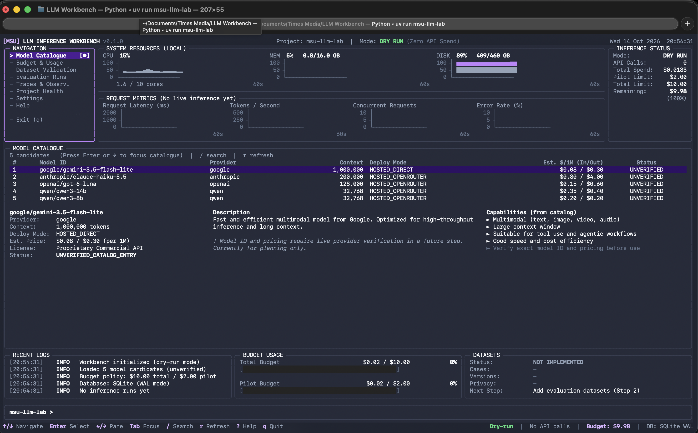

<p align="center">
  <picture>
    <source media="(prefers-color-scheme: dark)" srcset="assets/runport-logo-white.png">
    
  </picture>
</p>

<h3 align="center">Universal, Local-First LLM, Prompt & Workflow Benchmarking Platform</h3>

<p align="center">
  Benchmark <b>any API or orchestrated workflow</b> on your own dataset with strict ground-truth verification, zero simulated telemetry, and fail-closed micro-dollar spend caps.
</p>

<p align="center">
  <a href="https://github.com/Sudharsanselvaraj/runport"></a>
  <a href="https://www.python.org/downloads/"></a>
  <a href="LICENSE"></a>
  <a href="https://github.com/astral-sh/uv"></a>
  
  
</p>

<p align="center">
  <a href="#-quickstart"><b>Quickstart</b></a> •
  <a href="#-why-runport"><b>Why Runport?</b></a> •
  <a href="#-key-capabilities"><b>Key Capabilities</b></a> •
  <a href="#-terminal-ui--dashboard"><b>Terminal UI</b></a> •
  <a href="#-architecture"><b>Architecture</b></a> •
  <a href="#-safety--spend-model"><b>Spend & Safety</b></a> •
  <a href="#-connectors--workflows"><b>Connectors</b></a> •
  <a href="#-python-sdk"><b>Python SDK</b></a> •
  <a href="#-cli-reference"><b>CLI Reference</b></a> •
  <a href="#-development"><b>Development</b></a>
</p>

<br>

---

## ⚡ Quickstart

Get up and running locally in under 60 seconds with [`uv`](https://github.com/astral-sh/uv) or `pip`:

### 1. Installation

```bash
# Clone the repository
git clone https://github.com/Sudharsanselvaraj/runport.git
cd runport

# Install dependencies in an isolated virtual environment
uv sync
```

### 2. Launch the Interactive Interfaces

```bash
# Developer workflow launcher
uv run runport

# Full-screen Rich Terminal UI (TUI) Dashboard
uv run runport ui
```

### 3. Verify Offline Safety & Budget

```bash
# Offline check: verify provider credentials without sending any network request
uv run runport api-preflight

# Check budget caps, remaining balances, and append-only WAL ledger
uv run runport budget status

# Inspect the participant catalog, readiness blockers, and routed pricing
uv run runport models roster

# Run a synthetic-only verification plan (zero cost, zero outbound requests)
uv run runport smoke-test
```

---

## 💡 Why Runport?

Evaluating AI systems in production is plagued by unreliable benchmarks: synthetic simulations that don't match provider billing, model agreement masquerading as accuracy, runaway API spend during batch evaluations, and tools that only evaluate raw completions rather than real multi-step workflows.

**Runport fixes this with five foundational guarantees:**

| Traditional LLM Benchmarking | The Runport Standard |
|---|---|
| **Simulated / Mock Telemetry**: Fakes token counts and latency offline. | **Zero Simulation**: There is no dry-run mode in production. Missing provider tokens or latency stay `null` / `UNAVAILABLE`. |
| **Silent Overspend**: Batch evaluations run until your credit card fails. | **Hard Fail-Closed Caps**: Preflight bounds, circuit breakers down to `$0.02`/case, and an append-only SQLite WAL ledger. |
| **Model Agreement = Correctness**: Treats LLM consensus as ground truth. | **Strict Ground Truth**: Supervised metrics (accuracy, F1, calibration) are computed **exclusively** from human-approved annotations. |
| **Raw Model Endpoints Only**: Only tests single-prompt model APIs. | **Any Workflow / Any API**: Benchmarks raw LLMs alongside orchestrated workflows (Dify, Flowise, Langflow, n8n, LangGraph, custom HTTP). |
| **Uncontrolled Outbound Calls**: Scripts make network calls without warning. | **Typed Live Authorization**: Live requests require an interactive terminal user to type an approval phrase bound to the plan fingerprint. |

---

## 🚀 Key Capabilities

```text
┌─────────────────┐     ┌──────────────────┐     ┌──────────────────┐
│  Target System  │     │   Safety Gate    │     │  Observability   │
│ • Raw LLM APIs  │────▶│ • Spend Ceilings │────▶│ • Rich TUI       │
│ • Agent Flows   │     │ • Typed Approval │     │ • WAL Ledger     │
│ • Dify Pipelines│     │ • PII Redaction  │     │ • Trace Export   │
└─────────────────┘     └──────────────────┘     └──────────────────┘
```

- **Universal Target Support**: Benchmark anything with an input and output: OpenRouter, OpenAI-compatible APIs, local models (Ollama, vLLM), or workflow engines (Dify Chat & SSE Streaming, custom HTTP webhooks).
- **Hard, Fail-Closed Spend Caps**: Built-in limits ($18 total, $2 pilot, $0.50 single run, $0.02 single case). Spend kinds remain separate: `ACTUAL` (provider reported), `ESTIMATED` (catalog pricing × reported tokens), and `UNRESOLVED` (requires manual reconciliation before running further).
- **Statistical Rigor**: Built-in Wilson score confidence intervals, non-parametric bootstrap CIs, Cohen's Kappa for inter-annotator agreement, Holm-Bonferroni family-wise error rate corrections, and Precision/Recall/F1 metrics.
- **Operator Authorization**: Live external requests require typed confirmation bound to the plan fingerprint (e.g. `RUN LIVE gpt-4.1-nano PLAN a1b2c3d4`). Piped or non-interactive execution cannot confirm and is safely refused.
- **Local-First Privacy**: Automated salted SHA-256 pseudonyms and regex PII redaction (phones, emails). Source datasets and prediction stores are immutable and read-only.
- **Telemetry & Traces**: Export sanitized, redacted local traces (`trace-export-v1` format in JSONL, CSV, or deterministic ZIP) directly from the local SQLite ledger.

---

## 🖥️ Terminal UI & Dashboard

Runport provides a responsive, read-only terminal dashboard built with [Rich](https://github.com/Textualize/rich). It visualizes spend, execution health, request telemetry, calibration, and model agreement in real time.

```bash
uv run runport ui
```

<p align="center">
  
</p>

### Dashboard Navigation & Controls

| Shortcut | Action |
|:---:|---|
| `1` – `9`, `0`, `-`, `=` | Jump directly to dashboard sections (Overview, Quality, Calibration, Budget, etc.) |
| `[` / `]` | Step backward / forward through all 16 views |
| `Tab` / `Shift+Tab` | Cycle focus between navigation, data table, and inspector panels |
| `↑` `↓` / `k` `j` | Navigate rows within data views |
| `Enter` | Open side-by-side inspector for the selected model or run |
| `/` | Live filter roster by participant, model name, or provider |
| `:` | Open command prompt (`:overview`, `:budget`, `:quality`, `:latency`, `:traces`, `:quit`) |
| `r` | Manually reload telemetry and SQLite WAL ledger (auto-refreshes every 2 s) |
| `q` / `Esc` | Cleanly exit and restore terminal state |

---

## 🏗️ Architecture

```text
runport/
├── src/runport/
│   ├── cli.py                  # CLI entry point and interactive launcher
│   ├── catalog/                # Model candidate definitions and portfolio specs
│   ├── connectors/             # Workflow connectors (Dify chat/streaming, SSE, HTTP)
│   ├── scorers/                # Statistical scorers (Wilson, Bootstrap, Kappa, PRF)
│   ├── datasets/               # Dataset utilities and regex PII redaction
│   ├── classification/         # Classification contracts, runner, validators, splits
│   ├── core/                   # Spend budget service, paths, live execution guards
│   ├── storage/                # SQLite WAL ledger and evaluation run history
│   ├── providers/              # HTTP transports, retry policies, OpenRouter adapter
│   ├── observability/          # Event loggers, telemetry aggregations, trace export
│   └── tui/                    # Terminal dashboard, themes, live monitors, welcome menu
│
├── examples/plugins/           # Decoupled reference plugins
│   ├── kb_audit/               # Domain KB audit and deterministic patch engine
│   └── jev_decisions_api/      # Decisions API payload adapter
│
├── tests/                      # Comprehensive offline test suite (680+ tests)
└── data/                       # Local-only database, trace fixtures, and evaluation datasets
```

---

## 🛡️ Safety & Spend Model

Runport enforces hard budget boundaries at both preflight and runtime:

| Policy | Threshold | Enforcement Action |
|---|---|---|
| **Experiment Ceiling** | `$18.00` (configurable) | Preflight blocks execution if cumulative spend reaches cap |
| **Pilot Run Cap** | `$2.00` | Gating cap for exploratory or single-model runs |
| **Single Run Limit** | `$0.50` | Preflight rejects batch if estimated plan cost exceeds bound |
| **Single Case Circuit Breaker** | `$0.02` | Live runner immediately halts if a single record exceeds cap |
| **Unresolved Spend Lock** | Any unpriced transaction | Freezes further live execution until operator reconciles transaction |
| **Live Plan Authorization** | Interactive typed confirmation | Refuses requests without fingerprint-bound typed approval |

---

## 🔌 Connectors & Workflows

### 1. Orchestrated Workflows (e.g. Dify)
Benchmark multi-step conversational or streaming agents with automated secret scrubbing and retry handling:

```python
from runport.connectors.dify import post_chat_message, post_chat_stream

# Post to a Dify agent pipeline
result = post_chat_message(
    base_url="https://api.dify.ai/v1",
    api_key="app-xxxxxxxxxxxxxxxx",
    query="What are the system requirements?",
    user="anonymous-eval-001",
    timeout=30.0,
)
print(f"Status: {result.outcome}, Answer: {result.answer}")
```

### 2. Statistical Scoring SDK
Compute publication-grade statistical metrics with confidence intervals:

```python
from runport.scorers.stats import wilson, boot_ci, cohen_kappa, prf

# Wilson score interval for binomial accuracy (e.g. 85 successes in 100 trials)
low, high = wilson(successes=85, total=100, confidence=0.95)
print(f"95% CI: [{low:.3f}, {high:.3f}]")

# Inter-annotator agreement
kappa = cohen_kappa(rater_a=[1, 0, 1, 1], rater_b=[1, 0, 1, 0])
print(f"Cohen's Kappa: {kappa:.3f}")
```

### 3. PII Redaction & Pseudonymization
Clean evaluation datasets prior to benchmarking:

```python
from runport.datasets.redaction import redact, salted_hash

# Deterministic pseudonym
user_id = salted_hash("student@university.edu", salt="eval-salt-2026")

# Strip Malaysian/international phone numbers and email addresses
clean_text = redact("Contact me at user@example.com or +6012-3456789")
# Output: "Contact me at [EMAIL_REDACTED] or [PHONE_REDACTED]"
```

---

## 📖 CLI Reference

Run `runport --help` or `runport <command> --help` for full options:

| Command | Purpose |
|---|---|
| `runport` | Launch the interactive developer workflow selector |
| `runport ui` | Open the full-screen terminal dashboard (TUI) |
| `runport models roster` | Display candidate model portfolio, pinned routes, and blockers |
| `runport budget status` | View spend ledger, remaining balances, and active caps |
| `runport budget reconcile` | Manually reconcile unpriced or unresolved spend entries |
| `runport api-preflight` | Check provider API key availability without sending requests |
| `runport smoke-test` | Run synthetic verification plan across adapters |
| `runport export-traces` | Export sanitized local trace records (`jsonl`, `csv`, or `zip`) |
| `runport validate-dataset` | Verify split leakage and dataset contract schemas |
| `runport annotate` | Ground-truth annotation, adjudication, and label freezing |

---

## 🧪 Development & Testing

Runport uses [`uv`](https://github.com/astral-sh/uv) and [`pytest`](https://docs.pytest.org/). Sockets are blocked during tests, and all external transports use deterministic synthetic fixtures.

```bash
# Run the complete test suite (unit, integration, and PTY tests)
uv run pytest

# Run tests with coverage
uv run pytest --cov=runport

# Run plugin test suites
uv run pytest examples/plugins
```

---

## 📄 License & Attribution

Runport is open-source software licensed under the **[Apache 2.0 License](LICENSE)**.
See the **[NOTICE](NOTICE)** file for copyright notices.

```text
Runport
Copyright 2026 Sudharsanselvaraj and contributors.
Licensed under the Apache License, Version 2.0.
```
