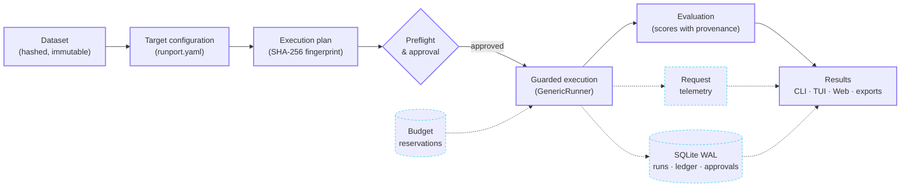

<p align="center">
  <picture>
    <source media="(prefers-color-scheme: dark)" srcset="assets/runport-logo-white.png">
    <source media="(prefers-color-scheme: light)" srcset="assets/runport-logo-black.png">
    
  </picture>
</p>

<h3 align="center">Benchmark, evaluate and govern AI systems — locally.</h3>

<p align="center">
  An open-source, local-first platform for benchmarking, evaluating and governing AI systems:<br />
  models, prompts, RAG pipelines, agents and workflows, with every score, token and dollar accounted for.
</p>

<p align="center">
  <a href="https://github.com/Sudharsanselvaraj/Runport/actions/workflows/ci.yml"></a>
  <a href="LICENSE"></a>
  <a href="https://www.python.org/"></a>
  <a href="#status"></a>
</p>

<p align="center">
  <a href="#quickstart"><strong>Quickstart</strong></a> ·
  <a href="#documentation"><strong>Documentation</strong></a> ·
  <a href="#integrations">Integrations</a> ·
  <a href="#architecture">Architecture</a> ·
  <a href="CONTRIBUTING.md">Contributing</a>
</p>

<br />

<p align="center">
  
</p>
<p align="center">
  <sub>Results explorer in the local web dashboard. Run of a local HTTP agent stub against the bundled synthetic dataset: $0 spend, scores labelled <em>Heuristic</em>, missing tokens shown as <code>None</code>.</sub>
</p>

---

## Product tour

<table>
  <tr>
    <td width="50%" valign="top">
      
      <p><strong>Plan before you spend.</strong> Every run starts as an execution plan with a SHA-256 fingerprint over targets, dataset and caps, a preflight verdict and a worst-case cost projection.</p>
    </td>
    <td width="50%" valign="top">
      
      <p><strong>Approve explicitly.</strong> Live execution needs a human approval bound to that fingerprint. A changed plan invalidates the approval.</p>
    </td>
  </tr>
  <tr>
    <td width="50%" valign="top">
      
      <p><strong>Account for every dollar.</strong> An append-only SQLite ledger books each request as <code>ACTUAL</code>, <code>ESTIMATED</code>, <code>UNRESOLVED</code> or <code>UNAVAILABLE</code>, under hard caps.</p>
    </td>
    <td width="50%" valign="top">
      
      <p><strong>Work from the terminal.</strong> The same engine drives the CLI, the Rich terminal UI and the web dashboard, in dark and light themes.</p>
    </td>
  </tr>
</table>

---

## What is Runport?

Runport runs a dataset of cases against one or more **targets** — an LLM API, a prompt wrapper, a RAG pipeline, a Python function, a subprocess, an MCP server, or a workflow on Dify, Flowise, Langflow, n8n or LangGraph — and records what each one returned, how long it took, how many tokens it used and what it cost.

It is built for teams who need benchmark results they can defend:

- **Nothing is invented.** Missing latency, tokens or cost stay `None`; they are never defaulted to zero.
- **Agreement is not correctness.** Accuracy comes only from human-approved ground truth. Heuristic and judge scores are stored and labelled as such.
- **Spend is governed.** Live runs need an approved plan, pass a budget reservation, and stop when a cost cannot be resolved.
- **Everything stays local.** Results, ledger and approvals live in SQLite on your machine; exported traces are scrubbed of secrets.

---

## Core capabilities

| | |
|:---|:---|
| **Benchmark** | Run any model, prompt, RAG pipeline, agent or workflow endpoint over the same dataset, live or as an offline replay of recorded outputs. |
| **Evaluate** | Score with exact-match ground truth, rubric and overlap heuristics, or classification metrics (accuracy, F1, calibration, Wilson and bootstrap intervals). Every score carries its kind and evaluator. |
| **Compare** | Put runs side by side by target, latency, tokens, cost and score, with DEV-calibrated thresholds evaluated unchanged on TEST. |
| **Measure** | Per-request latency, input and output tokens, and cost with provenance, from provider-reported or catalog-estimated values. |
| **Govern** | Fingerprinted plans, persisted approvals, atomic budget reservations, privacy gates and fail-closed handling of unresolved spend. |
| **Inspect** | CLI, Rich terminal UI, React web dashboard, an in-process Python SDK, an MCP server for agents, and sanitized trace exports. |

---

## Architecture

Every interface — CLI, TUI, web dashboard, Python SDK and MCP server — goes through one execution service and one guarded runner.



The runner applies its guards in a fixed order: **authorization → privacy gate → budget reservation → transport → validation → persistence → spend booking**. Replays never touch the network or the live ledger. See [Architecture](docs/ARCHITECTURE.md) and [Universal Execution Architecture](docs/UNIVERSAL_EXECUTION_ARCHITECTURE.md).

---

## Integrations

The connector registry in [`src/runport/connectors/registry.py`](src/runport/connectors/registry.py) is the source of truth for what is supported.

| Status | Connectors |
|:---|:---|
| **Stable** | OpenAI and OpenAI-compatible APIs · OpenRouter · Dify · Generic HTTP endpoint · Python callable · Subprocess · Ollama |
| **Experimental** | MCP server (tools) · Flowise · Langflow · n8n · LangGraph |
| **Compatible via OpenAI-compatible** | vLLM · LM Studio · LocalAI · LiteLLM proxy · Groq · Together · Fireworks · DeepInfra · DeepSeek · Mistral |
| **Compatible via OpenRouter** | Anthropic · Gemini |
| **Planned** | LangChain · CrewAI · LlamaIndex |

> [!NOTE]
> Experimental connectors are **black-box endpoint adapters**: Runport sees the request and the final response, not the workflow's internal nodes or steps. Per-step tracing is not guaranteed.

<details>
<summary><strong>Full capability matrix</strong> (streaming, tool calls, usage, cost and more per connector)</summary>

<br />

<!-- BEGIN CONNECTOR MATRIX (generated from src/runport/connectors/registry.py; do not edit by hand) -->
| Connector | Name | Status | Integration | Tested | Streaming | Tool calls | Structured output | Per-step trace | Usage | Cost | Errors / timeouts |
|:---|:---|:---:|:---|:---:|:---:|:---:|:---:|:---:|:---:|:---:|:---:|
| `openai_compat` | OpenAI / OpenAI-compatible | **Stable** | native | yes | — | — | partial | — | yes | partial | yes |
| `openrouter` | OpenRouter | **Stable** | native | yes | — | — | — | — | yes | yes | yes |
| `dify` | Dify | **Stable** | native | yes | yes | — | — | partial | yes | partial | yes |
| `http_workflow` | Generic HTTP endpoint | **Stable** | generic http | yes | — | — | — | — | partial | partial | yes |
| `python_target` | Python callable | **Stable** | in process | yes | — | — | partial | — | — | — | yes |
| `subprocess` | Subprocess (stdin/stdout) | **Stable** | in process | yes | — | — | — | — | — | — | yes |
| `ollama` | Ollama | **Stable** | native | yes | — | — | partial | — | yes | — | yes |
| `mcp` | MCP server (tools) | *Experimental* | native | yes | — | yes | yes | — | — | — | yes |
| `flowise` | Flowise | *Experimental* | generic http | partial | — | — | — | — | — | — | yes |
| `langflow` | Langflow | *Experimental* | generic http | partial | — | — | — | — | — | — | yes |
| `n8n` | n8n | *Experimental* | generic http | partial | — | — | — | — | — | — | yes |
| `langgraph` | LangGraph | *Experimental* | generic http | partial | — | — | — | — | — | — | yes |
| `vllm` | vLLM | Via | via `openai_compat` | — | — | — | — | — | yes | partial | yes |
| `lm_studio` | LM Studio | Via | via `openai_compat` | — | — | — | — | — | yes | partial | yes |
| `localai` | LocalAI | Via | via `openai_compat` | — | — | — | — | — | yes | partial | yes |
| `litellm` | LiteLLM proxy | Via | via `openai_compat` | — | — | — | — | — | yes | partial | yes |
| `groq` | Groq | Via | via `openai_compat` | — | — | — | — | — | yes | partial | yes |
| `together` | Together | Via | via `openai_compat` | — | — | — | — | — | yes | partial | yes |
| `fireworks` | Fireworks | Via | via `openai_compat` | — | — | — | — | — | yes | partial | yes |
| `deepinfra` | DeepInfra | Via | via `openai_compat` | — | — | — | — | — | yes | partial | yes |
| `deepseek` | DeepSeek | Via | via `openai_compat` | — | — | — | — | — | yes | partial | yes |
| `mistral` | Mistral | Via | via `openai_compat` | — | — | — | — | — | yes | partial | yes |
| `anthropic` | Anthropic | Via | via `openrouter` | — | — | — | — | — | yes | yes | yes |
| `gemini` | Gemini | Via | via `openrouter` | — | — | — | — | — | yes | yes | yes |
| `langchain` | LangChain | Planned | none | — | — | — | — | — | — | — | — |
| `crewai` | CrewAI | Planned | none | — | — | — | — | — | — | — | — |
| `llamaindex` | LlamaIndex | Planned | none | — | — | — | — | — | — | — | — |
<!-- END CONNECTOR MATRIX -->

</details>

Configuration for each connector: [Connector catalogue](docs/connectors/README.md) · [Connector reference](docs/connectors.md).

---

## Quickstart

**Requirements:** Python 3.11+ and [uv](https://docs.astral.sh/uv/). Node.js is only needed to rebuild the web dashboard; a prebuilt bundle ships with the package.

```bash
git clone https://github.com/Sudharsanselvaraj/Runport.git
cd Runport
uv sync --extra dev --extra report
```

Create a local workspace (config, budget policy and database):

```bash
uv run runport init
```

Run your first benchmark offline. It replays recorded outputs, so it needs **no API key** and books **$0.00**:

```bash
uv run runport benchmark --replay --dataset examples/replay-demo/fixtures.jsonl --split ALL
```

Check the budget ledger, then open the dashboard at `http://127.0.0.1:8000`:

```bash
uv run runport budget status
uv run runport web
```

Prefer the terminal? `uv run runport ui` opens the terminal dashboard, and `uv run runport` opens the interactive launcher.

> [!IMPORTANT]
> Before pointing Runport at a paid provider, read the [Safety guide](docs/safety.md): set your budget caps, then use `uv run runport api-preflight` to verify credentials offline. Live runs require an approved plan.

---

## Example

The offline replay above, as it prints on a clean checkout:

```text
╭───────────────────────────────────────────────────────────────╮
│ Runport Offline Replay Benchmark                              │
│ Target Model:  google/gemini-3.5-flash-lite                   │
│ Dataset:       fixtures.jsonl                                 │
│ Mode:          REPLAY RUN (Provenance: REPLAYED, $0.00 spend) │
╰───────────────────────────────────────────────────────────────╯
 Recorded Outputs     3 / 3        Fixtures: fixtures.jsonl · Split: ALL
 Mean Latency         151.9 ms     From recorded latencies
 Mean Accuracy        —            Word overlap with the expected answer (labelled cases only)
 Run Spend (USD)      $0.0000      Provenance: REPLAYED ($0.00 spend)

 Case ID   Query Snippet                          Latency   Accuracy   Provenance   Cost
 rep-001   What is the capital of France?         120 ms    —          REPLAYED     $0.0000
 rep-002   Convert 100 EUR to USD                 145 ms    —          REPLAYED     $0.0000
 rep-003   Explain quantum entanglement brief...  190 ms    —          REPLAYED     $0.0000
```

The fixtures carry no expected answers, so no score is shown — Runport prints `—` rather than inventing one. The run is stored in SQLite and appears in the dashboard. More runnable examples: [`examples/`](examples/) (Python callable, HTTP workflow, Dify workflow, classification, RAG).

---

## Documentation

| | |
|:---|:---|
| **Getting started** | [Quickstart](docs/quickstart.md) · [Concepts](docs/concepts.md) · [FAQ](docs/faq.md) |
| **Usage** | [CLI reference](docs/cli.md) · [Web dashboard](docs/web-ui.md) · [Configuration reference](docs/config-reference.md) |
| **Integrations** | [Connector catalogue](docs/connectors/README.md) · [Connector reference](docs/connectors.md) · [Dify](docs/connectors/dify.md) · [MCP architecture](docs/MCP_ARCHITECTURE.md) · [Python SDK contract](docs/SDK_API_CONTRACT.md) |
| **Architecture** | [Architecture](docs/ARCHITECTURE.md) · [Universal execution](docs/UNIVERSAL_EXECUTION_ARCHITECTURE.md) · [Canonical trace schema (design)](docs/CANONICAL_TRACE_SCHEMA.md) · [Decisions](docs/DECISIONS.md) |
| **Evaluation and metrics** | [Metrics](docs/metrics.md) |
| **Safety and governance** | [Safety guide](docs/safety.md) · [Invariant tests](docs/INVARIANT_TESTS.md) · [Multi-user security model (design)](docs/MULTI_USER_SECURITY_MODEL.md) · [Security policy](SECURITY.md) |
| **Development** | [Contributing](CONTRIBUTING.md) · [Agent and developer guide](AGENTS.md) · [Roadmap audit](docs/ROADMAP_IMPLEMENTATION_AUDIT.md) · [Release plan](docs/ROADMAP_RELEASE_PLAN.md) |

---

## Status

Runport is **alpha**. No version has been tagged or published yet, and interfaces may change.

**Available today:** the guarded execution path behind every interface, fingerprinted plans and persisted approvals, the atomic budget ledger, score provenance, the stable connectors above, an MCP client connector and a local stdio MCP server, an in-process Python SDK, the CLI, terminal UI and web dashboard.

**Not yet built** (designs and plans live in [`docs/`](docs/)):

- canonical trace and span storage, and agent trajectory evaluation;
- per-step instrumentation for LangGraph and other workflow frameworks;
- OpenTelemetry / OpenInference ingestion and Langfuse export;
- a TypeScript SDK and a mature remote Python SDK;
- authenticated remote MCP and production multi-user hosting.

See the [roadmap audit](docs/ROADMAP_IMPLEMENTATION_AUDIT.md) for what is verified and what is open.

---

## Community

- [Report a bug](https://github.com/Sudharsanselvaraj/Runport/issues/new?template=bug_report.md)
- [Request a feature](https://github.com/Sudharsanselvaraj/Runport/issues/new?template=feature_request.md) or a [connector](https://github.com/Sudharsanselvaraj/Runport/issues/new?template=connector_request.md)
- [Browse issues](https://github.com/Sudharsanselvaraj/Runport/issues)
- [Contributing guide](CONTRIBUTING.md) · [Code of conduct](CODE_OF_CONDUCT.md) · [Security policy](SECURITY.md)

## License

Runport is licensed under the [Apache License 2.0](LICENSE). See [NOTICE](NOTICE) for attributions.

<br />

<p align="center">
  <sub>Runport — benchmark results you can defend, spend you can account for, on your own machine.</sub>
</p>
