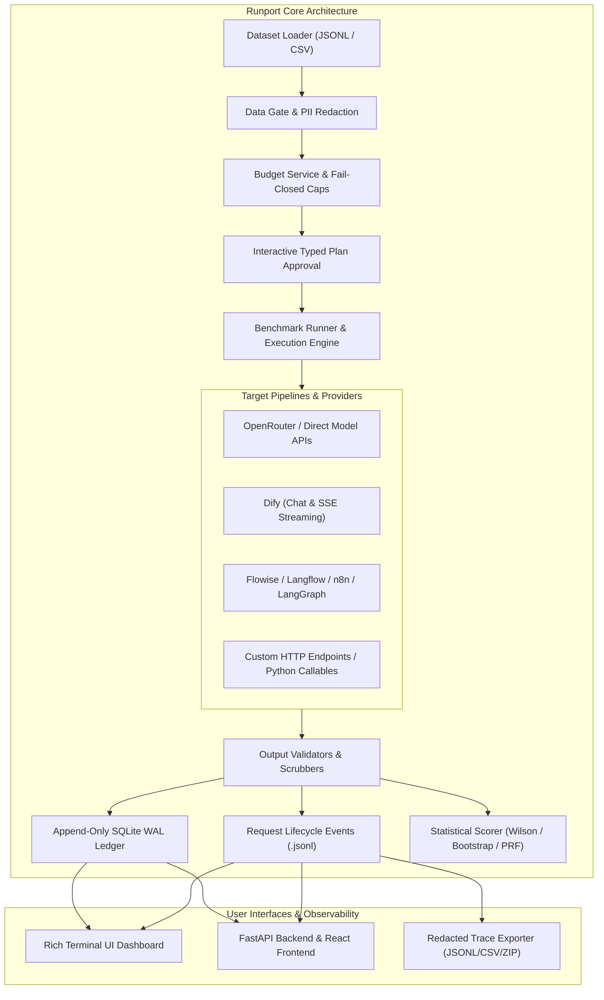

# System Architecture: Runport (`runport`)

**Status**: Universal Benchmarking Architecture  
**Date**: November 2026  
**License**: Apache 2.0  

---

## 1. Architectural Overview & Context

**Runport** is a universal, local-first open-source benchmarking platform engineered to evaluate any LLM, system prompt, autonomous agent, or orchestrated workflow (Dify, Flowise, Langflow, n8n, LangGraph, custom HTTP endpoints) on real datasets under hard, fail-closed spend caps.

The architecture decouples benchmarking into five fundamental layers:
1. **Target & Workflow Connector Layer**: Unified protocol for raw LLMs and multi-step orchestrated pipelines.
2. **Data & Privacy Gate Layer**: Schema-enforced case ingestion, salted-hash pseudonymization, and PII regex redaction.
3. **Execution & Budget Guard Layer**: Append-only SQLite WAL ledger, micro-dollar budget tracking, and interactive typed plan approval.
4. **Scoring & Statistical Verification Layer**: Supervised metrics computed strictly from human-approved ground-truth labels with Wilson CIs and bootstrap intervals.
5. **Observability & Presentation Layer**: Rich Terminal UI (TUI) dashboard, event lifecycle log, sanitized trace export, and FastAPI/React interfaces.

---

## 2. Core Architectural Principles

1. **Any Target with Input and Output**: Benchmarks raw completions, multi-turn dialogues, agent tools, or complex webhook pipelines using a uniform `Target` and `TargetResult` contract.
2. **Zero Simulation**: There is no mock data or dry-run mode in production. Missing provider telemetry (tokens, latency, confidence) remains `null` / `UNAVAILABLE`.
3. **Strict Ground-Truth Integrity**: Supervised quality metrics (accuracy, F1, calibration) are computed exclusively from human-approved annotations. Model agreement is never presented as accuracy.
4. **Fail-Closed Spend Protection**: Workspace ceilings (defaults: $5.00 total, $1.00 pilot, $1.00 per run, $0.05 per case; see `core/workspace.py`) are checked when a plan is made and before every case. A billable target that returns no cost is booked `UNRESOLVED`, the run halts, and live execution stays locked until reconciled.
5. **One Guarded Execution Path**: The CLI, Web API, Python SDK and MCP server all plan, approve and execute through `services/execution.py` and `runs/executor.py` (`GenericRunner`). Approvals are persisted, expire, bind to the plan fingerprint and are consumed atomically, once. Only a person approves: interactive CLI, the local Web UI, or an enabled CI token.
6. **Local-First & Data Privacy**: All telemetry, run history, and databases reside locally. Sensitive fields are redacted and pseudonyms use salted SHA-256 hashes.

---

## 3. Subsystem Breakdown

### 3.1 Connectors & Workflow Targets (`runport.connectors`)
- **HTTP Transport**: Bounded-retry poster handling transient 408/429/5xx status codes and honoring `Retry-After`.
- **OpenRouter & OpenAI Compat**: Non-streaming chat-completion adapters (OpenRouter as `OpenRouterTarget`).
- **Dify Connector**: Blocking and Server-Sent Events (SSE) streaming modes with secret scrubbing.
- **Workflow Connectors**: Flowise, Langflow, n8n and LangGraph as thin HTTP adapters, plus the generic HTTP connector.
- **MCP**: an MCP client target (`connectors/mcp.py`) and a Runport MCP server (`mcp_server/`).
- **Capabilities**: the authoritative matrix is `CONNECTOR_MATRIX` in `connectors/registry.py`.

### 3.2 Spend & Budget Engine (`runport.core.budget`)
- **Append-Only WAL Ledger**: SQLite database tracking micro-dollar costs by kind (`ACTUAL`, `ESTIMATED`, `UNRESOLVED`).
- **Circuit Breakers**: Immediate halt if a single evaluation case exceeds configured bounds.
- **Reconciliation Engine**: CLI and API mechanisms to resolve unpriced calls before resuming execution.

### 3.3 Statistical Scoring Subsystem (`runport.scorers`)
- **Binomial CIs**: Wilson score intervals for proportion metrics.
- **Bootstrap CIs**: Non-parametric percentile bootstrap confidence intervals.
- **Agreement**: Cohen's Kappa for inter-annotator reliability.
- **Multiple Comparisons**: Holm-Bonferroni step-down correction for family-wise error rates.

### 3.4 Presentation Layer
- **Rich Terminal UI (TUI)**: Full-screen dashboard, real-time telemetry graphs, candidate comparison roster, and trace inspector.
- **Developer Launcher**: Arrow-key workflow menu for fast navigation.
- **FastAPI & React Web Interface**: Localhost web application providing visual experiment planning, execution monitoring, and comparative reporting.

### 3.5 Multi-Tenant Isolation & Durable Asynchronous Execution
- **Resource Authorization**: Every API and SDK query validates project boundaries (`project_id`). Cross-tenant accesses return `404 Not Found` fail-closed.
- **Durable Worker Leases**: Asynchronous background jobs track heartbeat timestamps and worker leases (`worker_id`, `lease_expires_at`). Abandoned workers trigger automatic lease expiration and budget reservation sweeps.
- **Cooperative Cancellation**: Running jobs inspect cooperative cancellation tokens at case boundaries, ensuring clean shutdown and exact spend settlement.
- **Financial Concurrency & Idempotency**: Preflight reservations reserve funds per concurrent case; transactions enforce deterministic IDs (`tx-{run_id}-{case_id}`) with `INSERT OR IGNORE` semantics preventing duplicate spend booking.

### 3.6 Storage & Schema Migrations
- **SQLite WAL Mode**: Thread-safe, append-only persistence with write-ahead logging.
- **Schema Migrations**: Safe, additive migrations tracked in `schema_migrations`:
  - Migrations 1–5: Core evaluation runs, nullable statistics, canonical traces, and budget reservations.
  - Migration 6: Tenancy, organizations, projects, and memberships.
  - Migration 7: Worker leases, heartbeats, and background job coordination.
  - Migration 8: Run job idempotency keys (`Idempotency-Key`), project-scoped budget reservations, and reusable idempotency records.
