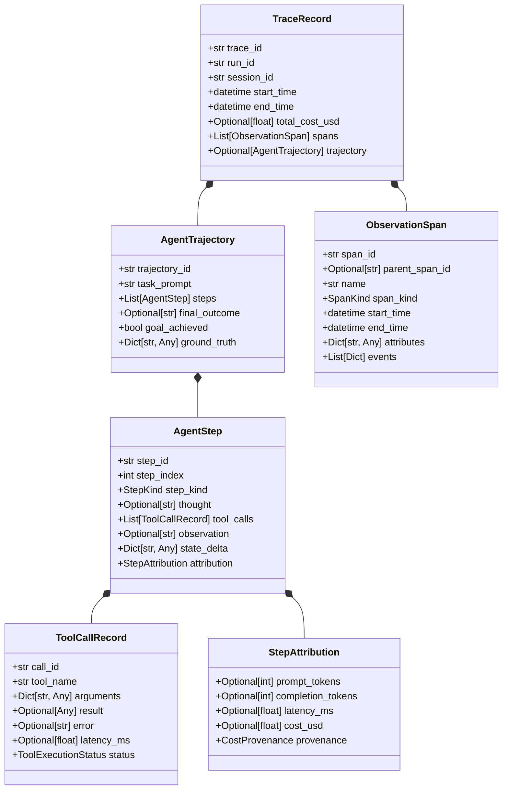

# Canonical Trace & Trajectory Schema Specification

> **Status**: Approved Architectural Standard  
> **Target Release**: v0.2.0 Trace Consolidation → v1.0.0 General Availability  
> **Document Ref**: `RUNPORT-SPEC-002`  
> **Author**: Runport Architecture & Engineering Team  

---

## 1. Executive Summary

Runport v0.1.0 introduced the foundational models `ObservationSpan` and `TraceRecord` (`src/runport/traces/models.py`), supporting basic RAG retrieval diagnostics and sanitized trace exports. However, modern AI workloads—particularly multi-turn autonomous agents, orchestrated graphs (LangGraph, CrewAI), and complex tool-use loops—require granular step-level telemetry that distinguishes reasoning, tool dispatch, external observations, and state transitions.

This specification formalizes Runport's **Canonical Trace Schema v2**, introducing:
1. First-class **Agent Trajectory** and **Agent Step** data structures.
2. Step-level attribution for token consumption, latency, and cost.
3. Strict enforcement of the **"Null is not 0"** architectural invariant.
4. Bidirectional mapping to the industry-standard **OpenInference** semantic conventions.
5. Export formatting for **OpenTelemetry (OTel)** and **Langfuse v2**.

---

## 2. Core Architectural Invariant: "Null is Not 0"

Runport strictly forbids fabricating telemetry values. In downstream evaluation, treating missing telemetry as zero skews statistical distributions, deflates cost averages, and conceals provider failures.

| Telemetry Field | Valid Value | Unreported / Missing Provider Value | Prohibited Replacement |
| :--- | :--- | :--- | :--- |
| **Token Usage** | Integer $\ge 0$ | `None` | `0` |
| **Latency** | Float $> 0.0$ (ms) | `None` | `0.0` or synthetic estimate |
| **Confidence Score** | Float $\in [0.0, 1.0]$ | `None` | `0.0` or `0.5` |
| **Cost (USD)** | Float $\ge 0.0$ | `None` (Provenance: `UNRESOLVED` / `UNAVAILABLE`) | `\$0.00` |

If a provider omits token or cost data, the span records `tokens: None` and books spend as `UNRESOLVED`, triggering fail-closed execution caps.

---

## 3. Canonical Data Models



### 3.1. Python / Pydantic v2 Definitions

```python
from datetime import datetime
from enum import Enum
from typing import Any, Dict, List, Optional
from pydantic import BaseModel, Field, model_validator


class CostProvenance(str, Enum):
    ACTUAL = "ACTUAL"          # Exact provider-reported USD spend
    ESTIMATED = "ESTIMATED"    # Verified catalog rate × reported tokens
    UNRESOLVED = "UNRESOLVED"  # Billed request with missing cost
    UNAVAILABLE = "UNAVAILABLE"# Zero-cost local execution
    REPLAYED = "REPLAYED"      # Offline replay execution ($0.00)


class SpanKind(str, Enum):
    CHAIN = "chain"
    LLM = "llm"
    TOOL = "tool"
    RETRIEVER = "retriever"
    AGENT = "agent"


class StepKind(str, Enum):
    REASONING = "reasoning"
    ACTION = "action"
    OBSERVATION = "observation"
    ROUTING = "routing"
    FINAL_ANSWER = "final_answer"


class ToolExecutionStatus(str, Enum):
    SUCCESS = "success"
    ERROR = "error"
    TIMEOUT = "timeout"
    BLOCKED = "blocked"


class ToolCallRecord(BaseModel):
    call_id: str = Field(..., description="Unique tool call invocation ID")
    tool_name: str = Field(..., description="Name of the invoked tool")
    arguments: Dict[str, Any] = Field(default_factory=dict, description="Input arguments passed to tool")
    result: Optional[Any] = Field(default=None, description="Serialized return value from tool")
    error: Optional[str] = Field(default=None, description="Error message if execution failed")
    latency_ms: Optional[float] = Field(default=None, description="Tool execution duration in milliseconds")
    status: ToolExecutionStatus = Field(default=ToolExecutionStatus.SUCCESS)


class StepAttribution(BaseModel):
    prompt_tokens: Optional[int] = Field(default=None, description="Input tokens consumed in this step")
    completion_tokens: Optional[int] = Field(default=None, description="Generated tokens in this step")
    latency_ms: Optional[float] = Field(default=None, description="Step duration in milliseconds")
    cost_usd: Optional[float] = Field(default=None, description="USD cost incurred during step")
    provenance: CostProvenance = Field(default=CostProvenance.UNAVAILABLE)

    @model_validator(mode="after")
    def validate_invariants(self) -> "StepAttribution":
        # Strict enforcement: missing cost cannot be marked ACTUAL
        if self.cost_usd is None and self.provenance == CostProvenance.ACTUAL:
            raise ValueError("cost_usd cannot be None when provenance is ACTUAL")
        return self


class AgentStep(BaseModel):
    step_id: str = Field(..., description="Unique step identifier")
    step_index: int = Field(..., description="Zero-based sequence index within trajectory")
    step_kind: StepKind = Field(..., description="Primary classification of step")
    thought: Optional[str] = Field(default=None, description="Internal model reasoning or chain-of-thought")
    tool_calls: List[ToolCallRecord] = Field(default_factory=list, description="Tools invoked during this step")
    observation: Optional[str] = Field(default=None, description="Environment or tool output observed by agent")
    state_delta: Dict[str, Any] = Field(default_factory=dict, description="State changes applied in this step")
    attribution: StepAttribution = Field(default_factory=StepAttribution)


class AgentTrajectory(BaseModel):
    trajectory_id: str = Field(..., description="Unique trajectory identifier")
    task_prompt: str = Field(..., description="Original user prompt or task goal")
    steps: List[AgentStep] = Field(default_factory=list, description="Ordered sequence of agent steps")
    final_outcome: Optional[str] = Field(default=None, description="Agent's final response or completion text")
    goal_achieved: Optional[bool] = Field(default=None, description="Supervised ground truth completion flag")
    ground_truth: Dict[str, Any] = Field(default_factory=dict, description="Expected human annotations")


class ObservationSpan(BaseModel):
    span_id: str = Field(...)
    parent_span_id: Optional[str] = None
    name: str = Field(...)
    span_kind: SpanKind = Field(...)
    start_time: datetime = Field(...)
    end_time: datetime = Field(...)
    attributes: Dict[str, Any] = Field(default_factory=dict)
    events: List[Dict[str, Any]] = Field(default_factory=list)


class TraceRecord(BaseModel):
    trace_id: str = Field(...)
    run_id: str = Field(...)
    session_id: Optional[str] = None
    start_time: datetime = Field(...)
    end_time: Optional[datetime] = None
    total_cost_usd: Optional[float] = None
    cost_provenance: CostProvenance = CostProvenance.UNAVAILABLE
    spans: List[ObservationSpan] = Field(default_factory=list)
    trajectory: Optional[AgentTrajectory] = None
```

---

## 4. OpenInference Semantic Conventions Mapping

Runport standardizes its span attributes against the OpenInference semantic specification:

| Runport Field | OpenInference Attribute Key | Type | Description |
| :--- | :--- | :--- | :--- |
| `span_kind = "llm"` | `openinference.span.kind` | `string` | Fixed to `"LLM"` |
| `span_kind = "tool"` | `openinference.span.kind` | `string` | Fixed to `"TOOL"` |
| `span_kind = "retriever"` | `openinference.span.kind` | `string` | Fixed to `"RETRIEVER"` |
| `step.thought` | `llm.thought` | `string` | Model internal chain-of-thought |
| `attribution.prompt_tokens`| `llm.token_count.prompt` | `int` | Prompt tokens |
| `attribution.completion_tokens` | `llm.token_count.completion` | `int` | Generated tokens |
| `attribution.cost_usd` | `llm.cost.total_usd` | `float` | Calculated spend |
| `tool_call.tool_name` | `tool.name` | `string` | Name of tool |
| `tool_call.arguments` | `tool.parameters` | `json_string` | JSON-encoded parameters |
| `tool_call.result` | `tool.output` | `string` | Serialized tool output |
| `retrieval_documents` | `retrieval.documents` | `list[json]` | List of retrieved document nodes |

---

## 5. OpenTelemetry (OTel) Export Conversion

Runport translates internal traces into standard OTLP JSON / ResourceSpans for integration with OpenTelemetry collectors:

```json
{
  "resourceSpans": [
    {
      "resource": {
        "attributes": [
          {"key": "service.name", "value": {"stringValue": "runport"}},
          {"key": "service.version", "value": {"stringValue": "0.2.0"}},
          {"key": "runport.run_id", "value": {"stringValue": "run-abc-123"}}
        ]
      },
      "scopeSpans": [
        {
          "scope": {"name": "runport.traces", "version": "2.0.0"},
          "spans": [
            {
              "traceId": "4bf92f3577b34da6a3ce929d0e0e4736",
              "spanId": "00f067aa0ba902b7",
              "parentSpanId": "",
              "name": "AgentExecution",
              "kind": 1,
              "startTimeUnixNano": "1699000000000000000",
              "endTimeUnixNano": "1699000002500000000",
              "attributes": [
                {"key": "openinference.span.kind", "value": {"stringValue": "AGENT"}},
                {"key": "runport.cost_provenance", "value": {"stringValue": "ESTIMATED"}},
                {"key": "runport.cost_usd", "value": {"doubleValue": 0.0042}}
              ],
              "status": {"code": 1}
            }
          ]
        }
      ]
    }
  ]
}
```

---

## 6. Langfuse v2 Ingestion & Export Schema

To provide full bi-directional interoperability with Langfuse, Runport implements direct export mapping matching Langfuse API v2:

```python
def to_langfuse_v2(trace: TraceRecord) -> Dict[str, Any]:
    """Serializes a Runport TraceRecord into Langfuse v2 ingest payload."""
    observations = []
    
    for span in trace.spans:
        observations.append({
            "id": span.span_id,
            "traceId": trace.trace_id,
            "parentObservationId": span.parent_span_id,
            "type": "GENERATION" if span.span_kind == SpanKind.LLM else "SPAN",
            "name": span.name,
            "startTime": span.start_time.isoformat(),
            "endTime": span.end_time.isoformat(),
            "input": span.attributes.get("input"),
            "output": span.attributes.get("output"),
            "usage": {
                "promptTokens": span.attributes.get("prompt_tokens"),
                "completionTokens": span.attributes.get("completion_tokens"),
                "totalTokens": span.attributes.get("total_tokens"),
            },
            "calculatedTotalCost": span.attributes.get("cost_usd"),
            "metadata": {
                "provenance": span.attributes.get("provenance"),
                "runport_run_id": trace.run_id,
            }
        })
        
    return {
        "id": trace.trace_id,
        "name": f"runport-{trace.run_id}",
        "timestamp": trace.start_time.isoformat(),
        "observations": observations,
    }
```

