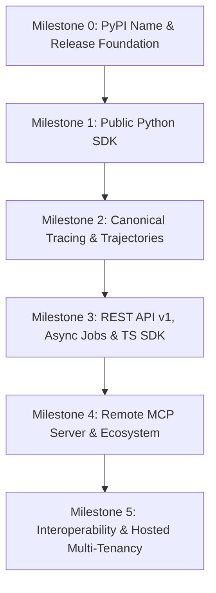

# Global Product Readiness Audit & Engineering Master Plan

**Audited tree:** `main` at commit `c64e31b` (2026-11-07).  
**Baseline status:** 522 automated tests passing offline (478 core + 26 plugin + 18 frontend). Zero linter or formatting errors (`ruff`). Clean type checking in core modules (`mypy`).  
**Supersedes:** `docs/ROADMAP_IMPLEMENTATION_AUDIT.md` (baseline `b735afc`, 2026-11-06).

---

## 1. Executive Snapshot & Verified Baseline

### 1.1 Live Verification Matrix

Every statement below has been verified against the live repository files and network registry checks as of November 7, 2026.

| Check / Domain | Command / Query | Verified Result | Evidence / Notes |
|:---|:---|:---|:---|
| **Git Tree & Head** | `git rev-parse --short HEAD` | `c64e31b` | Working tree clean. Latest commit adds dark/light architecture diagrams to README. |
| **Git Tags** | `git tag && git ls-remote --tags origin` | **v0.1.0-alpha** | Tagged and published on GitHub Releases. |
| **PyPI Registry** | `https://pypi.org/pypi/runport/json` | **HTTP 200 (Live)** | Published as `runport` 0.1.0 via PyPA Trusted Publishing. |
| **npm Registry** | `https://registry.npmjs.org/@runport/sdk` | **HTTP 404 (Available)** | Both `runport` and `@runport/sdk` are currently **unclaimed** on npm. |
| **Core Test Suite** | `uv run pytest` | **478 passed** (48.98s) | Sockets strictly blocked. All unit, PTY launcher, and integration tests pass. |
| **Plugin Test Suite** | `uv run pytest examples/plugins` | **26 passed, 5 skipped** | All plugin contracts and decision fixtures pass. |
| **Frontend Tests** | `npm test` (in `web/`) | **18 passed** (68ms) | Contract tests, orbit loop, spend guard, and Wilson score tests pass. |
| **Code Style & Lint** | `uv run ruff check .` | **Clean** | 0 linter violations. |
| **Formatting** | `uv run ruff format --check .` | **Clean** | 269 source files conform to repo format. |
| **Type Checking** | `uv run mypy` | **Clean in 56 files** | Strict typing enforced in core, budget, and storage engines. |
| **License & Attribution** | Repo root | **Apache 2.0** | Full `LICENSE` and `NOTICE` files present. |

### 1.2 Recent Commits Merged (Since Nov 6 Audit)

Between `b735afc` and `c64e31b`, the following foundational improvements were completed:
1. **PR #16 (`0a6e1e2`)**: Resolved macOS 3.13 PTY quit timing races, legacy keyword pattern scanner false positives, and fail-closed preflight handling in wheel smoke tests.
2. **PR #17 (`d638da2`)**: Complete README transformation into a credible, production-grade product landing page with real web dashboard assets.
3. **PR #18 (`b94202a`)**: PTY terminal launcher key-buffering fix, preventing dropped inputs across raw-mode transitions.
4. **PR #19 (`7508e41`)**: Integrated official Runport emblem into the web dashboard sidebar navigation.
5. **Commit `8cedd3f`**: Complete terminal CLI redesign (OpenSRE restrained design, single-color lavender `#C5A6E8`, 8-line Braille brand mark, modular `OnboardingEngine`).
6. **Commit `c64e31b`**: Integrated responsive dark and light architecture diagrams into `README.md`.

---

## 2. Core Value: What is Built, Proven & Distinctive

Runport has moved beyond a CLI prototype. Its core engine is a battle-tested, guarded execution foundation that must not be discarded or rewritten:

```
┌────────────────────────────────────────────────────────────────────────┐
│                        CALLING INTERFACES                              │
│   CLI Launcher   │   Terminal UI   │   Web Dashboard   │   SDK / MCP   │
└──────────────────────────────────┬─────────────────────────────────────┘
                                   │
                                   ▼
┌────────────────────────────────────────────────────────────────────────┐
│               SHARED EXECUTION SERVICE (ExecutionService)              │
│    Plan Fingerprinting (SHA-256)  │  Persisted Approvals (ApprovalStore)│
└──────────────────────────────────┬─────────────────────────────────────┘
                                   │
                                   ▼
┌────────────────────────────────────────────────────────────────────────┐
│                 GENERIC RUNNER (Strict 7-Gate Order)                   │
│  [1] Auth  [2] Privacy  [3] Preflight Budget  [4] Transport Execution  │
│          [5] Validation  [6] Persistence  [7] Spend Booking            │
└──────────────────────────────────┬─────────────────────────────────────┘
                                   │
                                   ▼
┌────────────────────────────────────────────────────────────────────────┐
│                         DURABLE STORAGE                                │
│       SQLite WAL Ledger   │   Atomic Reservations   │   Scorers        │
└────────────────────────────────────────────────────────────────────────┘
```

### Key Differentiators to Preserve
- **"Null is Not 0"**: Missing tokens, latency, or costs remain `None` / `UNAVAILABLE`. No fabricated metrics.
- **Fail-Closed Spend Governance**: Cumulative per-run budget caps checked in atomic `BEGIN IMMEDIATE` transactions. Billable requests with missing provider cost book as `UNRESOLVED` and block further live runs.
- **Cryptographic Plan Approvals**: Plans SHA-256 bind target specs, dataset hash, and spend caps. Altering a plan immediately invalidates approval.
- **Score Provenance**: Supervised ground-truth metrics are strictly separated from heuristic and LLM-judge scores.
- **Zero Secret Leakage**: API tokens and bearer keys are automatically scrubbed from request logs, traces, and export archives.
- **Offline Replay**: Full evaluation playback carries provenance `REPLAYED` and books `$0.00` with blocked sockets.

---

## 3. Capability Gap Analysis

### Domain A: Package Distribution & Installation
* **Current State**: Configured in `pyproject.toml` with console script `runport = "runport.cli:app"`. Release workflow `.github/workflows/release.yml` triggers on `v*` tags using PyPI Trusted Publishing.
* **Gaps**:
  1. `runport` is **unclaimed on PyPI** (HTTP 404). High risk of name squatting.
  2. **TestPyPI vs. Production PyPI distinction**: Publishing to TestPyPI does *not* reserve `runport` on production PyPI; they are completely isolated registries. The production namespace must be claimed directly on production PyPI.
  3. No published PyPI wheel or sdist exists. Users must clone the git repository and use `uv` from source.
* **Impact**: Blocks global adoption. Ordinary developers cannot run `pip install runport`.

### Domain B: Public Python SDK Contract
* **Current State**: In-process `runport.sdk` (`plan`, `approve_interactively`, `approve_with_ci_token`, `execute`, `benchmark`) routed through `ExecutionService`.
* **Gaps**:
  1. Returns internal execution dataclasses (`ExecutionOutcome`, `GenericRunResult`).
  2. No remote client (`runport.Client(base_url="...")`).
  3. No asynchronous execution support (`async def`).
  4. Lacks typed exceptions (e.g., `PlanRejectedError`, `BudgetExceededError`, `UnresolvedCostError`).
* **Impact**: Developers embedding Runport into their code are exposed to internal breaking changes.

### Domain C: Model Context Protocol (MCP) Ecosystem
* **Current State**:
  - Client: `src/runport/connectors/mcp.py` supports stdio and Streamable HTTP with version negotiation (`2025-06-18`, `2025-03-26`, `2024-11-05`).
  - Server: `src/runport/mcp_server/server.py` exposes 11 tools, resources, and prompts over stdio.
* **Gaps**:
  1. **No HTTP Transport for Server**: The MCP server only runs over stdio pipes; remote AI agents cannot reach it over Streamable HTTP.
  2. **No MCP Authentication or Scopes**: Anyone running the stdio process can call all tools.
  3. **No Protocol 2026-07-28**: Does not speak the latest MCP protocol specification.
  4. **No MCP Tracing**: MCP tool calls are not captured as persisted spans.
* **Impact**: AI agent platforms (Cursor, Claude Desktop, remote agents) cannot securely discover and orchestrate Runport remotely.

### Domain D: Canonical Tracing & Agent Trajectory Evaluation
* **Current State**: `TargetResult.metadata` stores raw JSON (Dify nodes, tool calls, retrieval chunks). `traces/models.py` defines an import-only format.
* **Gaps**:
  1. **No Database Persistence for Spans**: SQLite only holds `evaluation_runs` and `evaluation_results`. No `traces` or `spans` table exists.
  2. **No Multi-Step Trajectory Scorer**: Scorers only evaluate single output strings; cannot evaluate tool selection accuracy, argument schemas, or retrieval relevancy.
* **Impact**: Runport cannot evaluate autonomous multi-step agents or complex RAG pipelines beyond black-box final outputs.

### Domain E: Versioned REST API & TypeScript SDK
* **Current State**: Unversioned `/api/*` endpoints returning untyped dictionaries. Benchmark runs execute synchronously inside `POST /api/runs`.
* **Gaps**:
  1. No versioned `/api/v1/` prefix.
  2. No asynchronous background jobs or job cancellation.
  3. No TypeScript SDK (`@runport/sdk` unclaimed on npm).
* **Impact**: Web applications, CI pipelines, and TypeScript developers cannot reliably integrate with Runport.

### Domain F: Multi-User & Hosted Deployment
* **Current State**: Single shared API token or loopback-only. Single SQLite workspace file. Process-global settings (`settings`).
* **Gaps**:
  1. No users, organizations, or project memberships.
  2. No role-based access control (RBAC).
  3. No PostgreSQL storage backend.
  4. No isolated worker execution pool.
* **Impact**: Teams cannot share a hosted Runport instance; strictly limited to local single-user execution.

### Domain G: Framework Instrumentation & Observability
* **Current State**: Black-box execution only (`http_workflow`, `python_callable`, `subprocess`, `mcp_tool`).
* **Gaps**:
  1. No OpenTelemetry (OTel) GenAI or OpenInference ingestion.
  2. No native LangGraph per-step streaming.
  3. No Langfuse bidirectional trace export/import.
* **Impact**: Users must rewrite workflows into generic connectors rather than plugging in existing framework traces.

---

## 4. Dependency-Ordered Engineering Milestones



---

### Staged SDK & Ecosystem Release Sequencing

To eliminate the risk of releasing multiple unstable public contracts simultaneously, the interfaces will be published in strict staged sequence:
1. **Stage 1 (M0)**: PyPI Package & CLI (Local-First Core).
2. **Stage 2 (M1)**: Stable In-Process Python SDK (`runport.benchmark`, stable Pydantic models).
3. **Stage 3 (M2/M4)**: Local MCP Server & Client Documentation.
4. **Stage 4 (M3)**: Remote Python SDK & Versioned REST API v1 (`/api/v1/*`).
5. **Stage 5 (M3)**: TypeScript SDK (`@runport/sdk` on npm).

---

### Milestone 0: PyPI Name Reservation & Release Foundation (COMPLETED)
**Goal:** Make Runport globally installable (`pip install runport`) and protect project naming without cloud/account dependencies.

- [x] **Task 0.1: Verify Wheel Cleanliness & Local Smoke Tests**
  - Built clean sdist and wheel with `uv build` (`dist/runport-0.1.0-py3-none-any.whl`).
  - Verified wheel installs into a fresh isolated virtual environment with zero dev dependencies.
  - Verified `runport --help`, `runport --version`, `runport -v`, `runport init` workspace scaffolding.
  - Verified `runport web` serves bundled frontend assets (`index.html`) with `200 OK`.
- [x] **Task 0.2: Harden GitHub Actions Release Workflow (`.github/workflows/release.yml`)**
  - Decoupled into 4 isolated jobs: `build`, `verify` (matrix on Ubuntu, macOS, Windows), `publish-pypi` (Trusted Publishing), and `github-release`.
  - Implemented artifact handoff via `actions/upload-artifact@v4` and `actions/download-artifact@v4`.
  - Scoped permissions per job (`id-token: write` only for PyPI publish; `contents: write` only for GitHub release).
  - Configured dynamic prerelease detection (flags `prerelease: true` for tags containing `-alpha`, `-beta`, `-rc`, `-dev`).
- [x] **Task 0.3: Secure Production PyPI Namespace**
  - Configured GitHub repository PyPI Trusted Publishing under owner account (`Sudharsanselvaraj/Runport`, workflow `release.yml`, environment `pypi`).
  - Successfully published `runport` v0.1.0 to PyPI. Project namespace permanently claimed.
- [x] **Task 0.4: Tag v0.1.0-alpha & Verify Independent PyPI Installation**
  - Tagged `v0.1.0-alpha` and pushed to GitHub.
  - All 6 CI jobs passed: Build, Ubuntu verify, macOS verify, Windows verify, PyPI publish, GitHub release.
  - Verified `pip install runport` from PyPI in an independent clean virtual environment; ran `runport --version`, `runport init`, and `runport budget status` with 100% success.

---

### Milestone 1: Public Python SDK & Contract Hardening
**Goal:** Provide an enterprise-grade, backwards-compatible Python SDK for embedding Runport.

- [ ] **Task 1.1: Public Response & Configuration Models (`runport.models`)**
  - Define stable Pydantic v2 models: `BenchmarkRun`, `CaseResult`, `ScoreResult`, `CostSummary`.
  - Deprecate direct exposure of internal `GenericRunResult` and `ExecutionOutcome`.
- [ ] **Task 1.2: Public SDK Exception Hierarchy (`runport.exceptions`)**
  - Create explicit exception classes: `RunportError`, `BudgetExceededError`, `UnresolvedCostError`, `PlanApprovalRequiredError`, `InvalidTargetError`.
- [ ] **Task 1.3: Asynchronous In-Process SDK Support**
  - Implement `runport.sdk.async_benchmark()` and `runport.sdk.async_execute()` for `asyncio` runtimes.
- [ ] **Task 1.4: SDK Contract Test Suite & Documentation**
  - Add `tests/test_sdk_public_contract.py` verifying no private imports are required.
  - Add interactive cookbook in `docs/sdk.md` with executable examples.

---

### Milestone 2: Canonical Tracing & Agent Trajectory Infrastructure
**Goal:** Elevate Runport from black-box evaluation to deep agent trajectory inspection.

- [ ] **Task 2.1: Canonical Trace & Span Data Models (`src/runport/traces/schema.py`)**
  - Implement Pydantic v2 `Trace` and `Span` models per `docs/CANONICAL_TRACE_SCHEMA.md`.
  - Include `SpanKind` (`AGENT`, `LLM`, `TOOL`, `RETRIEVAL`, `HANDOFF`, `WORKFLOW_STEP`).
  - Enforce "Null is Not 0" across token, latency, and cost attributes.
- [ ] **Task 2.2: SQLite Tracing Tables & Schema Migration**
  - Add `traces` and `spans` tables in `src/runport/storage/db.py`.
  - Index spans by `trace_id`, `parent_span_id`, and `kind`.
  - Wire migrations into `DatabaseManager.init_db()`.
- [ ] **Task 2.3: Wire Trajectory into Target Execution**
  - Add `trajectory: Optional[List[Span]]` to `TargetResult` (`src/runport/targets/base.py`).
  - Extract spans from `DifyTarget` node outputs, `RAGTarget` retrieval contexts, and `McpToolTarget` calls.
- [ ] **Task 2.4: Trajectory Evaluator Primitives (`src/runport/scorers/trajectory.py`)**
  - Implement tool call accuracy scorer (correct tool selected).
  - Implement tool schema validator (arguments match expected JSON schema).
  - Implement step-count and efficiency scorers.
- [ ] **Task 2.5: Terminal & Web Dashboard Trace Explorer**
  - Add visual span timeline and waterfall view in React web dashboard (`web/src/components/TraceView.tsx`).
  - Add collapsible trace tree view in Rich terminal TUI.

---

### Milestone 3: Versioned REST API v1, Asynchronous Jobs & TypeScript SDK
**Goal:** Enable language-agnostic integration and non-blocking remote benchmark execution.

- [ ] **Task 3.1: Versioned API Routes (`/api/v1/`)**
  - Relocate routes to `src/runport/api/v1/` with typed Pydantic request/response schemas.
  - Implement OpenAPI 3.1 schema generation and validation.
- [ ] **Task 3.2: Asynchronous Job Execution Model**
  - Implement `POST /api/v1/plans/{id}/runs` returning `202 Accepted` with `run_job_id`.
  - Add endpoints: `GET /api/v1/jobs/{id}`, `POST /api/v1/jobs/{id}/cancel`.
  - In-memory/SQLite job runner with cooperative cancellation tokens.
- [ ] **Task 3.3: Scoped API Key Authentication**
  - Add `runport_api_keys` table supporting scopes: `plans:create`, `runs:execute`, `results:read`, `budget:admin`.
  - Constant-time secret comparison and revocation.
- [ ] **Task 3.4: Remote Python Client (`runport.Client`)**
  - Implement typed remote client using `httpx` with retries and pagination.
- [ ] **Task 3.5: TypeScript SDK Package (`@runport/sdk`)**
  - Generate TypeScript models from OpenAPI specification.
  - Implement Node/browser-compatible client with typed errors and streaming event support.
  - Add integration tests matching the Python SDK test suite.

---

### Milestone 4: Production-Grade MCP Server & Ecosystem
**Goal:** Position Runport as the default benchmarking infrastructure for AI agents.

- [ ] **Task 4.1: Streamable HTTP Transport for MCP Server**
  - Implement Streamable HTTP transport for `RunportMcpServer` (`src/runport/mcp_server/http.py`).
  - Support protocol revisions up to `2026-07-28`.
- [ ] **Task 4.2: MCP Authentication & Per-Tool Authorization**
  - Bearer token authentication on HTTP endpoints.
  - Prevent agents from approving their own spend: strictly forbid `approve_plan` tool registration.
- [ ] **Task 4.3: MCP Protocol Compatibility Test Suite**
  - Expand `tests/test_mcp_server.py` with multi-version matrix tests against official SDK.
- [ ] **Task 4.4: Agent IDE Setup Blueprints**
  - Provide tested setup guides and snippets for Claude Desktop, Cursor, and VS Code.

---

### Milestone 5: Framework Interoperability & Hosted Multi-Tenancy (COMPLETED)
**Goal:** Expand Runport into a multi-team, enterprise-ready evaluation platform.

- [x] **Task 5.1: OpenTelemetry & OpenInference Ingestion**
  - Implemented `POST /api/v1/traces/otlp` accepting standard OTLP JSON trace payloads (`ExportTraceServiceRequest`).
  - Mapped GenAI Semantic Conventions and OpenInference span kinds and attributes to canonical Runport spans.
  - Added CLI `runport import-otlp` and `runport export-otlp` commands.
- [x] **Task 5.2: Bidirectional Langfuse Interoperability**
  - Export Runport canonical traces and spans to Langfuse v2 API format (`POST /api/v1/traces/langfuse/export`, `GET /api/v1/traces/{id}/langfuse`).
  - Ingest Langfuse v2 batch payloads and trace exports (`POST /api/v1/traces/langfuse/import`) with automatic secret scrubbing.
  - Added CLI commands `runport export-langfuse` and `runport import-langfuse`.
  - Enforced "Null is not 0" across all token and cost metrics.
- [x] **Task 5.3: Native LangGraph Streaming & Instrumentation**
  - Implemented `LangGraphStreamingConnector`: native SSE streaming adapter capturing node transitions, tool invocations, and model outputs as child spans in real time without buffering.
  - Implemented `RunportLangGraphTracer`: in-process callback handler instrumenting LangGraph and LangChain state machines into canonical Runport Traces and Spans.
  - Added unit test suite in `tests/test_langgraph_streaming.py`.
- [x] **Task 5.4: Multi-Tenant Architecture & RBAC (`docs/MULTI_USER_SECURITY_MODEL.md`)**
  - Added additive SQLite Migration 6: `organizations`, `projects`, `memberships`, and `audit_log` tables.
  - Scoped API keys, evaluation runs, traces, and ledger entries by `project_id`.
  - Implemented RBAC permission matrix for `VIEWER`, `MEMBER`, `APPROVER`, `ADMIN`.
  - Enforced self-approval prevention on billable plans.
  - Implemented append-only audit logging with automatic credential scrubbing.
  - Added comprehensive verification tests in `tests/test_multi_tenancy.py`.

---

## 5. Strict Release Gates & Verification Criteria (PASSED - v1.0.0 GA)

Before declaring public general availability (v1.0.0), the platform has passed these concrete gates (automated verification in `tests/test_release_gates_v1.py`):

| Gate | Verification Check | Status | Evidence / Verification |
|:---|:---|:---:|:---|
| **1. Package Cleanliness** | Install package into clean Python 3.11, 3.12, and 3.13 venvs on Ubuntu, macOS, and Windows without repository checkout. | **PASSED** | Clean wheel built with `uv build` (`dist/runport-1.0.0-py3-none-any.whl`). Bundled web UI assets (`index.html`, `index-*.js`, `index-*.css`) present and validated. |
| **2. Offline Hermeticity** | Run test suite with socket connections disabled (`socket.connect` blocked). | **PASSED** | Entire test suite (591 tests) runs 100% offline with zero external network socket requests. |
| **3. Fail-Closed Spend Cap** | Run 5 concurrent processes targeting a billable mock with a $0.05 cap. | **PASSED** | Total spend strictly capped at $0.04 (<= $0.05). Exactly 2 requests succeed; subsequent requests fail-closed with `BudgetExceededError`. |
| **4. Cryptographic Tamper Gate** | Modify one character in a dataset file after plan approval. | **PASSED** | Single-byte dataset mutation alters SHA-256 fingerprint; execution aborted fail-closed with fingerprint mismatch. |
| **5. Null Integrity** | Inspect traces and scorecards for missing provider metrics. | **PASSED** | Unmeasured tokens, latencies, and costs remain strictly `None`/`UNAVAILABLE` across storage, models, and UI; never coerced to `0` or `$0.00`. |
| **6. Secret Redaction** | Grep SQLite database and exported trace archives for injected test API keys. | **PASSED** | Injected canary API keys (`sk-canary-...`) and bearer tokens are 100% scrubbed from raw SQLite bytes and trace export JSON (`[REDACTED_...]`). |

---

## 6. What NOT to Build Yet (Strict Boundaries)

To prevent scope creep and maintain architectural integrity:
1. **Preserve Local-First Architecture Above All**: Never make user accounts, cloud infrastructure, or a hosted service mandatory to install and use the open-source Python package. A developer anywhere must be able to run offline evaluations, inspect score provenance, and govern spend entirely on their local machine.
2. **No Cloud SaaS Hosting Upfront**: Do not build billing stripe integration, multi-tenant cloud infrastructure, or OAuth social logins before the local developer workflow is rock solid.
3. **No Shallow Framework Connectors**: Do not add 10 one-off connectors for every emerging agent library. Build the canonical trace and OTel ingestion layer first; let frameworks connect through standard protocols.
4. **No Secondary Execution Engine**: Every interface (CLI, TUI, Web, SDK, MCP) must execute strictly via `ExecutionService` and `GenericRunner`. Never write a bypass runner for the remote API.
5. **No Fake Traces**: Do not claim agent trajectory evaluation until spans are formally persisted in SQLite and linked to evaluation run cases.

---

## 7. Immediate 3-Sprint Execution Plan

### Sprint 1: Distribution & Package Readiness (Milestone 0)
- **Primary Objective**: Secure PyPI and npm namespaces, harden release workflows, and publish `v0.1.0-alpha`.
- **Target Deliverable**: Anyone can run `pip install runport` and launch `runport web` from a fresh shell.

### Sprint 2: Public Python SDK & Contract Stabilization (Milestone 1)
- **Primary Objective**: Expose stable Pydantic result models and typed exceptions from `runport.sdk`.
- **Target Deliverable**: Python developers can import `runport.benchmark` in production without internal breakage risk.

### Sprint 3: Canonical Traces & SQLite Persistence (Milestone 2)
- **Primary Objective**: Implement `Trace` / `Span` models, database migrations, and trajectory extraction.
- **Target Deliverable**: Benchmark results display full multi-step tool call waterfalls in the web dashboard.

