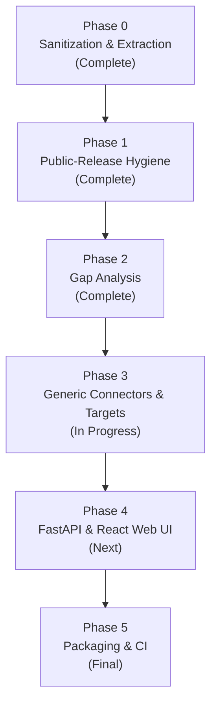

# Implementation Plan: Runport (`runport`)

**Status**: Active Platform Roadmap  
**Target**: Complete Open-Source LLM and Workflow Benchmarking Platform  
**License**: Apache 2.0  

---

## 1. Master Phase Overview

---

## 2. Phase Breakdown

### Phase 0: Baseline Sanitization & Hygiene (Complete)
- Created independent master backup at external location.
- Purged confidential student conversation exports, internal system prompts, and study code.
- Extracted generic scorers (`stats.py`), redaction (`redaction.py`), Dify connector (`dify.py`), and model candidates (`models.py`).
- Established clean Git baseline with 1 commit per file.

### Phase 1: Repository-Wide De-Branding & Public-Release Cleanup (Complete)
- Scrubbed all residual domain-specific terminology, hardcoded user paths, and admissions queries.
- Cleaned SVG assets and documentation.
- Ensured offline test pass rate is 100%.

### Phase 2: Specification Gap Analysis (Complete)
- Audited implementation against the 21 key requirements from the original BUILD PROMPT.
- Documented in `docs/GAP_ANALYSIS.md`.

### Phase 3: Generic Target Architecture & Workflow Connectors (In Progress)
- **Generic Target Protocol**: Unified `Target` and `TargetResult` models with error, retry, usage, latency, and capability handling.
- **Workflow Connectors**:
  - Generic HTTP Workflow Connector (`runport.connectors.http_workflow`)
  - Flowise Connector (`runport.connectors.flowise`)
  - Langflow Connector (`runport.connectors.langflow`)
  - n8n Connector (`runport.connectors.n8n`)
  - LangGraph Connector (`runport.connectors.langgraph`)
  - Python Target (`runport.connectors.python_target`)
- **Replay Mode**: Isolated `REPLAYED` provenance, separate store, zero provider spend booking.
- **Spend Defaults**: $5.00 total, $1.00 run, $0.05 case, with `require_priced: true`.

### Phase 4: Web Application (FastAPI + React / TypeScript / Vite)
- **FastAPI Backend**: REST endpoints for targets, datasets, runs, spend ledger, live approvals, and telemetry.
- **React Frontend**: Single-user localhost interface for visual plan builder, typed approval, real-time TUI-style monitoring, and reports.

### Phase 5: Verification, Packaging & CI
- Comprehensive test coverage for all new connectors and web endpoints.
- GitHub Actions CI workflow (multi-version Python, linting, packaging).
- Verification of CLI and package outside the repository.
