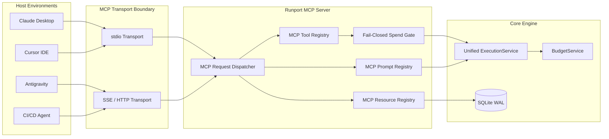
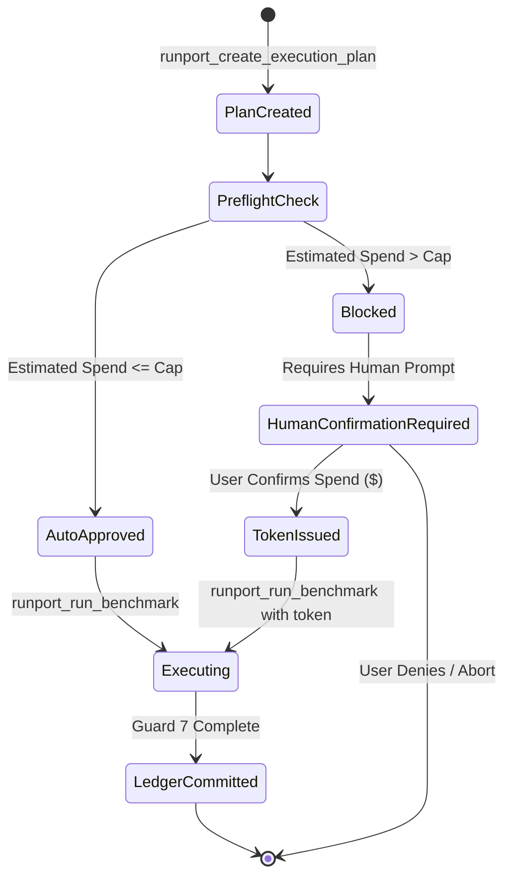

# Model Context Protocol (MCP) Server Architecture Specification

> **Status**: Approved Architectural Standard  
> **Target Release**: v0.4.0 Agent Ecosystem → v1.0.0 General Availability  
> **Document Ref**: `RUNPORT-SPEC-004`  
> **Author**: Runport Architecture & Engineering Team  

---

## 1. Executive Summary

The Model Context Protocol (MCP) is an open standard enabling AI assistants (such as Claude Desktop, Cursor, and Antigravity) to access tools, contextual resources, and prompt templates securely.

This specification details the architecture of the **Runport MCP Server** (`src/runport/mcp/`). By exposing Runport through MCP, developers and agentic workflows can evaluate candidate models, inspect execution traces, review spend ledgers, and manage evaluation datasets directly from within their IDE or assistant interface.

Critically, the Runport MCP server implements **fail-closed budget governance**: autonomous AI agents cannot unilaterally override hard spend caps or approve their own execution budgets. High-cost benchmark approvals require human-in-the-loop authorization via signed cryptographic tokens.

---

## 2. Server Architecture & Transports



### 2.1. Supported Transports
- **`stdio`**: Standard input/output transport for local desktop assistants (Claude Desktop, Cursor). Launched via `uv run runport mcp`.
- **`sse`**: Server-Sent Events over HTTP for networked agents and distributed environments. Launched via `uv run runport mcp --transport sse --port 8001`.

---

## 3. MCP Tool Specifications

### 3.1. `runport_create_execution_plan`
Generates a cryptographically bound `ExecutionPlan` and calculates worst-case spend without executing calls.

- **Parameters**:
  - `candidate_models` (`list[str]`, required): List of models or endpoints to benchmark (e.g., `["openrouter/anthropic/claude-3.5-sonnet", "ollama/llama3.2"]`).
  - `dataset_path` (`str`, required): Absolute or relative path to JSONL/CSV dataset.
  - `prompt_template` (`str`, required): Template with variable placeholders (e.g., `"Summarize: {document}"`).
  - `budget_cap_usd` (`float`, optional, default: `5.00`): Maximum allowable spend for the benchmark.
- **Returns**:
  ```json
  {
    "plan_id": "plan-7c9b",
    "fingerprint": "e3b0c44298fc1c149afbf4c8996fb92427ae41e4649b934ca495991b7852b855",
    "estimated_cost_usd": 2.45,
    "budget_cap_usd": 5.00,
    "requires_human_approval": false,
    "total_samples": 100
  }
  ```

### 3.2. `runport_run_benchmark`
Executes an approved plan through the strict 7-guard pipeline.

- **Parameters**:
  - `plan_fingerprint` (`str`, required): Deterministic SHA-256 hash of the execution plan.
  - `approval_token` (`str`, optional): Cryptographic approval token required if estimated spend exceeds the budget cap.
  - `is_replay` (`bool`, optional, default: `false`): If `true`, runs offline against cached trace observations with guaranteed \$0.00 spend.
- **Returns**:
  ```json
  {
    "run_id": "run-f48a12",
    "status": "COMPLETED",
    "duration_seconds": 18.4,
    "total_spend_usd": 2.18,
    "spend_provenance": "ACTUAL",
    "metrics": {
      "accuracy": 0.890,
      "f1_score": 0.884,
      "wilson_ci_95": [0.812, 0.942]
    }
  }
  ```

### 3.3. `runport_approve_plan`
Issues a single-use approval token authorizing spend beyond the standard cap.

- **Security Constraint**: Must verify explicit user authorization before granting approval. Agents are forbidden from approving plans without human confirmation.
- **Parameters**:
  - `plan_fingerprint` (`str`, required): Fingerprint of the plan to approve.
  - `approved_spend_limit_usd` (`float`, required): Explicit maximum USD ceiling authorized.
  - `ttl_minutes` (`int`, optional, default: `60`): Expiration window for the approval token.
- **Returns**:
  ```json
  {
    "token": "appr_982bf1...",
    "fingerprint": "e3b0c442...",
    "approved_spend_limit_usd": 15.00,
    "expires_at": "2026-11-05T22:30:00Z"
  }
  ```

### 3.4. `runport_get_budget_status`
Inspects remaining spend caps and active ledger balance.

- **Parameters**: None.
- **Returns**:
  ```json
  {
    "daily_cap_usd": 50.00,
    "daily_spent_usd": 14.82,
    "daily_remaining_usd": 35.18,
    "unresolved_spend_count": 0,
    "is_execution_blocked": false
  }
  ```

### 3.5. `runport_validate_dataset`
Validates schema compliance, checks for missing ground truth, and scans for data leakage between splits.

- **Parameters**:
  - `dataset_path` (`str`, required): Path to dataset file.
  - `split_column` (`str`, optional, default: `"split"`): Column identifying train/dev/test splits.
- **Returns**:
  ```json
  {
    "is_valid": true,
    "row_count": 500,
    "splits": {"train": 350, "dev": 75, "test": 75},
    "leakage_detected": false,
    "sha256": "4a7d...31b"
  }
  ```

---

## 4. MCP Resource Specifications

Runport exposes live execution artifacts as read-only MCP resources:

| Resource URI | Description | MIME Type |
| :--- | :--- | :--- |
| `runport://runs/{run_id}` | Full JSON execution summary, model parameters, and metrics | `application/json` |
| `runport://traces/{trace_id}` | Step-level trace tree, tool calls, and latency attribution | `application/json` |
| `runport://budget/status` | Current ledger balance, spend provenance breakdown, and caps | `application/json` |
| `runport://datasets/{name}` | Dataset metadata, schema definition, and split distribution | `application/json` |

---

## 5. MCP Prompt Specifications

Pre-configured evaluation prompt templates provided to assistants:

### 5.1. `benchmark_evaluation_review`
- **Purpose**: Directs the AI assistant to perform an architectural review of benchmark results, identifying statistically significant performance variations and cost outliers.
- **Arguments**:
  - `run_id`: The ID of the benchmark run to review.
- **Template Context**: Pulls `runport://runs/{run_id}` and `runport://budget/status` directly into prompt context.

### 5.2. `dataset_leakage_audit`
- **Purpose**: Audits evaluation datasets for n-gram overlap, exact string duplication, or contamination between DEV and TEST splits.
- **Arguments**:
  - `dataset_path`: Path to evaluation dataset.

---

## 6. Security Boundaries & Fail-Closed Governance



### Invariants for Autonomous Agent Interactions
1. **No Autonomous Self-Approval**: The MCP server strictly forbids an autonomous agent from invoking `runport_approve_plan` on an unbudgeted plan without surfacing an explicit confirmation dialog to the human user.
2. **Deterministic Fingerprint Validation**: Approval tokens cannot be applied to altered plans. If the agent changes the candidate model or dataset path, the fingerprint shifts and the token is rejected.
3. **Single-Use Durability**: Consumed approval tokens are written immediately to SQLite under a WAL transaction lock. Tokens cannot be re-used across calls.

