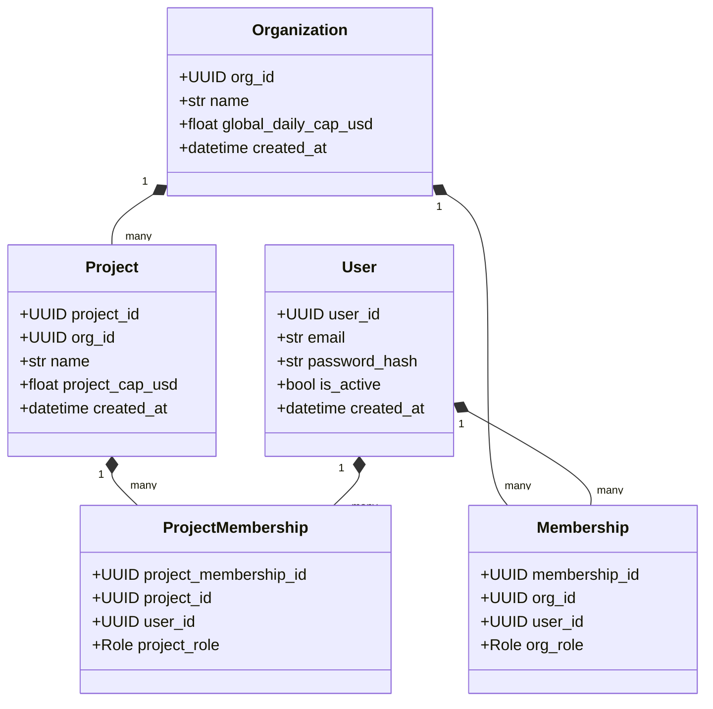

# Multi-User Security & Isolation Model Specification

> **Status**: Approved Architectural Standard  
> **Target Release**: v0.5.0 Multi-Tenant Security → v1.0.0 General Availability  
> **Document Ref**: `RUNPORT-SPEC-005`  
> **Author**: Runport Architecture & Engineering Team  

---

## 1. Executive Summary

Runport v0.1.0 operates as a **local-first, single-user system**. It binds by default to `127.0.0.1:8000`, verifies localhost origin in `local_security_middleware` (`src/runport/api/app.py`), checks a single optional bearer token (`RUNPORT_API_TOKEN`), and stores all state in a single unpartitioned SQLite database (`data/runport.db`).

Deploying Runport in a team or enterprise environment without architectural changes introduces immediate risks:
- **Zero Tenant Isolation**: Runs, traces, API keys, and datasets from all users share the same tables without foreign-key boundaries.
- **Shared Budget Cap Collisions**: One team's runaway benchmark can exhaust the entire organization's spend cap.
- **Approval Escalation**: Any user with network access can approve arbitrary spend overrides.

This specification details the **Runport Multi-User Security Model**, establishing:
1. A 3-tier organizational hierarchy (`Organization` $\to$ `Project` $\to$ `User`).
2. A database migration strategy supporting both zero-dependency SQLite and production PostgreSQL.
3. Strict Role-Based Access Control (RBAC).
4. Scoped, cryptographically hashed API keys (`rp_live_...`).
5. Concurrency controls and an append-only security audit log.

---

## 2. Tenancy Hierarchy & Isolation Architecture



### 2.1. Isolation Boundary Rules
1. **Data Isolation**: All benchmark runs, traces, execution plans, datasets, and ledger entries belong to a specific `project_id`. Cross-project queries are forbidden at the database query layer.
2. **Budget Isolation**: Spend caps are evaluated hierarchically:
   $$\text{Spend}_{\text{project}} \le \text{Cap}_{\text{project}} \quad \text{AND} \quad \sum \text{Spend}_{\text{all\_projects}} \le \text{Cap}_{\text{organization}}$$
   Exceeding a project-level cap halts runs in that project without blocking other projects in the organization.
3. **Secret Isolation**: Provider credentials (e.g., OpenRouter, OpenAI keys) configured at the project level are encrypted with AES-256-GCM using project-specific keys derived via HKDF.

---

## 3. Database Migration Strategy: SQLite & PostgreSQL

Runport maintains its **local-first ethos** while supporting production enterprise hosting through a dual-backend abstraction:

| Feature | Local-First Mode (Default) | Enterprise / Multi-User Mode |
| :--- | :--- | :--- |
| **Backend Engine** | SQLite 3 with WAL Mode | PostgreSQL 15+ |
| **Driver** | Python standard `sqlite3` | `psycopg3` / `asyncpg` |
| **Schema Isolation** | Single file (`data/runport.db`) or per-project SQLite files | Row-Level Security (RLS) + Tenant IDs |
| **Concurrency Lock** | Immediate transaction WAL lock | `SELECT ... FOR UPDATE` row locks |
| **Target Scale** | Single developer, local CI | Engineering organizations, multi-worker clusters |

### 3.1. Tenant-Partitioned SQLite Schema Migration
```sql
-- Migration: 0002_add_tenancy.sql
ALTER TABLE runs ADD COLUMN project_id TEXT NOT NULL DEFAULT 'proj_default';
ALTER TABLE spend_ledger ADD COLUMN project_id TEXT NOT NULL DEFAULT 'proj_default';
ALTER TABLE plan_approvals ADD COLUMN project_id TEXT NOT NULL DEFAULT 'proj_default';
ALTER TABLE datasets ADD COLUMN project_id TEXT NOT NULL DEFAULT 'proj_default';

CREATE INDEX IF NOT EXISTS idx_runs_project ON runs (project_id, created_at DESC);
CREATE INDEX IF NOT EXISTS idx_ledger_project ON spend_ledger (project_id, timestamp DESC);
```

---

## 4. Role-Based Access Control (RBAC)

Runport defines five granular roles across Organizations and Projects:

| Role | Scope | Description |
| :--- | :--- | :--- |
| **`Owner`** | Organization | Full administrative control, billing, project creation, member management. |
| **`Admin`** | Project | Project settings, budget policy configuration, API key issuance. |
| **`Approver`** | Project | Authorized to review execution plans and sign spend override tokens. |
| **`Runner`** | Project | Authorized to execute approved benchmark plans, upload datasets, and view results. |
| **`Viewer`** | Project | Read-only access to benchmark metrics, traces, and spend dashboards. |

### 4.1. Granular Permission Matrix

| Permission | Owner | Admin | Approver | Runner | Viewer |
| :--- | :---: | :---: | :---: | :---: | :---: |
| `benchmarks:read` | Yes | Yes | Yes | Yes | Yes |
| `traces:read` | Yes | Yes | Yes | Yes | Yes |
| `datasets:upload` | Yes | Yes | Yes | Yes | No |
| `runs:execute` | Yes | Yes | Yes | Yes | No |
| `runs:cancel` | Yes | Yes | Yes | Yes | No |
| `budget:approve` | Yes | Yes | Yes | No | No |
| `budget:reconcile` | Yes | Yes | Yes | No | No |
| `policy:update` | Yes | Yes | No | No | No |
| `keys:create` | Yes | Yes | No | No | No |
| `members:manage` | Yes | Yes | No | No | No |

---

## 5. Scoped API Key Architecture

### 5.1. Key Format & Generation
Runport API keys follow a standardized, high-entropy structure:
$$\text{Prefix} + \text{Environment} + \text{Base62 Encoded Secret}$$
- **Live Key**: `rp_live_8f3a9e2c1b7d4e5f6a0b1c2d3e4f5a6b7c8d9e0f`
- **Test Key**: `rp_test_1a2b3c4d5e6f7a8b9c0d1e2f3a4b5c6d7e8f9a0b`

### 5.2. Cryptographic Storage & Verification
1. **Never Store Plaintext**: Only the SHA-256 hash or Argon2id digest of the key is stored in the database.
2. **Display Once**: The plaintext key is surfaced to the user exactly once upon creation.
3. **Database Schema**:
```sql
CREATE TABLE IF NOT EXISTS api_keys (
    key_id TEXT PRIMARY KEY,
    project_id TEXT NOT NULL,
    user_id TEXT NOT NULL,
    key_prefix TEXT NOT NULL,         -- e.g. "rp_live_8f3a..." (for identification)
    hashed_secret TEXT NOT NULL,       -- SHA-256 hex digest
    name TEXT NOT NULL,
    scopes TEXT NOT NULL,              -- JSON array of granted scopes
    expires_at TEXT,
    last_used_at TEXT,
    is_revoked INTEGER NOT NULL DEFAULT 0,
    created_at TEXT NOT NULL,
    FOREIGN KEY (project_id) REFERENCES projects (project_id)
);

CREATE INDEX IF NOT EXISTS idx_api_keys_hash ON api_keys (hashed_secret);
```

---

## 6. Append-Only Security Audit Log

Every security-sensitive event—including plan approvals, spend cap alterations, key creations, and unauthorized access attempts—is written to an append-only audit table.

### 6.1. Audit Event Schema
```sql
CREATE TABLE IF NOT EXISTS security_audit_log (
    event_id TEXT PRIMARY KEY,
    project_id TEXT,
    actor_id TEXT NOT NULL,
    actor_ip TEXT NOT NULL,
    user_agent TEXT,
    action TEXT NOT NULL,             -- e.g., "plan.approved", "cap.updated"
    resource_type TEXT NOT NULL,      -- e.g., "ExecutionPlan", "BudgetPolicy"
    resource_id TEXT NOT NULL,
    status TEXT NOT NULL CHECK (status IN ('SUCCESS', 'DENIED', 'ERROR')),
    metadata JSON NOT NULL,
    created_at TEXT NOT NULL
);

CREATE INDEX IF NOT EXISTS idx_audit_created ON security_audit_log (created_at DESC);
```

### 6.2. Immutability Guarantee
Audit records can never be updated or deleted through the application layer. Database triggers or WAL replica archiving prevent tampering even by administrative users.

