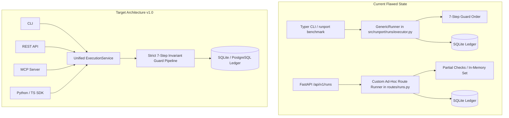

# Runport Roadmap Implementation Audit

> **Status**: Comprehensive Engineering Audit  
> **Release Target**: v0.1.0 Baseline → v1.0.0 Universal Platform  
> **Repository**: `Sudharsanselvaraj/runport`  
> **Audit Date**: November 2026  
> **Author**: Runport Architecture & Engineering Team  

---

## 1. Executive Summary

Runport v0.1.0 delivers a robust, local-first foundation for benchmarking raw LLMs, prompt variations, and black-box workflow HTTP endpoints under hard spend caps. Core mechanisms—such as the append-only SQLite WAL ledger (`src/runport/storage/db.py`), statistical scoring with Wilson score intervals and Cohen's kappa (`src/runport/scorers/`), the interactive Rich TUI (`src/runport/tui/`), and local web dashboard (`web/` + `src/runport/api/`)—are operational and backed by 389 passing unit and contract tests.

However, a technical audit reveals a significant delta between the marketing vision of a **universal AI workflow benchmarking platform** and the v0.1.0 codebase. Several key capabilities highlighted on the roadmap or public documentation are either unstarted, partially implemented, or restricted to experimental HTTP wrappers. Furthermore, two critical architectural vulnerabilities exist in the core execution path:
1. **Dual Execution Engines**: CLI commands invoke `src/runport/runs/executor.py` (`GenericRunner`), whereas the REST API implements an independent, duplicate execution and approval flow in `src/runport/api/routes/runs.py`.
2. **Volatile Approval Tokens**: Execution plan approvals in the REST API use an in-memory Python `set` (`_CONSUMED_APPROVAL_TOKENS`), which is lost on server restart and vulnerable to concurrency bypasses across multi-worker deployments.

This audit provides a feature-by-feature classification of the 9 missing roadmap capabilities, documents existing code anchors, highlights architectural risks, and outlines precise completion criteria required for v1.0.0 General Availability.

---

## 2. Classification Schema

Each roadmap capability is categorized under one of five strict statuses:

| Classification | Definition |
| :--- | :--- |
| **`IMPLEMENTED`** | Production-ready, fully covered by automated tests, compliant with all architectural invariants. |
| **`PARTIALLY IMPLEMENTED`** | Core data structures or basic functionality exist, but essential capabilities (e.g., scoring, export, step breakdown) are incomplete. |
| **`EXPERIMENTAL`** | Functional prototype exists, but relies on shallow abstractions (e.g., black-box HTTP POST) without granular instrumentation or stability guarantees. |
| **`NOT IMPLEMENTED`** | Zero code footprint exists in the repository. Design and specifications required. |
| **`BLOCKED BY ARCHITECTURE`** | Cannot be implemented safely without fundamental database schema migration, multi-process concurrency refactoring, or security model overhaul. |

---

## 3. Feature-by-Feature Roadmap Audit

### 3.1. Complete MCP Client & Server Ecosystem

- **Classification**: `NOT IMPLEMENTED`
- **Existing Code Footprint**:
  - `src/runport/`: Zero files related to Model Context Protocol (MCP).
  - Dependencies: `pyproject.toml` contains no MCP SDK or FastMCP dependency.
- **Working Features**:
  - None.
- **Missing Pieces**:
  - MCP stdio and SSE transport server exposing Runport tools, resources, and prompts.
  - MCP tool definitions (`runport_run_benchmark`, `runport_create_execution_plan`, `runport_approve_plan`, `runport_validate_dataset`, `runport_get_budget_status`).
  - MCP resource providers (`runport://runs/{run_id}`, `runport://traces/{trace_id}`, `runport://budget/status`).
  - MCP prompt templates (`benchmark_evaluation_review`, `dataset_leakage_audit`).
  - Fail-closed security boundary preventing autonomous agent privilege escalation.
- **Existing Tests**: None.
- **Security & Reliability Risks**:
  - An MCP server executing arbitrary benchmarks could trigger unbudgeted financial spend if budget preflight and human-in-the-loop approval checks are bypassed.
- **Dependencies**: Unified Execution Service (`src/runport/runs/service.py`), Durable Approval Token Store.
- **Completion Criteria**:
  1. FastMCP server implemented in `src/runport/mcp/server.py` supporting stdio and SSE transports.
  2. Tools, resources, and prompts registered with full JSON Schema validation.
  3. Preflight budget verification enforced on all MCP execution tools.
  4. Comprehensive integration tests in `tests/test_mcp.py` verifying tool invocation, resource retrieval, and fail-closed spend boundaries.

---

### 3.2. Public Python SDK

- **Classification**: `NOT IMPLEMENTED`
- **Existing Code Footprint**:
  - `pyproject.toml`: Configured solely as a CLI application with entrypoint `runport = "runport.cli:app"`.
  - `src/runport/__init__.py`: Minimal package initialization without top-level client exports.
- **Working Features**:
  - Internal Python targets can be invoked via `PythonTarget` (`src/runport/targets/python.py`), but this is an execution target, not a client SDK.
- **Missing Pieces**:
  - Public client class (`runport.Client` and `runport.AsyncClient`).
  - High-level API modules: `client.benchmarks`, `client.datasets`, `client.runs`, `client.traces`, `client.budget`.
  - HTTP client transport with connection pooling, retries, and typed Pydantic models.
  - PyPI package packaging and documentation.
- **Existing Tests**: None for public SDK client workflows.
- **Security & Reliability Risks**:
  - Developers currently import internal modules (`from runport.core.budget import BudgetService`), coupling external code to private implementation details subject to breaking changes.
- **Dependencies**: REST API stabilization, Scoped API Key Authentication.
- **Completion Criteria**:
  1. `runport.client.Client` and `runport.client.AsyncClient` implemented with full typing.
  2. Fluent API supporting dataset upload, plan generation, approval, execution polling, and trace retrieval.
  3. Custom exception hierarchy (`RunportError`, `BudgetExceededError`, `ApprovalRequiredError`).
  4. Contract test suite in `tests/test_sdk_python.py` verifying offline client behavior against mock endpoints.

---

### 3.3. Public TypeScript SDK

- **Classification**: `NOT IMPLEMENTED`
- **Existing Code Footprint**:
  - `web/src/api/client.ts`: Internal Axios/fetch wrapper dedicated to the React web UI.
- **Working Features**:
  - Internal web dashboard queries REST endpoints for runs, ledger status, and trace lists.
- **Missing Pieces**:
  - Standalone `@runport/sdk` npm package.
  - Universal client compatible with Node.js 18+, Bun, Deno, and modern browser runtimes.
  - TypeScript definitions matching the OpenAPI specification.
  - Streaming event subscription for live benchmark logs.
- **Existing Tests**: Web dashboard component tests only (`web/src/__tests__/`).
- **Security & Reliability Risks**:
  - Frontend currently assumes a single-tenant local environment (`http://127.0.0.1:8000`), lacking token refresh or tenant header propagation.
- **Dependencies**: REST API OpenAPI export, Unified Execution Service.
- **Completion Criteria**:
  1. Monorepo package `packages/sdk-ts` created with Vite/tsup build configuration.
  2. Full coverage of Runport REST API with isomorphic fetch.
  3. Automated type generation from FastAPI OpenAPI schema (`uv run python -m runport.api.export_openapi`).
  4. Integration tests in `packages/sdk-ts/tests/` verifying Node and browser execution.

---

### 3.4. Native LangGraph Per-Step Tracing

- **Classification**: `EXPERIMENTAL`
- **Existing Code Footprint**:
  - `src/runport/connectors/langgraph.py` (Lines 1–48): Implements `LangGraphConnector`, subclassing `HttpWorkflowConnector`.
- **Working Features**:
  - Issues HTTP POST request to LangGraph Cloud or custom server endpoint (`/runs/wait`).
  - Extracts final response text from `messages[-1].content` or `output.messages[-1].content`.
- **Missing Pieces**:
  - Per-node execution timing, token consumption, and state delta capture.
  - Step-by-step state snapshot inspection.
  - Tool invocation capture inside graph nodes.
  - Native LangGraph callback handler or AST-based graph listener.
- **Existing Tests**:
  - `tests/test_connectors.py` (Lines 210–255): Verifies HTTP POST mocking and payload formatting.
- **Security & Reliability Risks**:
  - If a multi-agent LangGraph workflow loops indefinitely or fails at step 5 of 6, Runport reports total latency and cost as a single opaque block or books `UNRESOLVED` without step-level diagnosis.
- **Dependencies**: Canonical Trace Schema (`AgentTrajectory`, `AgentStep`), Unified Execution Service.
- **Completion Criteria**:
  1. Implementation of `RunportLangGraphCallbackHandler` streaming node events to Runport EventTail.
  2. Ingestion of state transitions, tool calls, and node-level token spend.
  3. Diagnostic analysis distinguishing agent routing errors from tool failures.

---

### 3.5. Universal Agent Trajectory Evaluation

- **Classification**: `PARTIALLY IMPLEMENTED`
- **Existing Code Footprint**:
  - `src/runport/traces/models.py`: Defines `ObservationSpan`, `TraceRecord`, and `TraceAnalysis`.
  - `src/runport/traces/importer.py`: Parses trace JSON records.
  - `src/runport/traces/analyzer.py`: Detects RAG retrieval failures and latency anomalies.
- **Working Features**:
  - Trace span representation, parent-child span trees, and basic failure classification (e.g., empty retrieval context, high latency).
- **Missing Pieces**:
  - Multi-turn trajectory scoring (Goal Completion, Plan Adherence, Redundant Tool Call Index).
  - Tool-selection precision, recall, and argument schema validation.
  - Supervised ground-truth trajectory alignment against gold paths.
  - Evaluation of looping or cyclic agent behavior.
- **Existing Tests**:
  - `tests/test_traces.py`: 7 tests covering span parsing, "Null is not 0" enforcement, and basic analyzer diagnostics.
- **Security & Reliability Risks**:
  - Misleading benchmark results if an agent arrives at a correct final answer via hallucinated or forbidden intermediate actions.
- **Dependencies**: Canonical Trace Schema, Supervised Metric Framework.
- **Completion Criteria**:
  1. Definition of trajectory scorers in `src/runport/scorers/trajectory.py`: `ToolSelectionF1`, `PlanAdherenceScore`, `RedundancyRatio`.
  2. Alignment checks against human-approved gold trajectories.
  3. Integration into `src/runport/runs/executor.py` for automated evaluation.

---

### 3.6. OpenTelemetry (OTel) Ingestion

- **Classification**: `NOT IMPLEMENTED`
- **Existing Code Footprint**:
  - `src/runport/observability/`: Contains `EventTail` and trace export utilities (`export.py`).
  - No OTLP HTTP/gRPC receiver or OpenInference span converter.
- **Working Features**:
  - None for ingestion. Runport currently emits custom event dictionaries (`TraceEvent`).
- **Missing Pieces**:
  - FastAPI endpoint `/api/v1/traces/otlp/v1/traces` accepting standard OTLP JSON and Protobuf payloads.
  - Semantic mapping from OpenInference conventions (`openinference.span.kind`, `llm.input_messages`, `llm.output_messages`, `tool.name`) to `ObservationSpan`.
  - Background asynchronous batch processor for high-throughput span ingestion.
- **Existing Tests**: None.
- **Security & Reliability Risks**:
  - Unauthenticated or unbounded OTLP ingestion could overwhelm the SQLite database or cause disk exhaustion.
- **Dependencies**: Canonical Trace Schema, Multi-User Security Model (rate limits, project keys).
- **Completion Criteria**:
  1. OTLP trace ingestion endpoint active at `/api/v1/traces/otlp`.
  2. Bidirectional translation between OpenInference span attributes and Runport `TraceRecord`.
  3. End-to-end integration test with OpenTelemetry Python SDK emitting spans into Runport.

---

### 3.7. Langfuse Export

- **Classification**: `PARTIALLY IMPLEMENTED`
- **Existing Code Footprint**:
  - `src/runport/traces/importer.py` (Lines 80–135): Implements `import_langfuse_traces()`, parsing Langfuse JSON export format into Runport `TraceRecord` objects.
  - `src/runport/observability/export.py`: Exports traces only in Runport's internal `trace-export-v1` format (JSONL, CSV, ZIP).
- **Working Features**:
  - One-way import from Langfuse JSON files into Runport trace models.
- **Missing Pieces**:
  - Reverse export from Runport `TraceRecord` to Langfuse API v2 / JSON export format.
  - Direct push to a remote Langfuse instance via public/secret API keys.
  - CLI command: `runport traces export --format langfuse`.
- **Existing Tests**:
  - `tests/test_traces.py`: Verifies Langfuse trace import parsing.
- **Security & Reliability Risks**:
  - Secret leakage: Provider API keys or user secrets must be scrubbed before external export.
- **Dependencies**: Canonical Trace Schema, Secret Redactor (`src/runport/datasets/sanitizer.py`).
- **Completion Criteria**:
  1. `export_langfuse_traces()` implemented in `src/runport/observability/export.py`.
  2. Full adherence to Langfuse ingestion format (traces, observations, scores).
  3. Unit test verifying round-trip fidelity: `Runport Trace` → `Langfuse JSON` → `Runport Trace`.

---

### 3.8. Production-Ready Multi-User Hosting

- **Classification**: `NOT IMPLEMENTED (BLOCKED BY ARCHITECTURE)`
- **Existing Code Footprint**:
  - `src/runport/storage/db.py`: Implements single-tenant SQLite WAL database (`DatabaseManager`).
  - `src/runport/api/app.py`: Implements `local_security_middleware` checking a single static environment variable `RUNPORT_API_TOKEN`.
- **Working Features**:
  - Local single-user protection against remote requests via localhost verification and bearer token check.
- **Missing Pieces**:
  - Multi-tenant data model (`tenants`, `organizations`, `projects`, `users`, `memberships`).
  - Role-Based Access Control (RBAC): `Owner`, `Admin`, `Approver`, `Runner`, `Viewer`.
  - Scoped API key management with granular permissions and expiration.
  - Tenant-isolated budget caps and ledger partitions.
  - Support for multi-user database engines (PostgreSQL / SQLite schema isolation).
- **Existing Tests**:
  - `tests/test_api_security.py`: Tests single static token middleware and localhost blocking.
- **Security & Reliability Risks**:
  - Multi-tenant deployment in the current state results in immediate cross-tenant data leakage, budget cap collisions, and approval hijacking.
- **Dependencies**: Database Schema Migration, Multi-User Security Model.
- **Completion Criteria**:
  1. Multi-tenant schema migration scripts supporting PostgreSQL and SQLite.
  2. Full RBAC enforcement across all REST routes and execution services.
  3. Scoped API keys with SHA-256 / Argon2id hashing and last-used tracking.
  4. Security test suite in `tests/test_multi_user_rbac.py` verifying zero cross-tenant access.

---

### 3.9. Universal Framework Instrumentation

- **Classification**: `EXPERIMENTAL`
- **Existing Code Footprint**:
  - `src/runport/connectors/`: Contains adapters for `dify.py`, `flowise.py`, `langflow.py`, `n8n.py`, `langgraph.py`, `http.py`, and `python.py`.
- **Working Features**:
  - Unified HTTP request dispatching, configurable response path JSON pointers (e.g., `data.outputs.text`), and basic status code handling.
- **Missing Pieces**:
  - Deep in-process instrumentation (LangChain callbacks, LlamaIndex handlers, AutoGen hooks, CrewAI listeners).
  - Fine-grained intermediate step telemetry (reasoning chains, tool calls, vector retrieval stats).
  - Standardized webhook listener for asynchronous event streaming from n8n / Flowise / Dify.
- **Existing Tests**:
  - `tests/test_connectors.py`: Contract tests verifying HTTP request payload structures and mock response parsing.
- **Security & Reliability Risks**:
  - Failure to capture intermediate spend: External workflows executing multi-agent loops can accumulate massive third-party API spend while Runport only sees a single HTTP request.
- **Dependencies**: Canonical Trace Schema, Universal Execution Architecture.
- **Completion Criteria**:
  1. Official callback integrations for LangChain / LlamaIndex / CrewAI published under `src/runport/integrations/`.
  2. Async webhook listener receiving step events from workflow orchestrators.
  3. Per-step latency, token, and cost breakdown rendered in Web UI and TUI.

---

## 4. Critical Architectural Findings & Vulnerabilities

### 4.1. Dual Execution Engines Vulnerability



#### Code Evidence:
- **CLI Path**: `src/runport/cli.py` invokes `GenericRunner.run_plan()` (`src/runport/runs/executor.py`, Line 158). This runner enforces:
  1. Authorization
  2. Privacy Gate (Sanitizer)
  3. Preflight Budget Check (`BudgetService.check_preflight_budget`)
  4. Transport Execution
  5. Strict Validation
  6. Persistence
  7. Spend Booking
- **REST API Path**: `src/runport/api/routes/runs.py` (Lines 180–310) implements an independent execution loop:
  - Generates its own plan fingerprint.
  - Re-implements cost estimation logic.
  - Manages approval verification independently.
  - Bypasses portions of `GenericRunner` error-handling invariants.

#### Critical Risk:
A bug fix, spend cap enforcement rule, or safety invariant applied to `executor.py` does not automatically protect users executing runs via the Web UI or REST API, leading to inconsistent ledger accounting and potential budget overruns.

---

### 4.2. Volatile Approval Tokens Vulnerability

#### Code Evidence:
In `src/runport/api/routes/runs.py`:
```python
# Lines 38-42
_CONSUMED_APPROVAL_TOKENS: set[str] = set()
```
When an execution plan exceeds the hard budget cap, the API requires a signed approval token. Upon approval, the token is added to `_CONSUMED_APPROVAL_TOKENS`.

#### Critical Risks:
1. **Server Restart Reset**: If the FastAPI server restarts or auto-reloads, `_CONSUMED_APPROVAL_TOKENS` is wiped clean, potentially permitting replay of previously consumed approval tokens.
2. **Multi-Worker Concurrency Bypass**: If Runport is deployed with multiple Uvicorn workers (`--workers 4`) or behind a reverse proxy, worker processes do not share memory. A token consumed in Worker A can be re-used in Worker B, bypassing the spend cap.
3. **Audit Impossibility**: Consumed tokens are not written to the SQLite ledger, preventing post-incident forensic audits.

---

### 4.3. Single-Tenant Database Schema Bottleneck

#### Code Evidence:
In `src/runport/storage/db.py`, the SQLite schema defines:
```sql
CREATE TABLE IF NOT EXISTS runs (
    run_id TEXT PRIMARY KEY,
    name TEXT NOT NULL,
    benchmark_type TEXT NOT NULL,
    status TEXT NOT NULL,
    created_at TEXT NOT NULL,
    completed_at TEXT
);
```
None of the core tables (`runs`, `spend_ledger`, `approvals`, `traces`, `datasets`) contain:
- `tenant_id`
- `org_id`
- `created_by_user_id`

#### Architectural Consequence:
Implementing multi-user hosting without a formal database migration path will result in complete data coupling and security boundary failure.

---

## 5. Architectural Gap Analysis Matrix

| Roadmap Capability | v0.1.0 Status | Target Module Path | Primary Blocker |
| :--- | :--- | :--- | :--- |
| **MCP Ecosystem** | `NOT IMPLEMENTED` | `src/runport/mcp/` | Lack of unified execution service |
| **Python SDK** | `NOT IMPLEMENTED` | `src/runport/client/` | Dual execution path & API churn |
| **TypeScript SDK** | `NOT IMPLEMENTED` | `packages/sdk-ts/` | Dual execution path & missing OpenAPI build |
| **LangGraph Per-Step** | `EXPERIMENTAL` | `src/runport/connectors/langgraph.py` | Missing canonical step trace schema |
| **Agent Trajectory Scoring**| `PARTIALLY IMPLEMENTED`| `src/runport/scorers/trajectory.py` | Missing multi-turn trajectory models |
| **OpenTelemetry Ingestion** | `NOT IMPLEMENTED` | `src/runport/observability/otlp.py` | Missing OTLP endpoint & mapping logic |
| **Langfuse Export** | `PARTIALLY IMPLEMENTED`| `src/runport/observability/export.py` | One-way importer only; needs reverse exporter |
| **Multi-User Hosting** | `BLOCKED BY ARCHITECTURE`| `src/runport/auth/` & `storage/db.py` | Single-tenant SQLite schema without tenancy |
| **Framework Instrumentation**| `EXPERIMENTAL` | `src/runport/integrations/` | Connectors only wrap outer HTTP POST endpoints |

---

## 6. Prioritized Remediation Roadmap

To achieve a production-grade v1.0.0 release, development must proceed in strict dependency order:

1. **Phase 1: Universal Execution Consolidation (P0)**
   - Create `src/runport/runs/service.py` (`ExecutionService`).
   - Deprecate duplicate execution loop in `src/runport/api/routes/runs.py`.
   - Migrate approval tokens to SQLite table `plan_approvals` with cryptographic signatures, expiration, and atomic single-use status.
2. **Phase 2: Canonical Trace Schema & OpenTelemetry (P1)**
   - Formalize `AgentTrajectory`, `AgentStep`, and `ToolCallRecord` models.
   - Implement OpenInference / OTel ingestion and Langfuse v2 export.
3. **Phase 3: Public SDKs & MCP Server (P1)**
   - Implement `runport.Client` and `runport.AsyncClient`.
   - Implement FastMCP server for Claude Desktop / Cursor / Antigravity integration.
   - Publish `@runport/sdk` TypeScript package.
4. **Phase 4: Deep Framework Callbacks & Trajectory Scoring (P2)**
   - Implement LangGraph per-step callback handler.
   - Introduce trajectory scorers: `ToolSelectionF1`, `PlanAdherenceScore`.
5. **Phase 5: Multi-Tenant Security & RBAC (P2)**
   - Database schema migration adding tenancy columns.
   - Role-Based Access Control and scoped API keys (`rp_live_...`).
   - Append-only security audit log.

