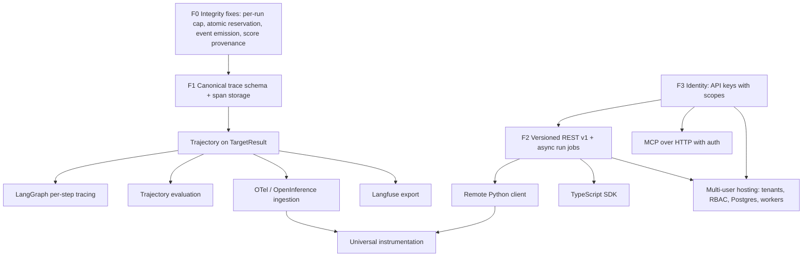

# Roadmap Implementation Audit

**Audited tree:** `main` at `b735afc` (2026-11-06), after PRs #13 (unified execution, MCP, SDK, dashboard), #14 (integrity
hardening) and #15 (cross-platform CI). Section 1 also covers branch `claude/ci-green`, which fixes the last red CI jobs.
**Scope:** the nine capabilities missing from the v0.1.0 announcement, plus the foundations they depend on.

This document separates **evidence** (what the code does, with file paths) from **recommendations** (what to build). Every
"verified" statement was checked against the code or by running a command. Earlier versions of this file are corrected in
section 7; the fixes made since the first version are listed in section 9.

---

## 1. Verified baseline

### 1.1 GitHub Actions on `main` at `b735afc` (CI run for the PR #15 merge)

| Job | Result | Cause |
|:---|:---|:---|
| Lint & Code Style, Type Check (mypy) | pass | — |
| Test, ubuntu, Python 3.11 / 3.12 / 3.13 | pass | — |
| Test, windows, Python 3.11 / 3.12 / 3.13 | pass | — |
| Test, macos, Python 3.11 / 3.12 | pass | — |
| Test, macos, Python 3.13 | **fail** | `tests/test_launcher_pty.py`: a quit key sent while the terminal switched modes was discarded; the launcher was killed (`-9`). |
| Web Build & Wheel Smoke Test | **fail** | `runport api-preflight` exits 1 without `OPENROUTER_API_KEY` (by design); the smoke step treated that as an error. |
| Security & Legacy Scans | **fail** | Gitleaks passes; the Legacy Pattern Scan matched the generic words `lead` and `intent` in ordinary prose. |

### 1.2 Branch `claude/ci-green` (fixes for the three failures above; not yet run on GitHub Actions)

| Check (run locally, macOS, Python 3.12) | Result |
|:---|:---|
| `uv run pytest -q` | **465 passed** |
| `uv run pytest -q examples/plugins` | 26 passed, 5 skipped |
| `uv run ruff check .`, `uv run ruff format --check .` | pass |
| `uv run mypy` | no issues in 56 files |
| `npm test` (web) | 18 passed |
| `gitleaks git` (full history) | no leaks |
| Legacy Pattern Scan (same command as CI) | clean |
| Launcher PTY tests, 3 concurrent runs under 4 CPU-bound processes | 5/5 each |
| Wheel built, installed with the CI command, smoke steps run | pass |

### 1.3 Scope limits of these checks

- mypy does **not** cover `api/`, `cli/`, `tui/`, `observability/`, `evaluation/replay_scoring.py` or `classification/threshold.py`; the
  last two have about 20 known type errors.
- `git tag` and `git ls-remote --tags origin` show **no tags**. `pyproject.toml` still says `0.1.0` and the README says Alpha.
  The release workflow (`.github/workflows/release.yml`, PyPI on `v*` tags) has never run, so nothing merged is a published release.

---

## 2. Capability classification

| # | Capability | Status | One-line reason |
|:---|:---|:---|:---|
| 1 | MCP client and server ecosystem | **PARTIALLY IMPLEMENTED** | Client (tools, stdio + Streamable HTTP) and server (stdio, 11 tools, resources, prompts) exist and are tested with the official MCP SDK; no server HTTP transport, no resources/prompts in the client, no MCP auth. |
| 2 | Public Python SDK | **PARTIALLY IMPLEMENTED** | `runport.sdk` works in-process with the shared guards; there is no remote client, no stable versioned contract and no published package. |
| 3 | Public TypeScript SDK | **NOT IMPLEMENTED** | No package. The REST API it would wrap is unversioned and synchronous. |
| 4 | Native LangGraph per-step tracing | **NOT IMPLEMENTED** | `connectors/langgraph.py` is a one-shot HTTP POST to `/runs/wait`. |
| 5 | Universal agent trajectory evaluation | **BLOCKED BY ARCHITECTURE** | There is no span/trajectory field on `TargetResult` and no trace table. |
| 6 | OpenTelemetry ingestion | **NOT IMPLEMENTED** | No OTLP endpoint, no OTel/OpenInference parsing, no dependency. |
| 7 | Langfuse export | **NOT IMPLEMENTED** | Only a Langfuse-*shaped* JSON/CSV importer exists. |
| 8 | Production multi-user hosting | **BLOCKED BY ARCHITECTURE** | One shared token, no users or tenants, SQLite file per workspace, synchronous runs inside HTTP requests. |
| 9 | Universal framework instrumentation | **NOT IMPLEMENTED** | No instrumentation API; frameworks are reached only as black-box HTTP or Python callables. |

### 2.1 MCP ecosystem: PARTIALLY IMPLEMENTED

**Evidence**
- Client: `src/runport/connectors/mcp.py`, `McpToolTarget`, `McpSession`, `StdioTransport`, `StreamableHttpTransport`,
  `validate_json_schema`. Implements `initialize` with version negotiation (`2025-06-18`, `2025-03-26`, `2024-11-05`), paginated
  `tools/list`, `tools/call`, cancellation on timeout, session teardown, secret redaction (header values and credential-named env vars).
  Cost is never $0 for a billable HTTP server: billing mode is `local` for stdio, `billable` for non-loopback URLs.
- Server: `src/runport/mcp_server/server.py`, `RunportMcpServer`; CLI `runport mcp serve` (`cli/commands/plans.py`). Tools:
  `list_connectors`, `list_models`, `list_targets`, `list_datasets`, `validate_target`, `create_benchmark_plan`,
  `request_benchmark_approval`, `get_plan_status`, `execute_approved_benchmark`, `get_run`, `get_evaluation_results`, `compare_runs`.
  Resources `runport://{connectors,models,targets,datasets,runs,budget}` and template `runport://runs/{run_id}`. Prompts
  `benchmark_target`, `investigate_failed_cases`, `compare_candidates`.
- Execution goes through `ExecutionService.execute_by_ids` → `GenericRunner`. No approve tool exists; `ApprovalStore.approve`
  rejects any channel outside `cli_interactive`, `web_ui`, `ci_token`, `local_only` (`services/approvals.py`).
- Tests: `tests/test_mcp_connector.py` (16, offline fixture server `tests/fixtures/mcp_fixture_server.py`), `tests/test_mcp_server.py`
  (2 end-to-end flows over real stdio: the official `mcp` 2.3.0 `ClientSession` and Runport's own client).

**Missing**
- Server over Streamable HTTP (needed for remote agents), and its authentication.
- Client support for `resources/*`, `prompts/*`, sampling, OAuth discovery; MCP sessions are not recorded as trace spans.
- Protocol `2025-11-25` / `2026-07-28` (the SDK's newest) are not spoken; the server answers `2025-06-18`, which the SDK accepts.
- Per-tool authorization: anyone who can start the stdio server can call every tool (acceptable for a local process, not for HTTP).

**Completion criteria:** Streamable HTTP server with token or OAuth auth and per-tool scopes; MCP calls emitted as spans; client
resources/prompts; protocol-version matrix test against the official SDK.

### 2.2 Public Python SDK: PARTIALLY IMPLEMENTED

**Evidence:** `src/runport/sdk.py` (`plan`, `approve_interactively`, `approve_with_ci_token`, `execute`, `benchmark`), re-exported
lazily from `runport/__init__.py`. All calls use `ExecutionService`. A plain function can be benchmarked unchanged; local-only
plans auto-approve via the `local_only` channel, verified in `ApprovalStore.approve`. Tests: `tests/test_sdk.py` (4).

**Missing:** a remote client for a shared Runport server, typed public result models (it returns internal `ExecutionOutcome` /
`GenericRunResult` dataclasses), datasets/runs/traces read APIs, async support, semantic-versioning guarantees, docs reference.
**Risk:** the return types are internal and will change when traces are added (section 2.5).

### 2.3 TypeScript SDK: NOT IMPLEMENTED

**Evidence:** none in `web/` or elsewhere; `web/` is the dashboard. The REST API (`src/runport/api/routes/`) is unversioned
(`/api/...`), returns untyped `Dict[str, Any]` from most routes, and runs live benchmarks synchronously inside `POST /api/runs`.
**Depends on:** versioned REST contract (`docs/SDK_API_CONTRACT.md`), async run jobs, API keys.

### 2.4 Native LangGraph per-step tracing: NOT IMPLEMENTED

**Evidence:** `src/runport/connectors/langgraph.py` subclasses `HttpWorkflowConnector`, posts to `/runs/wait`, reads
`messages.-1.content`. The capability registry (`connectors/registry.py`, `CONNECTOR_MATRIX`) correctly lists per-step trace as "no".
**Depends on:** canonical trace schema and storage (2.5), streaming transport.

### 2.5 Universal agent trajectory evaluation: BLOCKED BY ARCHITECTURE

**Evidence:**
- `TargetResult` (`targets/base.py`) has `metadata: Dict` only. Dify node data lands in `metadata["per_node_data"]`; MCP tool
  details in `metadata`; RAG retrieval in `metadata["retrieval"]`. Nothing is typed or persisted as spans.
- Storage (`storage/db.py`) has `evaluation_runs`, `evaluation_results`, `budget_ledger`, `model_portfolio`, `plan_approvals`,
  `schema_migrations`. No trace or span table.
- `traces/models.py` (`TraceRecord`, `ObservationSpan`) is an import model for diagnosis, not linked to runs.
- Scorers (`scorers/`, `evaluation/evaluator.py`) score a single output string.

**Blocker:** a canonical trace schema and persistence (`docs/CANONICAL_TRACE_SCHEMA.md`) must exist before any trajectory scorer.

### 2.6 OpenTelemetry ingestion: NOT IMPLEMENTED

**Evidence:** no `opentelemetry`/`otlp`/`openinference` reference in `src/`, `tests/` or `pyproject.toml`. **Depends on:** trace schema,
an ingestion endpoint with auth, size limits and redaction.

### 2.7 Langfuse export: NOT IMPLEMENTED

**Evidence:** `traces/importer.py` reads Langfuse-style JSON/CSV (`latency` in seconds, `usage`, `observations`).
`observability/export.py` exports Runport's own sanitized JSONL/CSV/ZIP bundle, not the Langfuse ingestion API format.
**Depends on:** trace schema; then a mapper to the Langfuse public ingestion API.

### 2.8 Production multi-user hosting: BLOCKED BY ARCHITECTURE

**Evidence:**
- Auth (`api/app.py`, `_access_policy_middleware`): no token → loopback only with Host check; token set → one shared token for all
  callers. No users, roles, organizations or projects.
- Any API caller can approve plans (`POST /api/runs/approve`, channel `web_ui`); the approver name is free text.
- Workspace = one directory with one SQLite file; settings are process-global (`core/config.py`, `settings`).
- Live runs execute synchronously inside the request (`api/routes/runs.py`); no job queue, cancellation or worker isolation.
- Secrets come from the server's environment for every caller.
**Blocker:** identity, tenancy and a job model are prerequisites, not features (`docs/MULTI_USER_SECURITY_MODEL.md`).

### 2.9 Universal framework instrumentation: NOT IMPLEMENTED

**Evidence:** integration paths today are black-box: `http_workflow`, `python` callable (`connectors/python_target.py`), `subprocess`,
`mcp` tools. The registry lists LangChain, CrewAI and LlamaIndex as `planned`. No decorator, context manager or callback handler
emits steps. **Depends on:** trace schema, an instrumentation API in the SDK, and OTel ingestion (so instrumentation can be OTel-native).

---

## 3. Architecture audit

| Question | Answer | Evidence |
|:---|:---|:---|
| One shared execution service? | **Yes, for live target runs.** | `services/execution.py` `ExecutionService` → `runs/executor.py` `GenericRunner`, used by CLI `benchmark`/`benchmark-rag`, `/api/plan`, `/api/runs`, `/api/targets/test`, `runport.sdk`, the MCP server. `BenchmarkRunner.run`, `RAGBenchmarkRunner.run` and `ClassificationRunner.run_batch` also execute via `GenericRunner` (with their own plan objects and a `TokenApprover` built from a `LiveAuthorization`). The only `provider.generate(` left is in `connectors/openrouter.py`. |
| One canonical run and trace schema? | **No.** | Runs: `evaluation_runs`/`evaluation_results`. Classification: `PredictionRecord` JSONL (`classification/records.py`). Events: `RequestEvent` JSONL (`observability/events.py`), now written by `GenericRunner` and keyed by `run_id`/`case_id`. Imported traces: `TraceRecord`. Tables in `storage/db.py`: `budget_ledger`, `model_portfolio`, `evaluation_runs`, `evaluation_results`, `budget_reservations`, `schema_migrations`, plus `plan_approvals` (`services/approvals.py`). No trace or span table. |
| One connector contract? | **Yes.** | `Target.execute → TargetResult`; `connectors/registry.py` `build_target` and `CONNECTOR_MATRIX`. |
| One evaluation interface? | **No, but provenance is now persisted.** | `scorers/base.py`, `evaluation/evaluator.py` `RubricEvaluator`, `rag/evaluator.py`, `classification/metrics.py`, `GenericRunner(case_scorer=…)`. Every stored score carries `score_kind` (`ground_truth`/`judge`/`heuristic`) and `evaluator`; reports compute accuracy and Wilson CIs from ground-truth rows only (`api/routes/reports.py`). No scorer yet writes `ground_truth` rows, so supervised accuracy is empty for current runs. |
| One authentication/authorization model? | **Partly.** | API: shared token or loopback. Approvals: `ApprovalStore` channels. No per-user identity anywhere. |
| One budget/approval path? | **Yes.** | `GenericRunner` guard order, `ApprovalStore`, and atomic reservations (`BudgetService.reserve` → `DatabaseManager.reserve_budget`, one `BEGIN IMMEDIATE` transaction over booked spend plus open reservations). The library runners accept a `LiveAuthorization` object directly; it is a capability object, not a persisted approval. |
| Durable persistence? | **Single-node only.** | SQLite WAL; `PRAGMA`-based migrations in `DatabaseManager.init_db`; no migration framework, no Postgres. |
| Stable public API? | **No.** | `/api/*` unversioned; responses mostly untyped dicts; SDK returns internal dataclasses. |

**Duplicate or divergent paths still present**
1. `api/routes/runs.py` replay branch builds its own run record; CLI replay uses `runs/replay.py` + `evaluation/replay_scoring.py`. Both are offline, but they persist differently.
2. `ClassificationRunner` writes `PredictionRecord`s to its own store in addition to `evaluation_results`.
3. ~~No code wrote `RequestEvent`s~~ — fixed in #14: `GenericRunner` emits start and finish events for every live case.

---

## 4. Security and data-integrity audit

| Area | Status | Evidence / gap |
|:---|:---|:---|
| Remote API auth | Fixed (#13) | Fails closed without a token; constant-time compare; DNS-rebinding Host check (`api/app.py`). Dashboard cannot send a token, so token mode is API/CLI-only. |
| API token handling | Single static secret | No rotation, scopes or per-client identity. |
| Secret storage | Environment only | `runport.yaml` must use `$NAME`/`${NAME}` (`registry.check_spec_has_no_literal_secrets`, `workspace._check_no_secrets`). No vault, no per-user secrets. |
| User/org isolation | None | Single tenant. |
| Approval generation/consumption | Fixed (#13) | Persisted, expiring, fingerprint-bound, atomic single use (`services/approvals.py`; concurrency test in `tests/test_integrity_security.py`). Any API caller can approve via `web_ui`. |
| Budget enforcement | Fixed (#14) | Per-run ceiling is cumulative; reservations are atomic and expire (30 min). **Documented limit:** a run can exceed its ceiling by the amount one case's actual cost exceeds its reserved estimate (`tests/test_budget_reservations.py`). |
| Unknown cost | Fixed (#13) | Billable + no cost → `UNRESOLVED`, run halts (`runs/executor.py` Guard 7; `targets/base.py` `BillingMode`). |
| Null vs zero | Fixed for known cases | Traces, RAG correctness, plan projections (#13); Compare chart no longer draws invented latency (#14). |
| Trace redaction | Present | `scrub_secrets` on results, exports, MCP output; PII redaction in `datasets/redaction.py`. |
| Concurrent execution | Safe for spend (single node) | Reservations serialize the check and the hold; a reproduced overspend (4 runs, $0.009 against $0.006) no longer occurs. Still single-process SQLite; no worker isolation. |
| Transaction boundaries | Per statement | Each ledger write is its own transaction; a run is not atomic. |
| Background jobs | None | Live API runs block the request; no cancel, no resume. |
| Audit logging | Partial | The ledger and `plan_approvals` (who approved, when, which fingerprint) are durable; API access is not logged. |

---

## 5. Dependency graph

Order of work: **F0 → F1 → F3 → F2**, then the features. F0 and F1 are small relative to what they unblock.

---

## 6. Executive summary

**Reusable now:** the `Target` contract and registry; `ExecutionService` + `GenericRunner` as the single live path; persisted
approvals; billing modes and `UNRESOLVED` handling; the MCP client and server; the in-process SDK; scrubbing and SSRF checks;
the capability matrix and its drift test.

**Build first (foundations):**
1. ~~F0 integrity fixes~~ — done in #14 (cumulative per-run cap, atomic reservation, request events, score provenance). Remaining F0 item: a scorer that writes `ground_truth` rows (exact match against human-approved labels), so supervised accuracy is populated.
2. F1 canonical trace schema and span tables, with `TargetResult.trajectory`.
3. F3 scoped API keys (prerequisite for any remote SDK, MCP over HTTP, or hosting).
4. F2 versioned REST v1 with asynchronous run jobs.

**Needs refactoring:** settings are process-global (`core/config.settings`), which blocks multi-tenant serving; runs execute
inside HTTP requests; four unlinked run/trace shapes.

**Could block v1.0:** multi-user hosting (identity, tenancy, Postgres, workers) is the largest and riskiest item; it should be its
own release with security tests. OpenTelemetry ingestion widens the attack surface (untrusted payload size, PII) and needs limits
and redaction from day one.

---

## 7. Corrections to the previous version of this audit

The earlier file on `main` (`1179841`) stated, among others:
- "CLI commands invoke `GenericRunner`" — at that commit the CLI live path used `BenchmarkRunner` with its own loop.
- MCP and Python SDK "NOT IMPLEMENTED" — true for `main`, not for this branch.
- `src/runport/targets/python.py` / `PythonTarget` — no such file or class; the target is `PythonCallableTarget` in `connectors/python_target.py`.
- `docs/safety.md` (same commit) cited a `runport benchmark --live --approve <fingerprint>` flag (does not exist) and "DNS pinning"
  (the code resolves and checks before connecting; the HTTP client resolves again). Both are corrected in `docs/safety.md`.

---

## 8. Test results on the audited tree

See section 1. CI results come from the GitHub Actions run on `b735afc`; local results are labelled as such.

---

## 9. Fixed since the first version of this audit

| Finding | Fix | Commit |
|:---|:---|:---|
| Per-run ceiling not cumulative; check-then-book race | Atomic reservation in one `BEGIN IMMEDIATE` transaction against per-run (cumulative), total and pilot ceilings (`BudgetService.reserve`, `DatabaseManager.reserve_budget`). Reproduced before: 4 concurrent runs booked $0.009 against $0.006. | `bf8ee80` |
| No executor wrote `RequestEvent`s | `GenericRunner` emits start and finish events for every live case | `448e014` |
| Score provenance not persisted; heuristic shown as accuracy | `score_kind` / `evaluator` columns; reports compute accuracy from ground-truth rows only | `a12b803`, `969d94b` |
| Compare chart drew 50 / 90 ms for missing latency | Missing values draw no bar | `969d94b` |
| CI red on main (lint deps, Rollup binary, Gitleaks placeholders, Windows `fcntl`, PTY and example timeouts) | Workflow and test fixes (#14) | `f6b3d55` |
| Windows test assumptions; wheel install command | #15 | `fcbe993`, `15d5c7f` |
| Last red jobs on `b735afc`: macOS 3.13 PTY quit race, smoke test vs fail-closed preflight, legacy scan word list | `claude/ci-green` (pending CI) | see branch |

Still open from section 4: the dashboard cannot send an API token, so token mode is API/CLI only.
