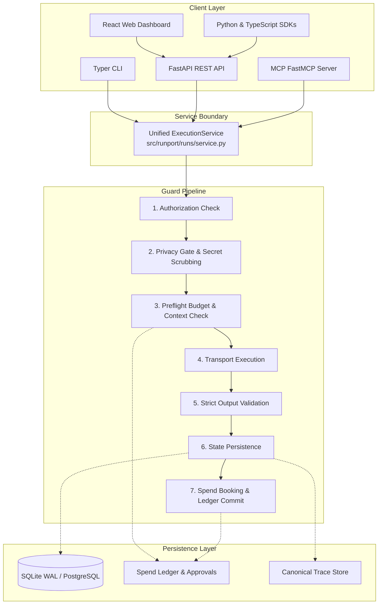
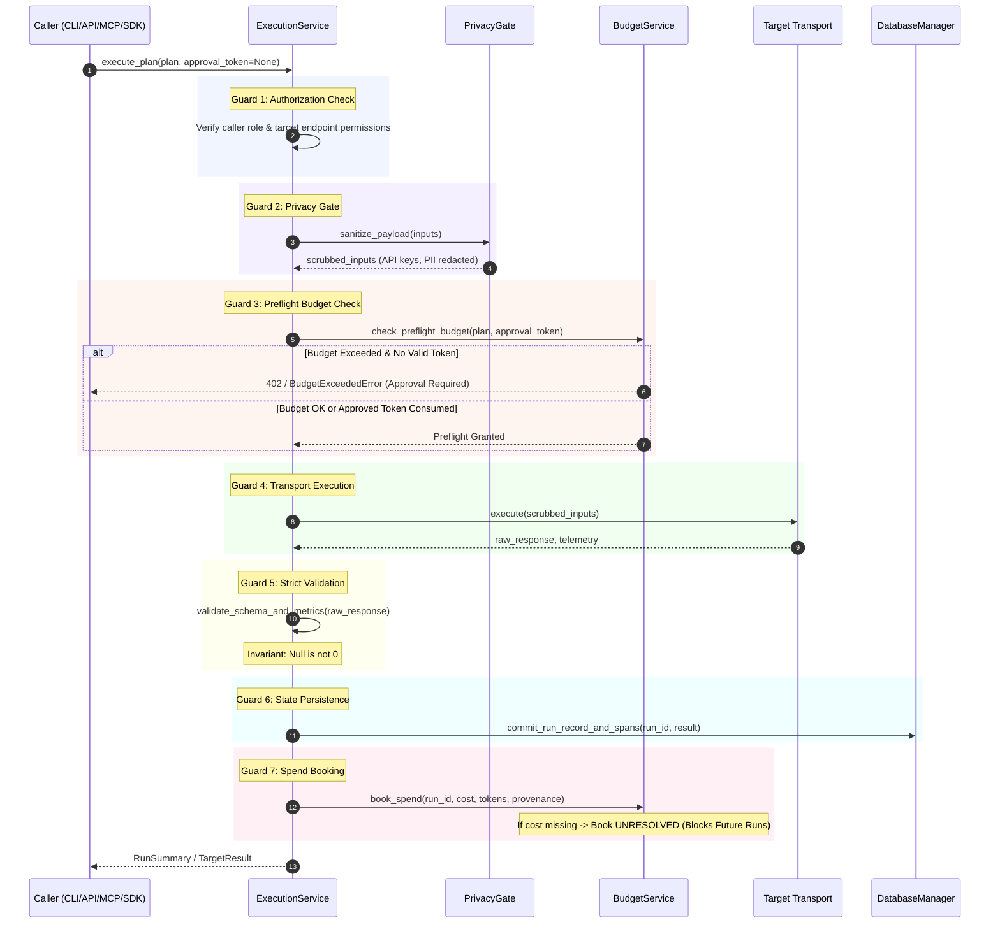

# Universal Execution Architecture Specification

> **Status**: Approved Architectural Standard  
> **Target Release**: v0.2.0 Consolidation → v1.0.0 General Availability  
> **Document Ref**: `RUNPORT-SPEC-001`  
> **Author**: Runport Architecture & Engineering Team  

---

## 1. Context & Motivation

In Runport v0.1.0, benchmark execution logic is fragmented across two independent implementations:
1. **CLI Execution Path**: `src/runport/cli.py` delegates to `GenericRunner` in `src/runport/runs/executor.py`, executing the strict 7-guard pipeline and booking spend via `BudgetService`.
2. **REST API Execution Path**: `src/runport/api/routes/runs.py` implements its own custom execution loop, recalculating plan fingerprints, performing ad-hoc budget checks, and tracking approved execution tokens in a transient in-memory Python `set` (`_CONSUMED_APPROVAL_TOKENS`).

This architectural duality introduces critical operational risks:
- **Inconsistent Invariant Enforcement**: Bug fixes, spend cap validations, or privacy scrubbing applied to `executor.py` are bypassed by API, Web UI, and future MCP/SDK callers.
- **Approval Bypass via Process Restarts**: In-memory approval tokens are erased on server restarts or worker recycling, creating replay attack vulnerabilities in multi-worker deployments.
- **Code Duplication**: Dual fingerprint calculation and budget booking paths increase maintenance overhead and violate the Single Source of Truth principle.

This document specifies the **Unified Execution Service** (`ExecutionService`), establishing a single, guarded, concurrency-safe execution engine consumed identically by the CLI, REST API, Web UI, Model Context Protocol (MCP) server, and Public SDKs.

---

## 2. Universal Execution Architecture Overview



Every execution request—regardless of origin—must construct an `ExecutionPlan` and execute it through `ExecutionService.execute_plan()`. Direct instantiation of transport callers or budget loggers outside `ExecutionService` is strictly forbidden.

---

## 3. The Non-Negotiable 7-Step Runner Guard Pipeline

The `ExecutionService` executes every item in an execution plan according to a strict, synchronous 7-guard pipeline. If any guard fails, the pipeline halts immediately, records the terminal state, and executes fail-closed rollbacks.



### Detailed Guard Specifications

#### Guard 1: Authorization Check
- **Role Verification**: Confirms caller identity possesses `runs:execute` privileges.
- **Endpoint Whitelist Check**: Verifies candidate target URLs against allowed egress CIDR ranges and SSRF blocklists (e.g., blocking `169.254.169.254`, `127.0.0.1` unless local Ollama/HTTP target is explicitly configured).

#### Guard 2: Privacy Gate (Sanitization & Secret Scrubbing)
- **Input Scrubbing**: Passes prompt inputs through `SecretSanitizer` (`src/runport/datasets/sanitizer.py`).
- **PII / Secret Removal**: Regex patterns scrub Bearer tokens, OpenAI/Anthropic/OpenRouter API keys, AWS credentials, and configurable sensitive entity patterns.
- **Integrity Assertion**: Source dataset content hashes (SHA-256) are validated before and after execution to guarantee immutable read-only ingestion.

#### Guard 3: Preflight Budget & Context Check
- **Rate Limit & Context Window Validation**: Validates that prompt tokens do not exceed target model context windows.
- **Cost Estimation**: Estimates worst-case USD spend using model catalog pricing:
  $$\text{WorstCaseCost} = (\text{InputTokens} \times \text{Rate}_{\text{input}}) + (\text{MaxOutputTokens} \times \text{Rate}_{\text{output}})$$
- **Spend Cap Check**: Validates that $\text{CurrentSpend} + \text{WorstCaseCost} \le \text{HardBudgetCap}$.
- **Approval Verification**: If estimated spend breaches the cap, execution halts unless a valid, unconsumed, cryptographically signed approval token is provided (see Section 5).

#### Guard 4: Transport Execution
- **Target Dispatch**: Dispatches request to the configured `Target` (`OpenRouterTarget`, `OllamaTarget`, `HttpWorkflowConnector`, etc.).
- **Bounded Backoff & Circuit Breaking**: Enforces maximum retries (default: 3) with exponential backoff and jitter. Unreachable targets fail fast.

#### Guard 5: Strict Output Validation
- **Schema & Structured Output Checks**: Validates response JSON schemas, regex constraints, and required fields.
- **"Null is Not 0" Invariant**:
  - Missing token usage remains `None` (never default to `0`).
  - Missing latency remains `None` (never default to `0.0ms`).
  - Missing cost remains `None` with provenance `UNRESOLVED` (never default to `\$0.00`).
- **Supervised Ground-Truth Verification**: Supervised metrics (accuracy, F1, calibration) are computed exclusively if human-approved gold annotations exist. Model-to-model consensus is tagged as `Agreement`, never `Accuracy`.

#### Guard 6: State Persistence
- **Atomic Run State Commit**: Inserts or updates the execution status in the `runs` table (`PENDING` $\to$ `RUNNING` $\to$ `COMPLETED` / `FAILED`).
- **Span & Event Recording**: Writes canonical observation spans to the trace repository.

#### Guard 7: Spend Booking & Ledger Commit
- **Ledger Inscription**: Appends a transaction record to `spend_ledger` with exact provenance:
  - `ACTUAL`: Exact provider-reported USD spend.
  - `ESTIMATED`: Catalog rate $\times$ reported tokens.
  - `UNRESOLVED`: Billed request where provider omitted cost.
  - `UNAVAILABLE`: Local execution (Ollama, local Python function).
- **Fail-Closed Unresolved Blocking**: If cost is unknown, the ledger marks the entry as `UNRESOLVED`. Unresolved spend immediately blocks subsequent live runs until reconciled via CLI/API.

---

## 4. Cryptographic Plan Fingerprint Specification

To guarantee that execution approvals cannot be transferred between different models, datasets, or configurations, Runport computes a deterministic SHA-256 fingerprint for every `ExecutionPlan`.

### 4.1. Fingerprint Input Structure
The plan fingerprint is computed over canonical JSON containing:
1. `plan_id`: Unique plan identifier.
2. `candidate_models`: Sorted list of model names or endpoint URLs.
3. `dataset_sha256`: SHA-256 hex digest of the raw dataset content.
4. `prompt_template_sha256`: SHA-256 hex digest of the normalized prompt template text.
5. `parameters`: Canonical dictionary of sampling parameters (`temperature`, `top_p`, `max_tokens`, `seed`).
6. `budget_cap_usd`: Floating-point hard cap configured for the run.
7. `created_at`: ISO 8601 UTC timestamp.

### 4.2. Deterministic Canonical Serialization Algorithm
```python
import hashlib
import json
from typing import Any, Dict

def compute_plan_fingerprint(plan_data: Dict[str, Any]) -> str:
    """Computes deterministic SHA-256 fingerprint of an execution plan."""
    canonical_payload = {
        "candidate_models": sorted(plan_data["candidate_models"]),
        "dataset_sha256": plan_data["dataset_sha256"],
        "prompt_template_sha256": hashlib.sha256(
            plan_data["prompt_template"].strip().encode("utf-8")
        ).hexdigest(),
        "parameters": {
            k: plan_data["parameters"][k]
            for k in sorted(plan_data["parameters"].keys())
        },
        "budget_cap_usd": f"{float(plan_data['budget_cap_usd']):.4f}",
    }
    
    canonical_bytes = json.dumps(
        canonical_payload,
        sort_keys=True,
        separators=(",", ":"),
        ensure_ascii=True,
    ).encode("utf-8")
    
    return hashlib.sha256(canonical_bytes).hexdigest()
```

### 4.3. Approval Invariant
Any modification to candidate models, dataset rows, prompt text, or budget policies alters the SHA-256 hash, immediately invalidating any previously issued approval tokens.

---

## 5. Durable, Single-Use Approval Token Lifecycle

Runport replaces the transient in-memory `_CONSUMED_APPROVAL_TOKENS` set with a persistent, concurrency-safe table in the SQLite WAL / PostgreSQL database.

### 5.1. Database Schema
```sql
CREATE TABLE IF NOT EXISTS plan_approvals (
    token TEXT PRIMARY KEY,
    fingerprint TEXT NOT NULL,
    plan_id TEXT NOT NULL,
    status TEXT NOT NULL CHECK (status IN ('ACTIVE', 'CONSUMED', 'REVOKED', 'EXPIRED')),
    approved_by TEXT NOT NULL,
    approved_spend_limit_usd REAL NOT NULL,
    expires_at TEXT NOT NULL,
    consumed_at TEXT,
    consumed_by_run_id TEXT,
    created_at TEXT NOT NULL,
    FOREIGN KEY (consumed_by_run_id) REFERENCES runs (run_id)
);

CREATE INDEX IF NOT EXISTS idx_approvals_fingerprint ON plan_approvals (fingerprint);
CREATE INDEX IF NOT EXISTS idx_approvals_status ON plan_approvals (status);
```

### 5.2. Atomic Single-Use Consumption Protocol
Approval token consumption must be strictly atomic to prevent race conditions across parallel requests:

```python
def consume_approval_token(
    db: DatabaseManager,
    token: str,
    expected_fingerprint: str,
    run_id: str,
) -> bool:
    """Atomically consumes an approval token under WAL transaction lock."""
    now_iso = datetime.now(timezone.utc).isoformat()
    
    with db.transaction() as cursor:
        cursor.execute(
            """
            UPDATE plan_approvals
            SET status = 'CONSUMED',
                consumed_at = :now,
                consumed_by_run_id = :run_id
            WHERE token = :token
              AND fingerprint = :expected_fingerprint
              AND status = 'ACTIVE'
              AND expires_at > :now
            """,
            {
                "token": token,
                "expected_fingerprint": expected_fingerprint,
                "run_id": run_id,
                "now": now_iso,
            },
        )
        if cursor.rowcount == 0:
            return False  # Token either expired, already consumed, or fingerprint mismatch
    return True
```

---

## 6. Replay Execution Semantics

Offline replay executions allow reproduction of evaluations and debugging of metrics without invoking live provider APIs or incurring spend.

### 6.1. Replay Invariants
1. **Zero Network Egress**: Replay execution runs entirely offline. Socket connections are blocked or redirected to cached responses.
2. **Provenance `REPLAYED`**: All replayed spans and metrics carry provenance `REPLAYED`.
3. **Guaranteed $0.00 Spend**: Spend ledger transactions for replay runs record strictly `0.00` USD spend with rate provenance `UNAVAILABLE`.
4. **Cache Immutability**: Responses are replayed from previously stored `ObservationSpan` records matched by input content hash.

---

## 7. Service Interface Contract

```python
class ExecutionService:
    """Unified single-point execution service for all Runport callers."""

    def __init__(
        self,
        db: DatabaseManager,
        budget_service: BudgetService,
        sanitizer: SecretSanitizer,
    ) -> None:
        self.db = db
        self.budget_service = budget_service
        self.sanitizer = sanitizer

    async def create_plan(
        self,
        request: BenchmarkRequest,
    ) -> ExecutionPlan:
        """Constructs and hashes an ExecutionPlan with preflight cost estimations."""
        ...

    async def approve_plan(
        self,
        fingerprint: str,
        approved_by: str,
        spend_limit_usd: float,
        ttl_minutes: int = 60,
    ) -> PlanApproval:
        """Issues a durable single-use approval token recorded in SQLite."""
        ...

    async def execute_plan(
        self,
        plan: ExecutionPlan,
        approval_token: Optional[str] = None,
        is_replay: bool = False,
    ) -> AsyncIterator[ExecutionProgressEvent]:
        """Executes the plan through the strict 7-guard pipeline."""
        ...

    async def get_run_status(self, run_id: str) -> RunStatusResponse:
        """Retrieves real-time execution status and booked spend."""
        ...
```

