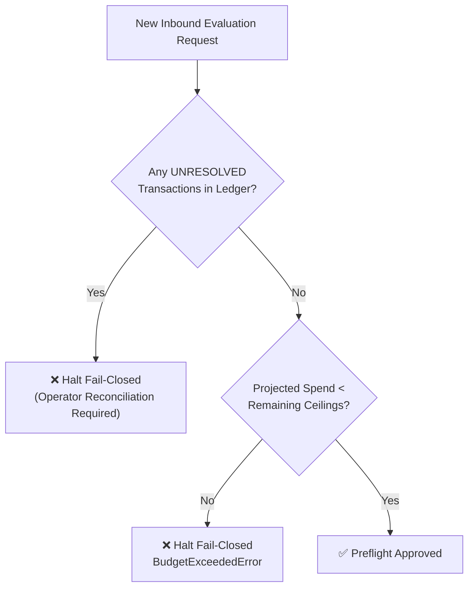

# Safety, Privacy & Spend Governance

Runport is engineered from the ground up to prevent unexpected API bills, eliminate data leakage, and protect local infrastructure.

---

## 1. Spend Governance & Fail-Closed Budget Caps

Traditional LLM evaluation runners loop over test sets until payment cards fail or rate limits trigger. Runport prevents financial accidents through hard, fail-closed spend caps enforced locally via an append-only SQLite WAL ledger (`runport.db`).

### 1.1 Spend Ceilings

Runport checks four distinct ceilings before dispatching any request:

| Ceiling | Workspace Default | Description |
|:---|:---:|:---|
| **Total Lifetime Ceiling** | `$5.00` USD | Absolute cumulative spend limit across the entire workspace. |
| **Pilot Evaluation Ceiling** | `$1.00` USD | Maximum spend allowed for a pilot run. |
| **Per-Run Ceiling** | `$1.00` USD | Maximum spend permitted for a single benchmark invocation. |
| **Per-Case Ceiling** | `$0.05` USD | Circuit-breaker limit halting runs if an individual case spikes in cost. |



### 1.2 Fixed Cost Provenance Vocabulary

Every micro-dollar spent is committed to the ledger with an explicit provenance:
- **`ACTUAL`**: Exact provider-reported USD spend from billing headers.
- **`ESTIMATED`**: Verified catalog rate $\times$ reported tokens.
- **`UNRESOLVED`**: Live request completed without cost or token telemetry. Halts subsequent live runs fail-closed until reconciled.
- **`UNAVAILABLE`**: Zero-cost unpriced / local execution ($0.00 USD).
- **`REPLAYED`**: Deterministic offline replay execution ($0.00 USD).

### 1.3 Unresolved Spend Circuit Breaker

If an upstream provider returns a completion but omits token usage or billing metadata:
1. The transaction is booked into `budget_ledger` with `is_unresolved = 1` and `cost_basis = 'UNRESOLVED'`.
2. All subsequent live runs are immediately locked fail-closed.
3. The operator must reconcile the transaction with the true cost from the provider dashboard:

```bash
uv run runport budget reconcile
```

---

## 2. Cryptographic Plan Approval

Before any live evaluation run begins, Runport compiles an immutable `ExecutionPlan`. The plan computes a cryptographic SHA-256 fingerprint binding:
- Target endpoint routes and candidate model IDs
- Input dataset SHA-256 hash
- Prompt template SHA-256 hash
- Configured budget caps and circuit breaker ceilings

### 2.1 Interactive Terminal Approval
In interactive terminals, operators review the projected spend and type the exact confirmation phrase:
```text
RUN LIVE google/gemini-2.0-flash PLAN 7f9a2b8c4d...
```
Piped, scripted, or non-interactive shells that cannot type this confirmation cannot reach a provider.

### 2.2 CI Token Approval
In automated continuous integration environments, pass single-use tokens:
```bash
uv run runport benchmark --live --approve <plan_fingerprint>
```
If any prompt, dataset, or cap changes, the fingerprint mismatches and the execution aborts fail-closed.

---

## 3. PII Redaction & Data Governance

Runport ensures sensitive data never leaves your environment unredacted:

### 3.1 Salted Pseudonymization
Identifiers are hashed using salted SHA-256:
```python
from runport.datasets.redaction import salted_hash

pseudo_id = salted_hash("user_12345", salt="workspace_secret_salt")
# Returns: '3a8f9c1b7e4d20a1'
```

### 3.2 Automated Regex PII Redaction
Replaces sensitive identifiers with token placeholders:
- Emails $\longrightarrow$ `[EMAIL]`
- National identity numbers & ICs $\longrightarrow$ `[ID_NUMBER]`
- International & local phone numbers $\longrightarrow$ `[PHONE]`
- Explicitly introduced personal names $\longrightarrow$ `[NAME]`

```python
from runport.datasets.redaction import redact

clean_text, counts = redact("Hello, my name is John Doe, email john@example.com")
print(clean_text)  # "Hello, my name is [NAME], email [EMAIL]"
```

---

## 4. SSRF Network Safeguards

Outbound HTTP connectors pass all target URLs through [`validate_safe_url`](file:///Users/sudharsan/Downloads/LLM%20Workbench%20lab/src/runport/core/security.py#L69-L137):
- **Cloud Metadata Services**: Requests targeting link-local metadata addresses (`169.254.169.254`, `fe80::/10`) are strictly blocked fail-closed.
- **Private RFC 1918 Subnets**: `10.0.0.0/8`, `172.16.0.0/12`, and `192.168.0.0/16` are blocked by default.
- **Loopback Protection**: `127.0.0.1` is blocked unless `allow_localhost = True` is explicitly configured for local engines (e.g., Ollama).
- **DNS Pinning**: Resolves hostnames prior to connection to defend against DNS rebinding attacks.

---

## 5. Secret Scrubbing

API keys, bearer headers, and authentication tokens are automatically scrubbed from request logs, SQLite tables, and trace exports:
- Authorization headers (`Bearer sk-...`) are replaced with `[REDACTED]`.
- Upstream provider request payloads are scrubbed of credentials before serialization.
- Raw text exports require explicit written [`RawTextAuthorization`](file:///Users/sudharsan/Downloads/LLM%20Workbench%20lab/src/runport/observability/export.py#L41-L52) containing owner, scope, and authorization date.
