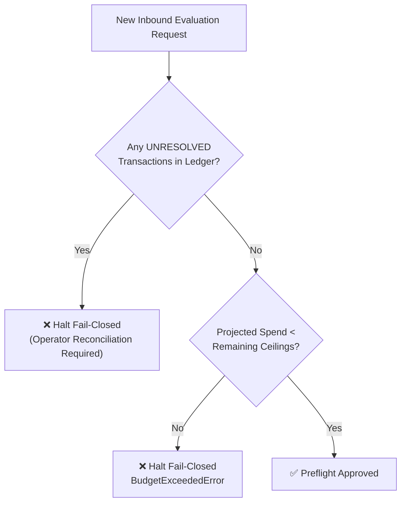

# Safety, Privacy & Spend Governance

Runport is engineered from the ground up to prevent unexpected API bills, eliminate data leakage, and protect local infrastructure.

---

## 1. Spend Governance & Fail-Closed Budget Caps

Traditional LLM evaluation runners loop over test sets until payment cards fail or rate limits trigger. Runport prevents financial accidents through hard, fail-closed spend caps enforced locally via an append-only SQLite WAL ledger (`runport.db`).

### 1.1 Spend Ceilings

Runport checks four distinct ceilings before dispatching any request:

| Ceiling | Workspace Default | Description |
|:---|:---:|:---|
| **Total Lifetime Ceiling** | `$5.00` USD | Absolute cumulative spend limit across the entire workspace. |
| **Pilot Evaluation Ceiling** | `$1.00` USD | Maximum spend allowed for a pilot run. |
| **Per-Run Ceiling** | `$1.00` USD | Maximum spend permitted for a single benchmark invocation. |
| **Per-Case Ceiling** | `$0.05` USD | Circuit-breaker limit halting runs if an individual case spikes in cost. |



### 1.2 Fixed Cost Provenance Vocabulary

Every micro-dollar spent is committed to the ledger with an explicit provenance:
- **`ACTUAL`**: Exact provider-reported USD spend from billing headers.
- **`ESTIMATED`**: Verified catalog rate $\times$ reported tokens.
- **`UNRESOLVED`**: A request to a target that may bill returned no usable cost. Booked without an amount; the run halts and later live runs stay locked until reconciled.
- **`UNAVAILABLE`**: Local or operator-declared free execution (in-process, subprocess, MCP stdio, loopback URLs, or `billing: unbilled`). Booked as $0.00.
- **`REPLAYED`**: Deterministic offline replay execution ($0.00 USD).

### 1.3 Unresolved Spend Circuit Breaker

Every target has a billing mode: `local`, `unbilled` (declared free by the operator) or `billable` (any non-loopback URL by default). If a `billable` target returns no usable cost, including a failed or timed-out request that may have been billed:
1. The transaction is booked into `budget_ledger` with `is_unresolved = 1` and `cost_basis = 'UNRESOLVED'`.
2. All subsequent live runs are immediately locked fail-closed.
3. The operator must reconcile the transaction with the true cost from the provider dashboard:

```bash
uv run runport budget reconcile
```

---

## 2. Cryptographic Plan Approval

Every live execution, from the CLI, the Web UI, the REST API, the Python SDK or the MCP server, goes through one service
(`src/runport/services/execution.py`) and one executor (`GenericRunner` in `src/runport/runs/executor.py`).

1. **Plan.** A plan binds the target definitions (secret values excluded), the cases, a per-plan nonce and the budget cap into a
   SHA-256 fingerprint. It is stored as `PENDING` with its worst-case spend and any blockers. Nothing is sent.
2. **Approve.** A person approves that exact fingerprint. Approvals are stored in SQLite, expire after 15 minutes, and move
   `PENDING → APPROVED → CONSUMED` in single conditional updates, so one approval runs at most once even across processes.
3. **Execute.** The fingerprint is recomputed from the current inputs; any change (target, cases, cap) refuses the run.

### 2.1 Who can approve

| Channel | How |
|:---|:---|
| Interactive terminal | `runport benchmark --live`, `runport benchmark-rag --live` or `runport approve <plan_id>`: type `RUN LIVE <targets> PLAN <fingerprint>`. Piped or non-interactive input is refused. |
| Web UI | The approval dialog on the Runs page (local dashboard, see the access policy below). |
| CI token | `runport.sdk.approve_with_ci_token`, only when `approver.token_approver_enabled: true` in `runport.yaml`. |
| Local-only plans | Plans whose every target is local can be approved automatically by the SDK; nothing can leave the machine or bill. |

MCP clients and SDK callers cannot approve remote or billable plans: there is no approve tool and the approval store rejects their channels.

## 3. PII Redaction & Data Governance

Runport ensures sensitive data never leaves your environment unredacted:

### 3.1 Salted Pseudonymization
Identifiers are hashed using salted SHA-256:
```python
from runport.datasets.redaction import salted_hash

pseudo_id = salted_hash("user_12345", salt="workspace_secret_salt")
# Returns: '3a8f9c1b7e4d20a1'
```

### 3.2 Automated Regex PII Redaction
Replaces sensitive identifiers with token placeholders:
- Emails $\longrightarrow$ `[EMAIL]`
- National identity numbers & ICs $\longrightarrow$ `[ID_NUMBER]`
- International & local phone numbers $\longrightarrow$ `[PHONE]`
- Explicitly introduced personal names $\longrightarrow$ `[NAME]`

```python
from runport.datasets.redaction import redact

clean_text, counts = redact("Hello, my name is John Doe, email john@example.com")
print(clean_text)  # "Hello, my name is [NAME], email [EMAIL]"
```

---

## 4. SSRF Network Safeguards

Outbound HTTP connectors pass all target URLs through [`validate_safe_url`](../src/runport/core/security.py):
- **Cloud Metadata Services**: Requests targeting link-local metadata addresses (`169.254.169.254`, `fe80::/10`) are strictly blocked fail-closed.
- **Private RFC 1918 Subnets**: `10.0.0.0/8`, `172.16.0.0/12`, and `192.168.0.0/16` are blocked by default.
- **Loopback Protection**: `127.0.0.1` is blocked unless `allow_localhost = True` is explicitly configured for local engines (e.g., Ollama).
- **DNS check**: Hostnames are resolved before the request and refused if any address is blocked. The HTTP client resolves again when it connects, so this is a pre-flight check, not DNS pinning.

---

## 5. Secret Scrubbing

API keys, bearer headers, and authentication tokens are automatically scrubbed from request logs, SQLite tables, and trace exports:
- Authorization headers (`Bearer sk-...`) are replaced with `[REDACTED]`.
- Upstream provider request payloads are scrubbed of credentials before serialization.
- Raw text exports require explicit written [`RawTextAuthorization`](../src/runport/observability/export.py) containing owner, scope, and authorization date.

---

## 6. API Access Policy

**Local development (no `RUNPORT_API_TOKEN`).** The API serves only loopback clients, and only when the `Host` header is a loopback
name or listed in `RUNPORT_ALLOWED_HOSTS` (DNS-rebinding protection). Remote clients are refused whatever credentials they send.

**Network deployment (`RUNPORT_API_TOKEN` set).** Every API request, local or remote, must present that token
(`Authorization: Bearer` or `X-Runport-Token`), compared in constant time. `runport web` refuses to bind a non-loopback host without a token.

Anyone who can reach the API can approve plans in the dashboard, so never give the token, or loopback access through a proxy, to an agent.
